<p align="center">
  <picture>
    <source media="(prefers-color-scheme: dark)" srcset="assets/screenshots/graphite/schematic-dark.webp">
    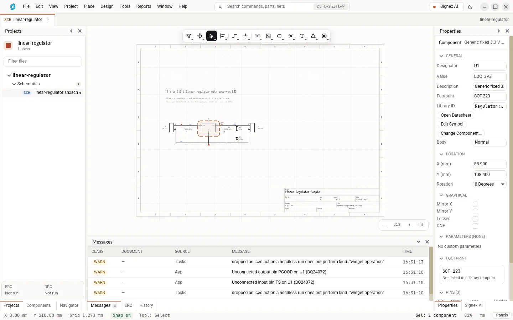
  </picture>
  <br>
  <em>Signex 26.11.0: the schematic editor in Graphite Light (Graphite Dark when your system is dark). <a href="#screenshots">More screenshots</a></em>
</p>

<h1 align="center">Signex</h1>
<p align="center">
  Source-available, AI-first electronics design automation
</p>

<p align="center">
  <a href="https://github.com/alplabai/signex/blob/main/LICENSE"></a>
  <a href="https://github.com/alplabai/signex/releases"></a>
  <a href="https://www.rust-lang.org/"></a>
  <a href="docs/USER_GUIDE.md"></a>
  <a href="https://github.com/alplabai/signex/discussions"></a>
</p>

<p align="center">
  <a href="#features">Features</a> &middot;
  <a href="#screenshots">Screenshots</a> &middot;
  <a href="#download">Download</a> &middot;
  <a href="#building">Building</a> &middot;
  <a href="#roadmap">Roadmap</a> &middot;
  <a href="docs/USER_GUIDE.md">User guide</a> &middot;
  <a href="#contributing">Contributing</a> &middot;
  <a href="#license">License</a>
</p>

---

Signex is source-available electronics design automation built in Rust, with
GPU-accelerated rendering through wgpu. Release 26.11.0 ships a **schematic
editor** and a **PCB editor**: from the schematic to a routed, rule-checked
board and its fabrication files. Symbol, footprint and component-library
editors and a board 3D view come with it at an earlier stage. Simulation and the
plugin system are on the [roadmap](docs/ROADMAP.md). Native file
formats (`.snxsch`, `.snxpcb`) are line-diffable in git and ~5× smaller than
the equivalent JSON.

**New here?** Install a package (see [Download](#download)), then follow the
**[User Guide](docs/USER_GUIDE.md)**: it takes you from **File ▸ New Project**
to a saved schematic and an exported PDF.

**Migrating from a GPL-based EDA tool?** The optional [import companion repository](https://github.com/alplabai/signex-kicad-import)
(GPL-3.0-or-later, distributed independently) converts
project files from GPL-based EDA tools to Signex's native
formats one-way. Run it once against your project; open the resulting
`.snxprj` in Signex.

**Migrating from Altium?** Install the optional
[signex-altium-import](https://github.com/alplabai/signex-altium-import)
companion (FSL-1.1-ALv2, clean-room). Then **File › Import › Altium Project…**
converts a `.PrjPcb`, `.SchDoc`, `.PcbDoc`, `.SchLib` or `.PcbLib` into a sibling
`<name>-signex/` folder and opens it. The import lists everything it had to
approximate or skip; review that list before you fabricate an imported
board.

**Editions:**

- **Signex Community** (FSL-1.1-ALv2, free, offline forever) — the full editor:
  schematic and PCB layout with routing and DRC, and the headless CLI; the
  plugin system joins it when it ships (see the [roadmap](docs/ROADMAP.md))
- **Signex Pro** — a separate, proprietary product built on Community that
  adds Signex AI, team collaboration and PLM

Nothing in Community is locked or gated, and Community shows no upgrade
prompts. Pro is planned separately; this repository holds Community only.

> **Status:** **26.11.0** (2026-11-17) is the latest release and the
> **Community Preview** release. The **schematic and PCB editors** are
> supported. The footprint, symbol and library editors and the board 3D view
> work, at an earlier stage. Signex AI ships in Pro and is not in this build.
> Versions are calendar-based, `YY.MM.MICRO`: 26.11.0 is the first release of
> November 2026, a second release that month would be 26.11.1, and release
> candidates such as `26.11.0-rc.1` are published as GitHub **pre-releases**
> (see [docs/ROADMAP.md](docs/ROADMAP.md) §3). `trunk` carries work made after
> the latest release.
> [Join the discussion](https://github.com/alplabai/signex/discussions) or check the [roadmap](#roadmap).

## Features

**Schematic**

- Hierarchical, multi-sheet schematics in the native `.snxsch` / `.snxprj`
  formats: wires, buses, net labels, power ports, junctions, no-connects,
  sheet symbols and entries, drawing shapes, Design Blocks and imported
  graphics
- Editing: move and drag with rubber-banding, rotate, mirror, copy and paste,
  paste array, in-place text editing (F2), Copy Attributes, Find Similar,
  project-wide Find and Replace, five selection modes and a selection filter
- Multi-unit symbols; placed parts keep their library symbol version until you
  update them from the library
- Annotation in four modes with per-designator locks, Back Annotate from the
  board, Number Schematic Sheets
- ERC: 33 built-in rules, including cross-sheet hierarchy, bus and
  completeness checks, a pin connection matrix, per-finding waivers with a
  reason and an author, and an ERC report as `.txt`, `.csv`, `.json`, `.html`
  or `.pdf` ([docs/ERC_RULES.md](docs/ERC_RULES.md),
  [docs/ERC_REPORT.md](docs/ERC_REPORT.md))
- Net colours (F5), AutoFocus (F9), cross-sheet net navigation and the Net
  Inspector
- Undo and redo on every editor, and crash recovery for sheets, boards,
  library rows and projects

**PCB**

- New PCB setup with profile cards; Update PCB from Schematic as a reviewable
  change table; cross probe between schematic and board in both directions
- Footprint placement and the Track, Via, Fill, Solid Region, Keepout, Pad,
  Arc, String and Dimension tools; board graphics and DXF import
- Interactive routing that walks around or pushes other nets, differential
  pairs, Quick Route, Multi-Route and length tuning; via stitching, teardrops
  and gloss
- Polygon pours filled in priority order, with island and dead-copper removal,
  cutouts and Slice Pour
- Layer Stack Manager with up to 32 copper layers and per-layer pad and via
  sizes; layer sets
- Net classes, the Rules manager with its class matrix and presets, a DRC rule
  language, and the DRC panel with waivers
  ([docs/DRC_RULES.md](docs/DRC_RULES.md))
- Pin and gate swap, design reuse blocks, track and via locks, panelisation
  ([docs/PANELISATION.md](docs/PANELISATION.md))
- Rotatable board view, coordinates from the board origin with Y up, and a
  board 3D view with the footprints' STEP or VRML models
- Fabrication Outputs: Gerber RS-274X with X2 attributes, Excellon drill files
  and a drill table, a pick-and-place CSV, an IPC-D-356 test netlist and a job
  file ([docs/FABRICATION_OUTPUTS.md](docs/FABRICATION_OUTPUTS.md)); board
  PDF, Print and board reports

**Libraries**

- `.snxlib` component libraries in the Library Browser tab, with lifecycle
  states, range filters and a stock library of placeable parts
- Component editor: General, Datasheet, Pin Map, Parameters, Supply,
  Simulation and Alternates
- Symbol editor and a footprint editor driven by a clean-room constraint
  solver (parametric sketch, bake to pads, silkscreen and courtyard)
- DigiKey, Mouser, LCSC and JLCPCB distributor adapters
- Per-library git version control with a History panel

**Output**

- PDF export with bookmarks, Print Preview, BOM preview with CSV / HTML / XLSX
  export, and netlist export

**Automation and AI**

- One command catalog drives the menus, the Active Bar, context menus, keys
  and the command palette ([docs/COMMANDS.md](docs/COMMANDS.md))
- `signex-cli` runs the same commands from JSON Lines, headless or attached to
  a running Signex over a local, user-only socket that is off by default
  ([docs/CLI.md](docs/CLI.md), [docs/AGENT_SOCKET.md](docs/AGENT_SOCKET.md));
  each agent edit is one labelled undo step, recorded in the project's journal
- ERC and DRC on demand for scripts and agents (`check_erc`, `check_drc`)
- Signex AI (assistant, agent and generator) ships in Pro; this build has no
  Signex AI panel

**Interface**

- Graphite Light (the default) and Graphite Dark, with Inter as the UI font,
  switchable from Preferences ▸ Appearance or the title-bar light/dark toggle
- Dockable panels; undock any document tab into its own window, or tile
  documents in the main window
- Project tab for sheets, variants, libraries, ERC and annotation settings, and
  version control
- Command palette (`Ctrl+Shift+P`), configurable keyboard-shortcut profiles
  that follow the OS (⌘ on macOS), trackpad pinch-zoom and two-finger pan
- Start screen with pinned and recent projects

**What's next:**

| Plan | Milestone |
|---|---|
| **PCB Design** | Board layout and routing from the schematic; the router plans |
| **Community Release** | Manufacturing output: ODB++, IPC-2581, STEP 3D export, assembly drawings |
| **3D Viewer → High-Speed Design** | 3D Viewer, Advanced PCB, High-Speed Design |
| **MCAD** | Enclosure fit check, part modelling and board-driven enclosures |
| **Simulation** | Unified simulation view with SPICE, EM, thermal |

## Screenshots

The current app, rendered from Signex 26.11.0, in Graphite Light and Graphite
Dark.

<p align="center">
  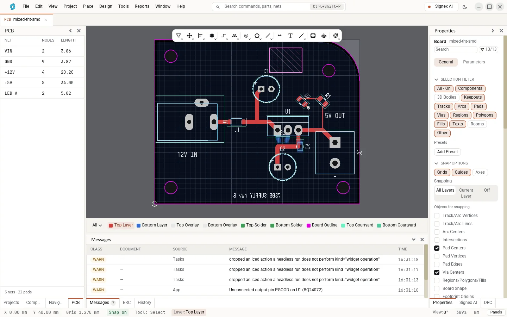
  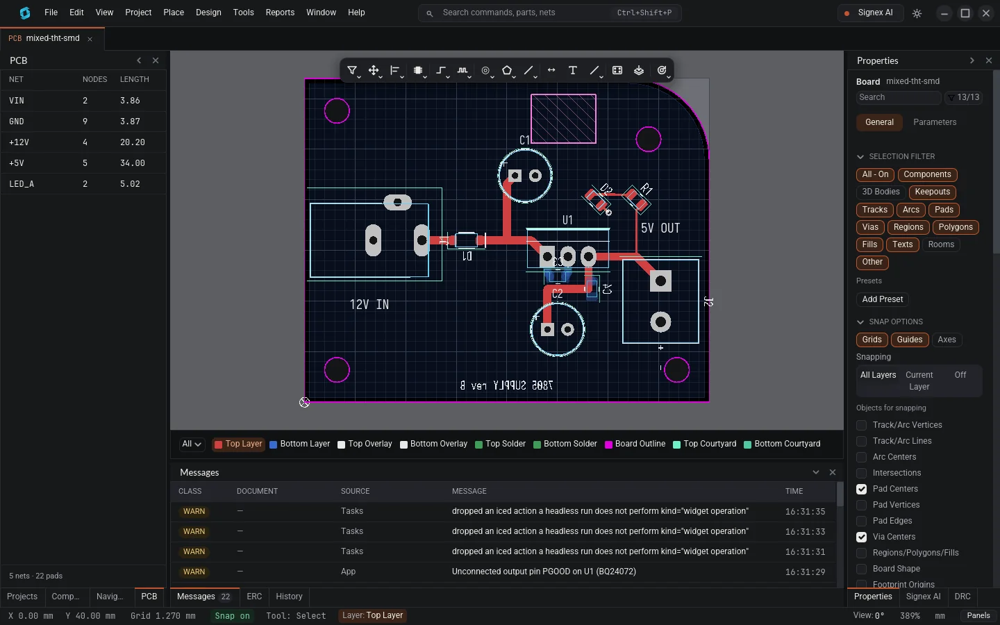
  <br>
  <em>PCB editor: the nets panel, the board with tracks and footprints, layer tabs and the board Properties</em>
</p>

<details>
<summary><strong>More screens</strong></summary>

<p align="center">
  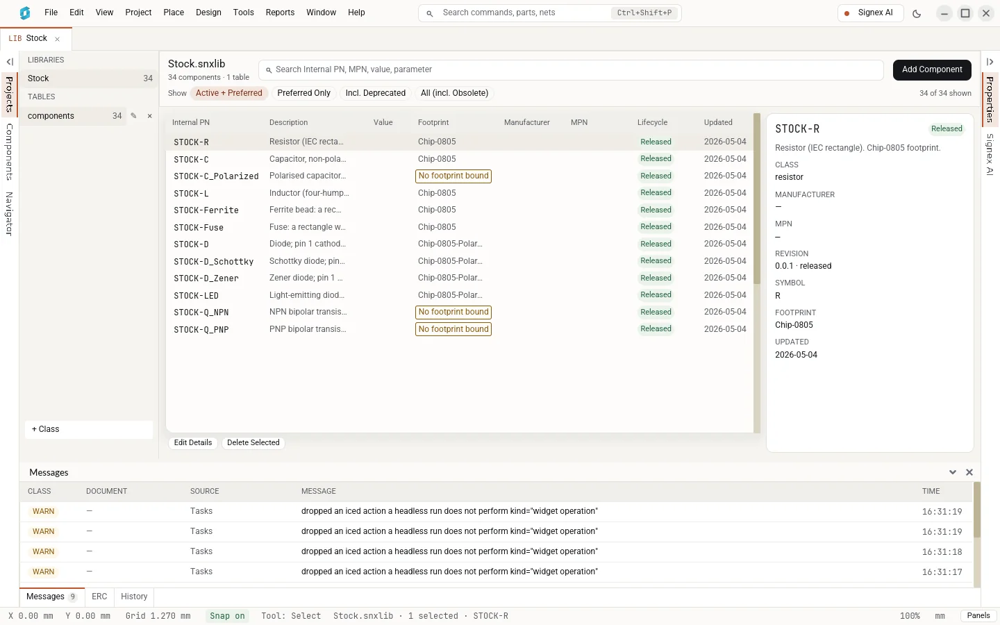
  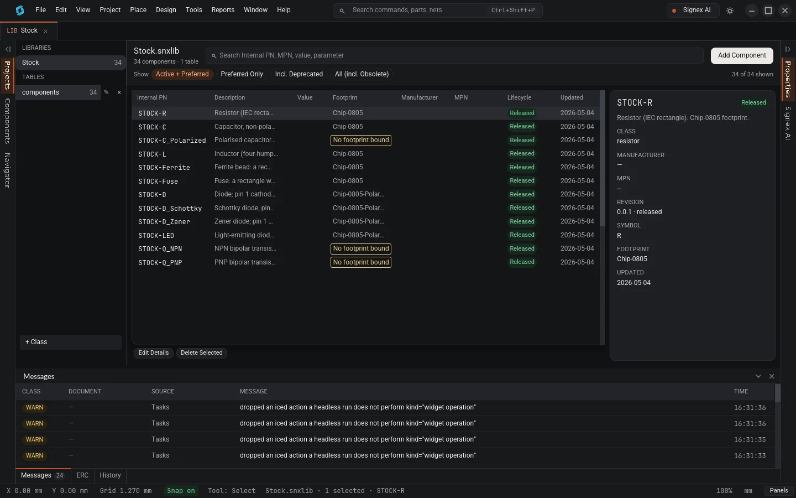
  <br>
  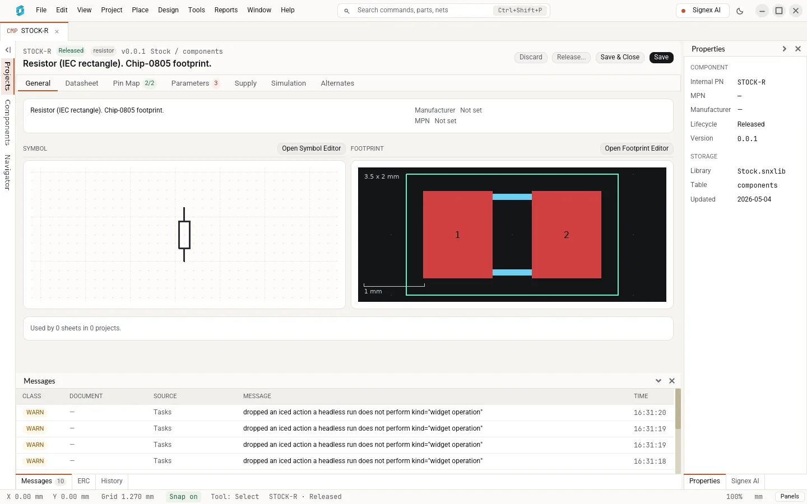
  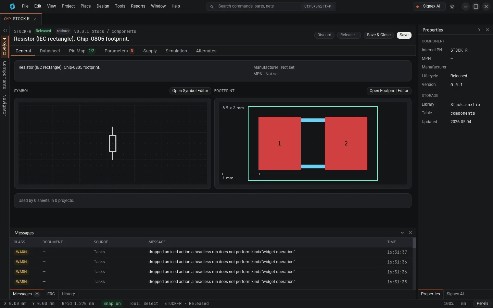
  <br>
  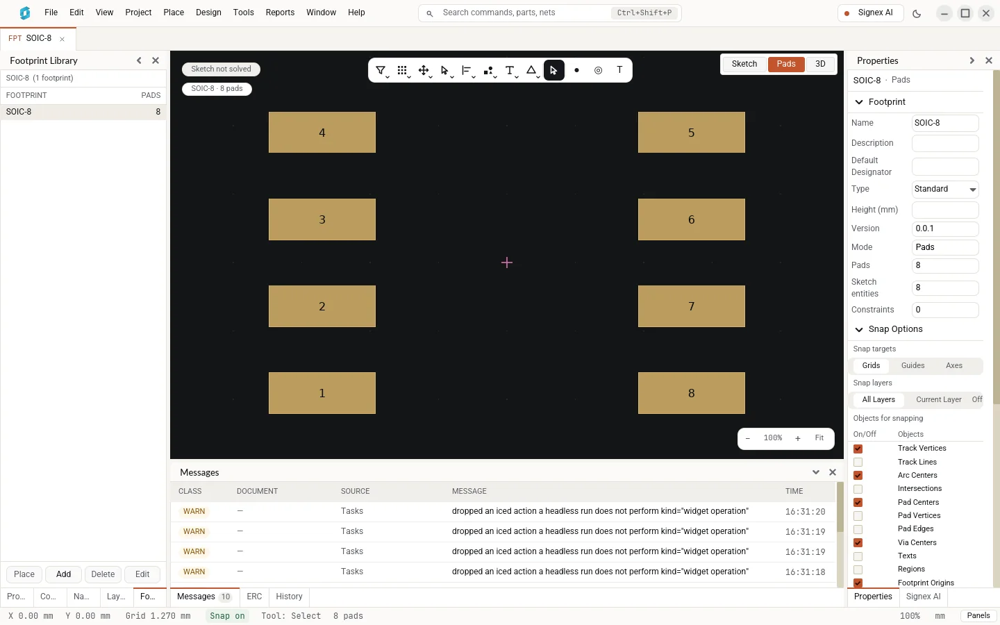
  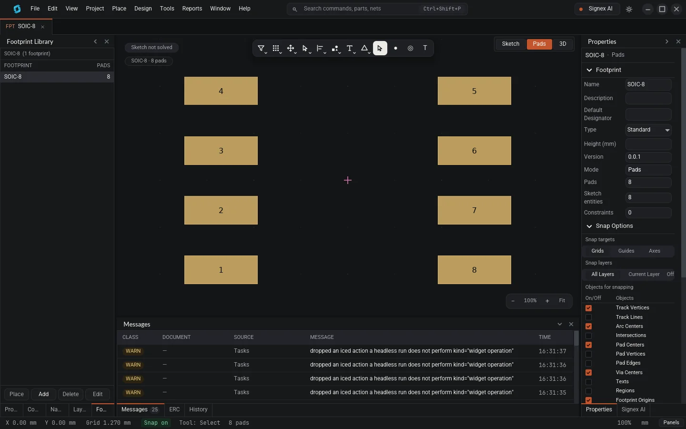
  <br>
  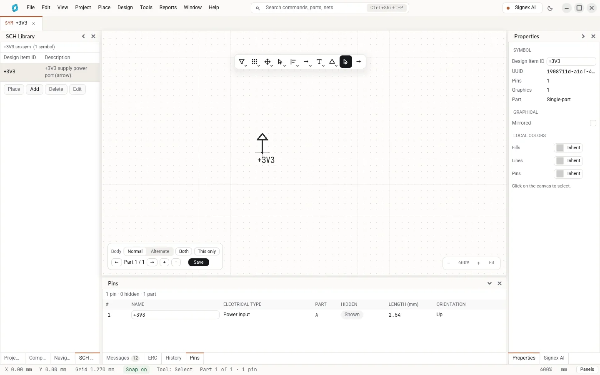
  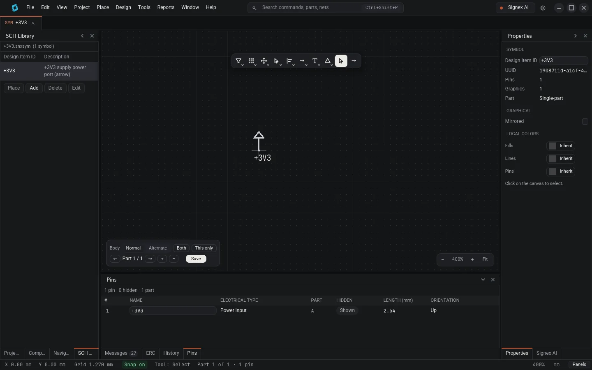
  <br>
  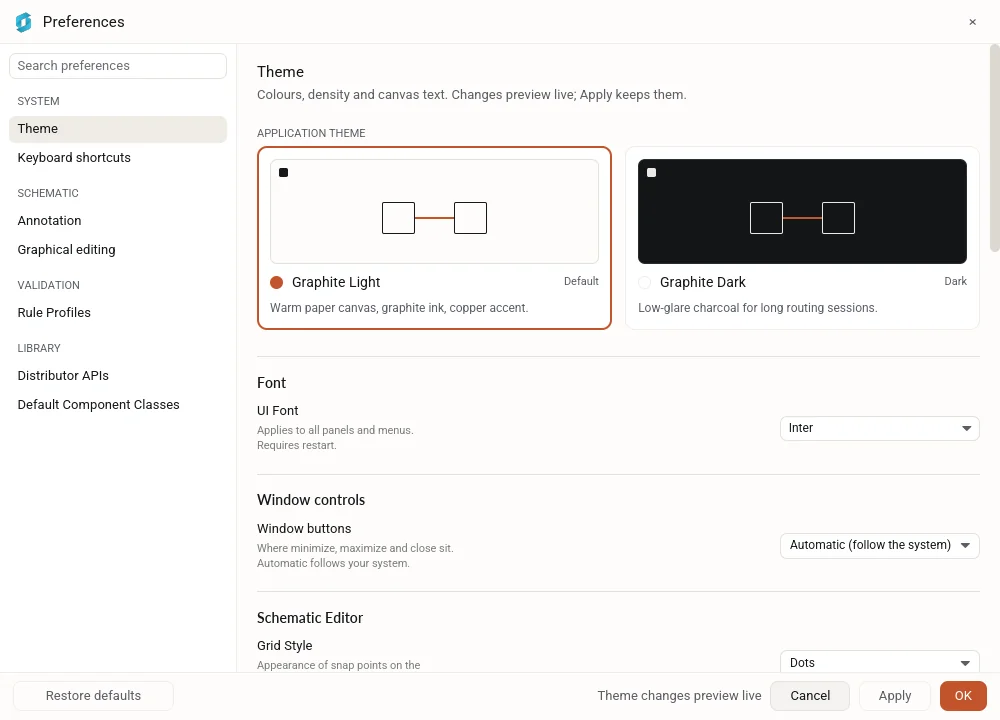
  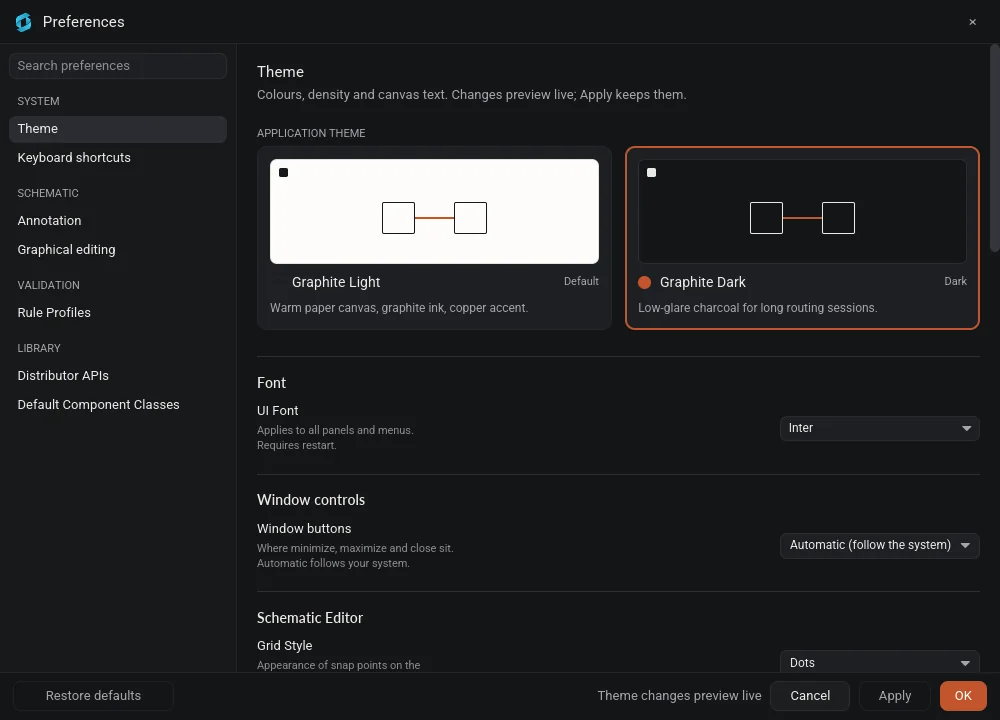
  <br>
  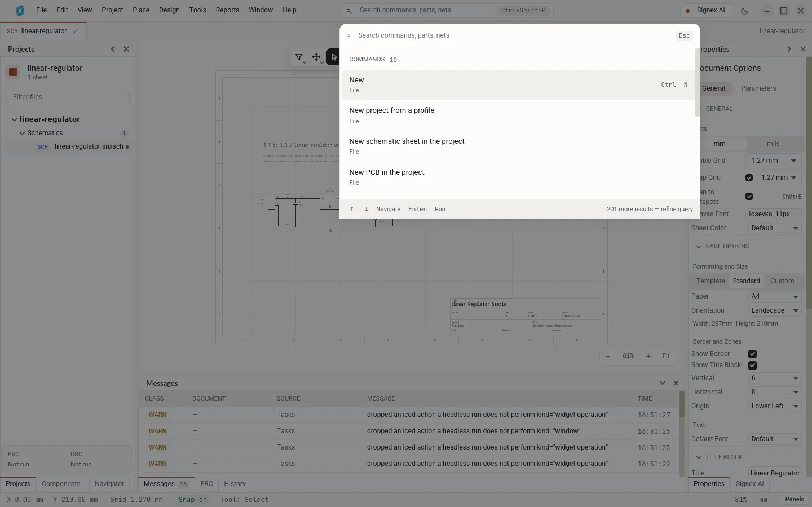
  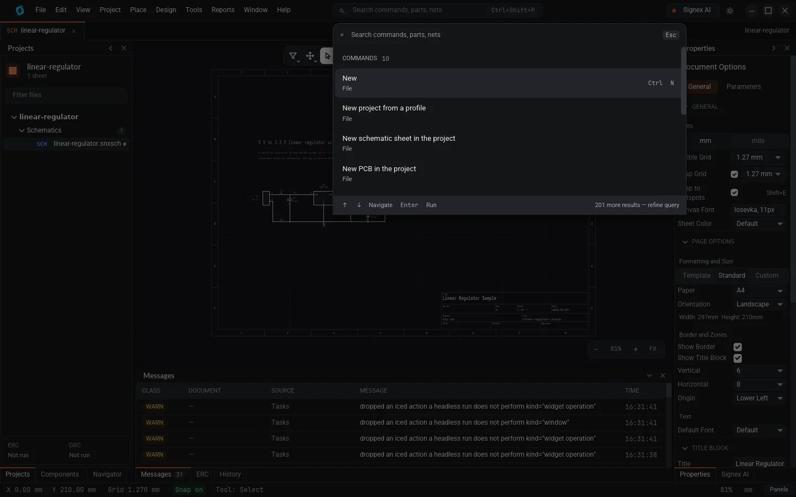
  <br>
  <em>Library Browser, component, footprint and symbol editors, Preferences and the command palette</em>
</p>

</details>

## Architecture

A 25-crate Rust workspace (`edition = 2024`), an acyclic DAG with
`signex-app` at the apex and `signex-types` as the shared foundation:

```
signex/
├── crates/
│   ├── signex-app/            # Main binary — iced 0.14 app (panels, dock, canvas, editors)
│   ├── signex-cli/            # Headless command runner — JSON Lines in, result lines out (docs/CLI.md)
│   ├── signex-commands/       # The command catalog: ids, labels, keys, operands
│   ├── signex-types/          # Domain types — schematic/PCB/layer/theme — NO rendering deps
│   ├── signex-engine/         # Command / patch / undo engine for schematic edits (+ signex-history)
│   ├── signex-net/            # Authoritative netlist + connectivity contract
│   ├── signex-erc/            # ERC rule engine (+ signex-erc-dsl)
│   ├── signex-drc/            # PCB design rule check (measures with pcb-geom; + signex-drc-dsl)
│   ├── pcb-geom/              # Integer-nanometre board geometry
│   ├── signex-sketch/         # Clean-room Newton-LM constraint solver + sketch schema
│   ├── signex-bake/           # Sketch → footprint bake (pad / silk / courtyard / mask / …)
│   ├── signex-output/         # PDF / netlist / BOM / fabrication output pipeline (+ signex-bom)
│   ├── signex-renderer/       # Domain types → render primitives (+ signex-gfx wgpu pipelines)
│   ├── signex-library/        # .snxlib component library — port/adapter model (+ signex-library-server)
│   ├── signex-widgets/        # Reusable iced widgets (tree view, active bar, previews)
│   ├── signex-i18n/           # UI message catalogs (Fluent) and locale-aware formatting
│   ├── signex-i18n-ids/       # Message ids and Translatable, with no locale dependency
│   └── signex-3d-model-importer/  # STEP / WRL importer for 3D body attach
└── Cargo.toml
```

**Design principles:**

- **Native `.snx*` formats first.** `.snxsch` / `.snxpcb` / `.snxprj` are the canonical formats (TOML envelope + TSV bulk blocks, line-diffable, ~5× smaller than JSON; the `.snxprj` project file is the one JSON exception, see [docs/architecture/snxprj-format.md](docs/architecture/snxprj-format.md)). One-way import from GPL-based EDA tools is an optional, independently-distributed companion tool.
- **Elm architecture (MVU).** iced's `state → view → Message → update` cycle; `view` is pure, `update` is the only mutation site and never blocks — all IO returns as a `Task`. No process-global mutable state.
- **Domain logic in domain crates.** Types and engines below `signex-app` carry zero `iced`/`wgpu` deps (Cargo-enforced); connectivity is derived once in `signex-net` and read everywhere else, never re-derived.
- **Multi-window by default.** Built on `iced::daemon`; every undocked tab gets its own engine + canvas keyed by window id, so two schematics can be edited in parallel without cross-talk.
- **Nanometer coordinates on disk.** Files store integer nanometres, exact in both metric and imperial; board geometry (`pcb-geom`) computes in integer nanometres, and "same point" is one shared bucket, never a float `EPS`.
- **GPU rendering.** wgpu 27 through iced: canvas tessellation for sheets and boards, and instanced pipelines in `signex-gfx`.

## Download

Before downloading, check the [hardware requirements](#hardware-requirements).
Every release publishes these packages. `v26.11.0` is a full release, so the
[latest release](https://github.com/alplabai/signex/releases/latest) link
points at it. Release candidates such as `v26.11.0-rc.1` are published as
GitHub **pre-releases**, which that link skips: open the
[Releases page](https://github.com/alplabai/signex/releases) to get one.

| Platform | Package | Architecture | Use |
|---|---|---|---|
| Windows | `signex-setup-<arch>-<version>.exe` | x86_64, ARM64 (`aarch64`) | Run for a guided installation |
| Windows | `signex-windows-<arch>-<version>.zip` | x86_64, ARM64 (`aarch64`) | Extract and run without installing |
| macOS | `signex-macos-universal-<version>.dmg` | Apple silicon and Intel | Open and drag Signex to Applications |
| Linux | `signex_<version>_<arch>.deb` | x86_64 (`amd64`), ARM64 (`arm64`) | Debian or Ubuntu (glibc 2.35 or newer): `sudo apt install ./signex_<version>_<arch>.deb` |
| Linux | `Signex-<version>-<arch>.AppImage` | x86_64, ARM64 (`aarch64`) | Most distributions: make executable with `chmod +x`, then run |
| Linux | `signex-linux-<arch>-<version>.tar.gz` | x86_64, ARM64 (`aarch64`) | Extract and run without installing |
| All | `signex-<version>.cdx.json` | n/a | CycloneDX SBOM: the `signex` binary's dependencies for every platform (a superset of any one build), with version and licence |
| All | `SHA256SUMS.txt` | n/a | SHA-256 checksums of every file above |

For 26.11.0, `<version>` is `26.11.0`: for example
`signex-setup-x86_64-26.11.0.exe` or `signex_26.11.0_amd64.deb`.

The Linux packages (`.deb`, AppImage, tarball) are built on Ubuntu 22.04 and
need **glibc 2.35 or newer**, so they run on Ubuntu 22.04, Debian 12 and later
distributions. Check yours with `ldd --version`.

### First launch

Until release signing is enabled (see
[docs/RELEASE_SIGNING.md](docs/RELEASE_SIGNING.md)), packages do not carry a
trusted publisher or developer signature:

- **Windows:** Microsoft Defender SmartScreen may appear. Select **More info**,
  then **Run anyway**.
- **macOS:** after opening the DMG and moving Signex to Applications,
  right-click Signex and select **Open** on the first launch to bypass
  Gatekeeper's unidentified-developer warning.

These workarounds can be removed when
[Windows signing](https://github.com/alplabai/signex/issues/318) and
[macOS signing and notarization](https://github.com/alplabai/signex/issues/319)
land.

### Verify a download

Every release includes a `SHA256SUMS.txt`: take the one attached to the release
you downloaded, from the [Releases page](https://github.com/alplabai/signex/releases).
Download it next to the package you chose. The checksum file lists every
release artifact, so the commands below select the one file you downloaded.

Linux (set `file` to the exact filename you downloaded):

```bash
file='Signex-<version>-x86_64.AppImage'
grep -F "  $file" SHA256SUMS.txt | sha256sum -c -
```

macOS (set `file` to the exact filename you downloaded):

```bash
file='signex-macos-universal-<version>.dmg'
grep -F "  $file" SHA256SUMS.txt | shasum -a 256 -c -
```

Windows PowerShell (set `$file` to the exact filename you downloaded):

```powershell
$file = "<downloaded-package-filename>"
$expected = ((Select-String -Path .\SHA256SUMS.txt -SimpleMatch "  $file").Line -split '\s+')[0]
(Get-FileHash -Algorithm SHA256 -Path $file).Hash.ToLowerInvariant() -eq $expected
```

## Hardware Requirements

Signex uses [wgpu](https://wgpu.rs) for hardware-accelerated rendering and
expects a modern GPU with effective Vulkan 1.1 (Linux), DirectX 12 (Windows),
or Metal (macOS) support. In practice this means **a GPU released around 2014
or later** — Intel HD Graphics 4400+, NVIDIA GeForce 600-series and newer, AMD
Radeon HD 7000-series and newer, or any Apple Silicon Mac.

Older GPUs that only expose legacy OpenGL may still launch the app via the
fallback path, but expect rendering glitches such as overlapping panels and
broken layout — these GPUs are not supported.

## Building

**Prerequisites:** Rust 1.97.0 — pinned via `rust-toolchain.toml`, so `rustup`
installs it automatically; this is also the MSRV (we build and support exactly
this toolchain) — and a GPU supporting Vulkan, Metal, or DX12.

On Linux, install the development packages CI uses (Debian and Ubuntu names;
`mesa-vulkan-drivers` supplies a software Vulkan driver for machines without a
GPU):

```bash
sudo apt-get install -y \
  libxkbcommon-dev libwayland-dev libvulkan-dev \
  libx11-dev libxrandr-dev libxinerama-dev libxcursor-dev libxi-dev \
  mesa-vulkan-drivers
```

A binary you build yourself links against your own glibc. The glibc 2.35
floor applies to the release packages, which are built on Ubuntu 22.04 for
that reason (`scripts/check_glibc_ceiling.sh`, #1688).

```bash
git clone https://github.com/alplabai/signex.git
cd signex
cargo run -p signex-app          # Run
cargo test --workspace           # Test
cargo clippy --workspace --all-targets --all-features -- -D warnings  # Lint
```

## Roadmap

| Milestone | Version / gate | Status |
|---|---|---|
| Scaffold — Iced shell, panels, themes, dock system | v0.1 | Done |
| Parser — external format read/write, domain types | v0.2 | Done |
| Canvas — wgpu pan/zoom/grid and camera | v0.3 | Done |
| Schematic Viewer — render all elements, multi-sheet nav | v0.4 | Done |
| Schematic Editor — select, move, wire, undo/redo, save | v0.5 | Done |
| Full SCH Editor — copy/paste, labels, components, Active Bar | v0.6 | Done |
| Validation + Multi-Window — ERC, annotation, pin matrix, undockable tabs | v0.7 | Done |
| Output — PDF, BOM, netlist, multi-project workspaces, dirty tracking | v0.8 | Done |
| Native file formats — `.snxsch` / `.snxpcb` TOML+TSV; external-format I/O via the import companion | v0.9 | Done |
| Library Browser tab — read-only `.snxlib` table | v0.10 | Done |
| Library & Polish — full DBLib model, SCH Library editor, Component Preview, picker + auto-mount, distributor adapters | v0.11 | Done |
| Symbol & Library — clean-room schematic renderer, unified Active Bar in symbol editor, `.snxsym` TOML envelope | v0.13 | Done |
| Footprint Editor — `.snxfpt` pad + parametric-sketch editor, Newton-LM solver (19 constraints), Align/Distribute/Move/Fill/Text tooling | v0.14 | Done |
| Editor Fixes — footprint/symbol editor correctness, order-independent netlist, crash-safe persistence, pinned toolchain | v0.15 | Done |
| Command Registry & Symbol Units | 1.0.0-rc.1 | Done |
| **Community Preview** — schematic and PCB editors | **Gate** | Reached: `v26.11.0` (2026-11-17) |
| **PCB Design** — board layout and routing from the schematic; the router plans | **Gate** | Next |
| **Community Release** — manufacturing output; full schematic + PCB editor | **Gate** | |
| 3D Viewer, Advanced PCB, High-Speed Design | Planned | |
| MCAD — enclosure fit check, part modelling, board-driven enclosures | Planned (P3) | Starts once the schematic and PCB editors are complete |
| Simulation — SPICE, EM, thermal, simulation wizards | Planned | |

See [docs/ROADMAP.md](docs/ROADMAP.md) for the detailed release plan.

## Documentation

The **[User Guide](docs/USER_GUIDE.md)** takes you from a downloaded package
to a saved schematic and an exported PDF, starting with **File ▸ New
Project**. It lives in the repository, so it is versioned with the code and
reviewed in pull requests.

In-repo reference docs live under [`docs/`](docs/): the
[command reference](docs/COMMANDS.md), [headless command runner](docs/CLI.md),
[keyboard shortcut file format](docs/KEYBOARD_SHORTCUTS.md),
[main menu bar](docs/MENU_BAR.md), [ERC rules](docs/ERC_RULES.md),
[DRC rules](docs/DRC_RULES.md), [PCB tools](docs/PCB_TOOLS.md),
[fabrication outputs](docs/FABRICATION_OUTPUTS.md),
[ROADMAP.md](docs/ROADMAP.md), [LICENSING.md](docs/LICENSING.md),
[RELEASE_SIGNING.md](docs/RELEASE_SIGNING.md), and
[REPOSITORY_AND_CODEBASE.md](docs/REPOSITORY_AND_CODEBASE.md). The
[wiki](https://github.com/alplabai/signex/wiki) is no longer the primary guide.

## Contributing

Signex is source-available and we welcome contributions from everyone — whether
you're an EDA professional, a Rust developer, or someone who just wants to
help build a better design tool.

**Ways to contribute:**

- Report bugs or rendering discrepancies
- Add test fixtures from real projects
- Implement a feature from the [roadmap](docs/ROADMAP.md)
- Fix an [open issue](https://github.com/alplabai/signex/issues)
- Improve documentation

**Build and run** (Linux needs the packages listed under [Building](#building)):

```bash
git clone https://github.com/alplabai/signex.git
cd signex
cargo build --workspace
cargo run -p signex-app
```

See **[CONTRIBUTING.md](CONTRIBUTING.md)** for the full guide: branching
workflow, crate map, code style, and good first issues.

## License

Signex Community Edition is source-available under the
[Functional Source License 1.1, Apache 2.0 Future License (FSL-1.1-ALv2)](LICENSE):

- **Allowed:** any use, including companies designing and selling their own
  products with Signex.
- **Not allowed:** a Competing Use, which means making Signex available to
  others in a commercial product or service that substitutes for Signex (or
  for a product or service Alp Lab offers using it), or that offers the same
  or substantially similar functionality. Free,
  non-commercial redistribution is allowed.
- **Later:** each release becomes Apache-2.0 two years after it ships.

Releases published before the licence change stay Apache-2.0.
Contributions made before the change (#2344) were licensed under Apache-2.0
and those grants remain; the project as a whole is distributed under
FSL-1.1-ALv2. A copy of the Apache-2.0 text is in
[LICENSE-APACHE](LICENSE-APACHE) (see [NOTICE](NOTICE)).

The main repository contains no GPL-derived code, so there is no GPL
aggregation in your build closure, before or after the Apache-2.0 conversion.

Migration from GPL-based EDA tools is provided via the optional [import companion repository](https://github.com/alplabai/signex-kicad-import),
which is **GPL-3.0-or-later** because it implements those tools'
file formats with structure derived from their GPL-3.0 source. The two
projects are distributed independently. See [docs/LICENSING.md](docs/LICENSING.md)
for the full rationale and the audit trail behind the two-repo split.

Copyright 2026 [Alp Lab AB](https://github.com/alplabai)

Signex™ and Signex AI™ are trademarks of Alp Lab AB. The FSL-1.1-ALv2 licence
does not grant rights to use them; forks must use a different name.
