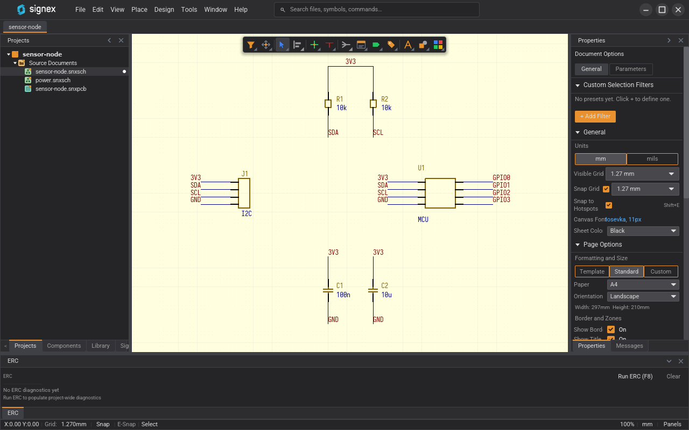
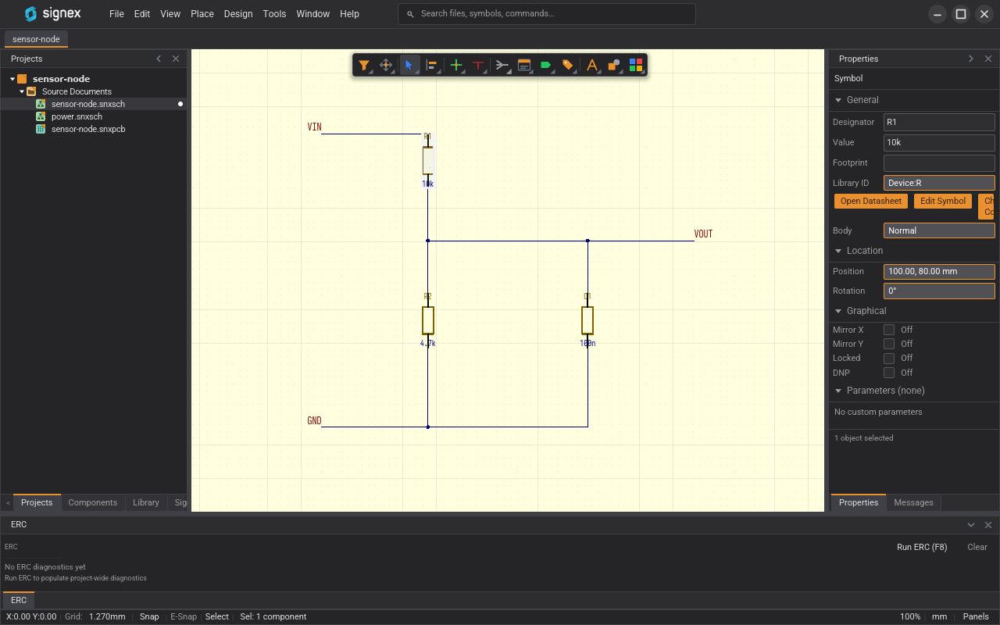
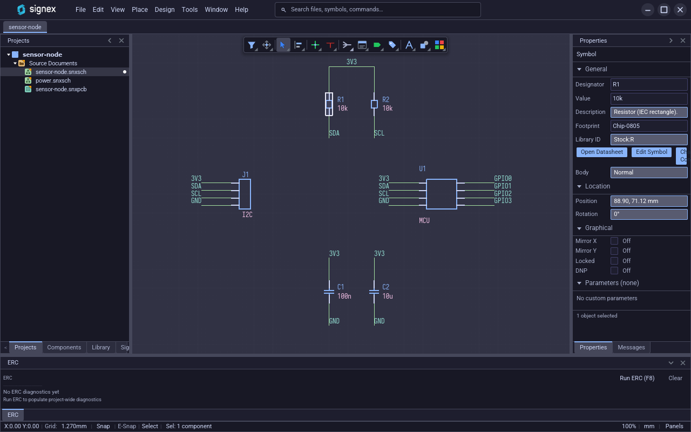
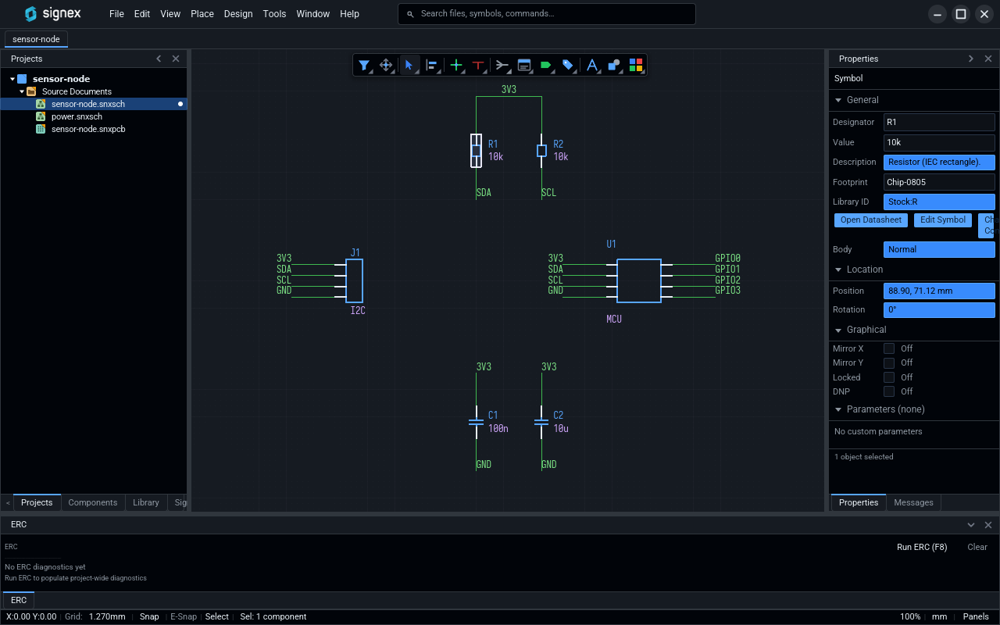
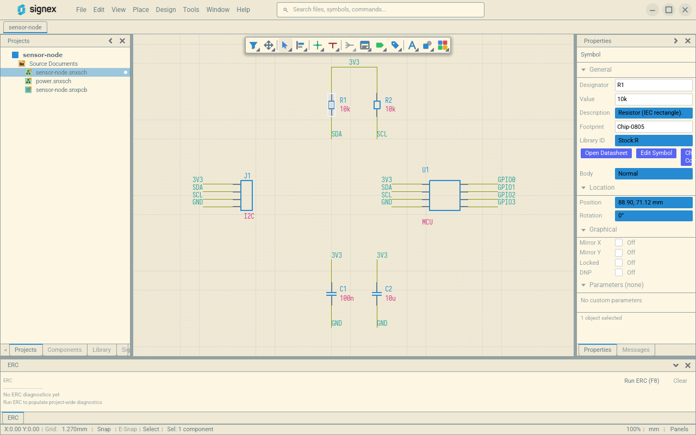

<p align="center">
  
</p>

<h1 align="center">Signex</h1>
<p align="center">
  Open-source, AI-first electronics design automation
</p>

<p align="center">
  <a href="https://github.com/alplabai/signex/blob/main/LICENSE"></a>
  <a href="https://github.com/alplabai/signex/releases"></a>
  <a href="https://www.rust-lang.org/"></a>
  <a href="docs/USER_GUIDE.md"></a>
  <a href="https://github.com/alplabai/signex/discussions"></a>
</p>

<p align="center">
  <a href="#features">Features</a> &middot;
  <a href="#screenshots">Screenshots</a> &middot;
  <a href="#download">Download</a> &middot;
  <a href="#building">Building</a> &middot;
  <a href="#roadmap">Roadmap</a> &middot;
  <a href="docs/USER_GUIDE.md">User guide</a> &middot;
  <a href="#contributing">Contributing</a> &middot;
  <a href="#license">License</a>
</p>

---

Signex is open-source EDA tooling built in Rust with GPU-accelerated
rendering and an Altium Designer-quality UI. Today it is a **schematic
editor** with symbol, footprint and component-library editors, ERC,
annotation, and PDF / BOM / netlist export. The PCB editor, 3D viewer,
simulation and plugin system are on the [roadmap](docs/ROADMAP.md), not in
the v1.0 Community Preview. Native file formats (`.snxsch`, `.snxpcb`) are
line-diffable in git and ~5× smaller than the equivalent JSON.

**New here?** Install a package (see [Download](#download)), then follow the
**[User Guide](docs/USER_GUIDE.md)**: it takes you from **File ▸ New Project**
to a saved schematic and an exported PDF.

**Migrating from a GPL-based EDA tool?** The optional [import companion repository](https://github.com/alplabai/signex-kicad-import)
(GPL-3.0-or-later, distributed independently) converts
project files from GPL-based EDA tools to Signex's native
formats one-way. Run it once against your project; open the resulting
`.snxprj` in Signex.

**Migrating from Altium?** Install the optional
[signex-altium-import](https://github.com/alplabai/signex-altium-import)
companion (Apache-2.0, clean-room). Then **File › Import › Altium Project…**
converts a `.PrjPcb`, `.SchDoc`, `.PcbDoc`, `.SchLib` or `.PcbLib` into a sibling
`<name>-signex/` folder and opens it. The import lists everything it had to
approximate or skip; review that list before you fabricate an imported
board.

**Two editions from one codebase:**

- **Signex Community** (Apache-2.0, free forever) — the schematic editor
  today; the PCB editor follows in v2.x (see the [roadmap](docs/ROADMAP.md))
- **Signex Pro** (subscription, planned for v3.0) — adds Signal AI
  (Claude-powered design copilot), plugins, real-time collaboration, and
  Signex 365 cloud PLM

> **Status:** Early development, heading for the first release candidate.
> **v0.15.0** (2026-07-23) is the latest tagged release; **v1.0.0-rc.1**, the
> first release candidate of the **v1.0.0 Community Preview** (schematic-only),
> is next. `trunk` already carries work past v0.15.0 that no release contains
> yet: a stock library with placeable parts, typed component values with a
> range filter, ERC completeness rules with waivers and an ERC report,
> cross-sheet net navigation, project-wide Find and Replace, and in-place
> text editing. The version axis and the v1.0 exit criteria are in
> [docs/ROADMAP.md](docs/ROADMAP.md). Release candidates are published as
> GitHub **pre-releases**; see [Download](#download).
> [Join the discussion](https://github.com/alplabai/signex/discussions) or check the [roadmap](#roadmap).

## Features

**What works today (v0.1–v0.15, plus the work on `trunk` since):**

- Open native Signex schematics (`.snxsch`, `.snxsym`, `.snxprj`); migrate
  legacy files from GPL-based EDA tools via the [import companion repository](https://github.com/alplabai/signex-kicad-import)
- Full schematic editing: select, move, wire (W), bus (B), label (L),
  component placement (P), delete, rotate (Space), mirror (X/Y)
- Advanced shape tools — Line, Rectangle, Circle, Arc (3-click), Polygon
  (click-by-click), editable drawing Properties with live preview
- Copy/paste, undo/redo (100 levels), save to the native `.snxsch` /
  `.snxprj` formats (`.snxsch`: TOML envelope + TSV bulk blocks, line-diffable
  in git; `.snxprj`: JSON, see [why](docs/architecture/snxprj-format.md))
- 7 built-in themes with customizable theme editor
- Altium-style docking panels with drag-to-undock/dock
- Active Bar — 13-button floating toolbar with dropdown menus
- Context menu, in-place text editing (F2), selection filter
- Properties panel with context-aware field editing, Parameter Manager
- **Multi-window editing (v0.7)** — undock any tab into its own OS window
  and edit it independently; each window keeps its own pan/zoom, selection,
  and undo/redo history
- **ERC validation (v0.7, extended since)** — 31 built-in rules (`RuleKind` in
  `crates/signex-erc/src/lib.rs`) including cross-sheet hierarchy checks,
  net-label conflicts, bus checks and completeness checks (part without
  footprint / value / MPN, unannotated designator, single-pin net, net with no
  driver, off-grid, ...); per-finding waivers that carry a reason and an
  author; File ▸ Export ▸ ERC Report as `.txt`, `.csv`, `.json`, `.html` or
  `.pdf` ([docs/ERC_RULES.md](docs/ERC_RULES.md),
  [docs/ERC_REPORT.md](docs/ERC_REPORT.md))
- **Annotation (v0.7)** — four modes, review-and-confirm dialog,
  lock/unlock per designator, project-wide consistency
- F5 net-color palette (Altium profile), F8 ERC, F9 AutoFocus (dim unrelated objects)
- Pin connection matrix (6×6 axes folding the 14 pin directions, per-cell severity override)
- Lasso, Inside, Outside, Touching Rectangle and Touching Line selection modes (Active Bar select menu)
- Native `.snxsch` / `.snxpcb` formats — TOML envelope + TSV bulk blocks,
  line-diffable, ~5× smaller than JSON, single file per design
- 60fps pan/zoom on schematics with 500+ components
- **Output (v0.8)** — PDF export with bookmarks + theme palette, Altium-spec
  BOM preview with column/variant pickers and CSV/HTML/XLSX export,
  unified Print Preview / Export PDF modal
- **Multi-project workspaces (v0.8)** — multiple projects open side-by-side,
  per-tab project scoping, accent-tinted active project root
- **Altium-style dirty tracking (v0.8)** — closing tabs never prompts;
  project-close lists every dirty file with Save All / Discard All / Cancel
- **Hierarchical sheet polish (v0.8)** — Altium-port-style child-sheet pins,
  per-sheet stroke/fill colours
- **TabPill chrome refactor (v0.8)** — 3-sided shared borders, theme-aware
  inactive fill, drag accent from theme
- **Apache-clean native formats (v0.9)** — `.snxsch` / `.snxpcb` are the
  canonical format; import of GPL-based EDA tool formats moved to the optional companion tool
- **Component library subsystem (v0.10–v0.11)** — Library Browser tab, DBLib
  row model, SCH Library editor, Component Preview, Pick Symbol/Footprint +
  auto-mount, DigiKey / Mouser / LCSC / JLCPCB distributor adapters,
  per-library git version control + History panel
- **Clean-room schematic renderer + Symbol editor (v0.13)** — renderer
  reimplemented against Signex-only specs (`docs/RENDERING_RULES.md`,
  IEEE-Std-91); unified Active Bar and TOML `.snxsym` envelope
- **Multi-unit symbols (v0.14)** — `part_count`, per-unit body geometry and
  graphics, unit buttons, two-click rect / line / circle + three-click arc
- **Footprint & sketch editor (v0.14)** — `.snxfpt` pad + parametric-sketch
  editor driven by an Apache-clean Newton-LM constraint solver (19 constraint
  kinds); bake to pads / silk / courtyard; Align / Distribute / Move / Fill /
  Text tooling; CPU 3D-body extrude preview
- **Authoritative netlist contract (v0.14)** — one connectivity derivation in
  `signex-net` (`build_netlist` / `build_project_netlist`) consumed by ERC,
  net-flood, and export; same-name labels + T-junctions merge correctly
- **Configurable keyboard-shortcut profiles (v0.14)** — grouped, searchable
  in-app editor; menu labels sourced from the command table
- **GPU render alignment (v0.14)** — `signex-gfx` aligned to iced's wgpu 27;
  the PCB editor draws through the shader widget. The schematic editor still
  draws on the CPU canvas — its GPU adapter is not mounted yet

**What's next:**

| Version | Milestone |
|---|---|
| **v1.0** | **Community Preview** — schematic-only release |
| **v2.0–v2.2** | **Community Release** — full PCB editor (viewer, routing, DRC, output) |
| **v2.3–v2.5** | 3D Viewer, Advanced PCB, High-Speed Design |
| **v3.0** | **Pro Release** — Signal AI + plugins + collaboration |
| **v4.0** | Unified simulation view with SPICE, EM, thermal |
| **v5.0** | Signex 365 cloud PLM |

## Screenshots

<p align="center">
  
  <br>
  <em>Active Bar, project tree with native <code>.snxsch</code> / <code>.snxprj</code> files, and the Properties panel for the selected symbol</em>
</p>

<details>
<summary><strong>More themes</strong></summary>

<p align="center">
  
  
  <br>
  
  <br>
  <em>Catppuccin Mocha, GitHub Dark, Solarized Light — 7 themes built in, fully customizable</em>
</p>

</details>

## Architecture

A 17-crate Rust workspace (`edition = 2024`), an acyclic DAG with
`signex-app` at the apex and `signex-types` as the shared foundation:

```
signex/
├── crates/
│   ├── signex-app/            # Main binary — iced 0.14 app (panels, dock, canvas, editors)
│   ├── signex-types/          # Domain types — schematic/PCB/layer/theme — NO rendering deps
│   ├── signex-engine/         # Command / patch / undo engine for schematic edits
│   ├── signex-net/            # Authoritative netlist + connectivity contract
│   ├── signex-erc/            # ERC rule engine (+ signex-erc-dsl)
│   ├── signex-sketch/         # Apache-clean Newton-LM constraint solver + sketch schema
│   ├── signex-bake/           # Sketch → footprint bake (pad / silk / courtyard / mask / …)
│   ├── signex-output/         # PDF / netlist / BOM export pipeline (+ signex-bom)
│   ├── signex-renderer/       # Domain types → render primitives (+ signex-gfx wgpu pipelines)
│   ├── signex-library/        # .snxlib component library — port/adapter model (+ signex-library-server)
│   ├── signex-widgets/        # Reusable iced widgets (tree view, active bar, previews)
│   └── signex-3d-model-importer/  # STEP / WRL importer for 3D body attach
└── Cargo.toml
```

**Design principles:**

- **Native `.snx*` formats first.** `.snxsch` / `.snxpcb` / `.snxprj` are the canonical formats (TOML envelope + TSV bulk blocks, line-diffable, ~5× smaller than JSON; the `.snxprj` project file is the one JSON exception, see [docs/architecture/snxprj-format.md](docs/architecture/snxprj-format.md)). One-way import from GPL-based EDA tools is an optional, independently-distributed companion tool.
- **Elm architecture (MVU).** iced's `state → view → Message → update` cycle; `view` is pure, `update` is the only mutation site and never blocks — all IO returns as a `Task`. No process-global mutable state.
- **Domain logic in domain crates.** Types and engines below `signex-app` carry zero `iced`/`wgpu` deps (Cargo-enforced); connectivity is derived once in `signex-net` and read everywhere else, never re-derived.
- **Multi-window by default.** Built on `iced::daemon`; every undocked tab gets its own engine + canvas keyed by window id, so two schematics can be edited in parallel without cross-talk.
- **Nanometer coordinates.** `i64` nanometers internally; exact in both metric and imperial — no float `EPS` comparisons for "same point".
- **Canvas for schematic, Shader for PCB.** CPU tessellation for schematics, GPU instanced rendering (`signex-gfx`, wgpu 27) for large PCB scenes.

## Download

Before downloading, check the [hardware requirements](#hardware-requirements).
These packages are published for every release from `v1.0.0-rc.1` on. Release candidates such as `v1.0.0-rc.1` are
published as GitHub **pre-releases**, which the `releases/latest` link skips:
open the [Releases page](https://github.com/alplabai/signex/releases) to get
one. The latest stable release, `v0.15.0`, carries a smaller set (x86_64 Linux
packages, the aarch64 macOS `.dmg`, the Windows installers and zips) and needs
glibc 2.39.

| Platform | Package | Architecture | Use |
|---|---|---|---|
| Windows | `signex-setup-<arch>-<version>.exe` | x86_64, ARM64 (`aarch64`) | Run for a guided installation |
| Windows | `signex-windows-<arch>-<version>.zip` | x86_64, ARM64 (`aarch64`) | Extract and run without installing |
| macOS | `signex-macos-universal-<version>.dmg` | Apple silicon and Intel | Open and drag Signex to Applications |
| Linux | `signex_<version>_<arch>.deb` | x86_64 (`amd64`), ARM64 (`arm64`) | Debian or Ubuntu (glibc 2.35 or newer from `v1.0.0-rc.1` on): `sudo apt install ./signex_<version>_<arch>.deb` |
| Linux | `Signex-<version>-<arch>.AppImage` | x86_64, ARM64 (`aarch64`) | Most distributions: make executable with `chmod +x`, then run |
| Linux | `signex-linux-<arch>-<version>.tar.gz` | x86_64, ARM64 (`aarch64`) | Extract and run without installing |
| All | `signex-<version>.cdx.json` | n/a | CycloneDX SBOM: the `signex` binary's dependencies for every platform (a superset of any one build), with version and licence |
| All | `SHA256SUMS.txt` | n/a | SHA-256 checksums of every file above |

From `v1.0.0-rc.1` on, the Linux packages (`.deb`, AppImage, tarball) are built on Ubuntu 22.04 and
need **glibc 2.35 or newer**, so they run on Ubuntu 22.04, Debian 12 and later
distributions. Check yours with `ldd --version`.

### First launch

Until release signing is enabled (see
[docs/RELEASE_SIGNING.md](docs/RELEASE_SIGNING.md)), packages do not carry a
trusted publisher or developer signature:

- **Windows:** Microsoft Defender SmartScreen may appear. Select **More info**,
  then **Run anyway**.
- **macOS:** after opening the DMG and moving Signex to Applications,
  right-click Signex and select **Open** on the first launch to bypass
  Gatekeeper's unidentified-developer warning.

These workarounds can be removed when
[Windows signing](https://github.com/alplabai/signex/issues/318) and
[macOS signing and notarization](https://github.com/alplabai/signex/issues/319)
land.

### Verify a download

Every release includes a `SHA256SUMS.txt`: take the one attached to the release
you downloaded, from the [Releases page](https://github.com/alplabai/signex/releases).
Download it next to the package you chose. The checksum file lists every
release artifact, so the commands below select the one file you downloaded.

Linux (set `file` to the exact filename you downloaded):

```bash
file='Signex-<version>-x86_64.AppImage'
grep -F "  $file" SHA256SUMS.txt | sha256sum -c -
```

macOS (set `file` to the exact filename you downloaded):

```bash
file='signex-macos-universal-<version>.dmg'
grep -F "  $file" SHA256SUMS.txt | shasum -a 256 -c -
```

Windows PowerShell (set `$file` to the exact filename you downloaded):

```powershell
$file = "<downloaded-package-filename>"
$expected = ((Select-String -Path .\SHA256SUMS.txt -SimpleMatch "  $file").Line -split '\s+')[0]
(Get-FileHash -Algorithm SHA256 -Path $file).Hash.ToLowerInvariant() -eq $expected
```

## Hardware Requirements

Signex uses [wgpu](https://wgpu.rs) for hardware-accelerated rendering and
expects a modern GPU with effective Vulkan 1.1 (Linux), DirectX 12 (Windows),
or Metal (macOS) support. In practice this means **a GPU released around 2014
or later** — Intel HD Graphics 4400+, NVIDIA GeForce 600-series and newer, AMD
Radeon HD 7000-series and newer, or any Apple Silicon Mac.

Older GPUs that only expose legacy OpenGL may still launch the app via the
fallback path, but expect rendering glitches such as overlapping panels and
broken layout — these GPUs are not supported.

## Building

**Prerequisites:** Rust 1.97.0 — pinned via `rust-toolchain.toml`, so `rustup`
installs it automatically; this is also the MSRV (we build and support exactly
this toolchain) — and a GPU supporting Vulkan, Metal, or DX12.

On Linux, install the development packages CI uses (Debian and Ubuntu names;
`mesa-vulkan-drivers` supplies a software Vulkan driver for machines without a
GPU):

```bash
sudo apt-get install -y \
  libxkbcommon-dev libwayland-dev libvulkan-dev \
  libx11-dev libxrandr-dev libxinerama-dev libxcursor-dev libxi-dev \
  mesa-vulkan-drivers
```

A binary you build yourself links against your own glibc. The glibc 2.35
floor applies to the release packages, which are built on Ubuntu 22.04 for
that reason (`scripts/check_glibc_ceiling.sh`, #1688).

```bash
git clone https://github.com/alplabai/signex.git
cd signex
cargo run -p signex-app          # Run
cargo test --workspace           # Test
cargo clippy --workspace --all-targets --all-features -- -D warnings  # Lint
```

## Roadmap

| Milestone | Version | Status |
|---|---|---|
| Scaffold — Iced shell, panels, themes, dock system | v0.1 | Done |
| Parser — external format read/write, domain types | v0.2 | Done |
| Canvas — wgpu pan/zoom/grid, Altium-style camera | v0.3 | Done |
| Schematic Viewer — render all elements, multi-sheet nav | v0.4 | Done |
| Schematic Editor — select, move, wire, undo/redo, save | v0.5 | Done |
| Full SCH Editor — copy/paste, labels, components, Active Bar | v0.6 | Done |
| Validation + Multi-Window — ERC, annotation, pin matrix, undockable tabs | v0.7 | Done |
| Output — PDF, BOM, netlist, multi-project workspaces, dirty tracking | v0.8 | Done |
| Native file formats — `.snxsch` / `.snxpcb` TOML+TSV; external-format I/O via the import companion | v0.9 | Done |
| Library Browser tab — read-only `.snxlib` table | v0.10 | Done |
| Library & Polish — full DBLib model, SCH Library editor, Component Preview, picker + auto-mount, distributor adapters | v0.11 | Done |
| Symbol & Library — clean-room schematic renderer, unified Active Bar in symbol editor, `.snxsym` TOML envelope | v0.13 | Done |
| Footprint Editor — `.snxfpt` pad + parametric-sketch editor, Newton-LM solver (19 constraints), Align/Distribute/Move/Fill/Text tooling | v0.14 | Done |
| Editor Fixes — footprint/symbol editor correctness, order-independent netlist, crash-safe persistence, pinned toolchain | v0.15 | Done |
| Command Registry & Symbol Units | v0.16 | In progress |
| **Community Preview** — schematic-only editor | **v1.0** | Release candidate `v1.0.0-rc.1` next |
| PCB Viewer — GPU rendering, layers, cross-probe | v2.0 | |
| PCB Routing + DRC + Output | v2.1–v2.2 | |
| **Community Release** — full schematic + PCB editor | **v2.2** | |
| 3D Viewer, Advanced PCB, High-Speed Design | v2.3–v2.5 | |
| **Pro Release** — Signal AI + plugins + collaboration | **v3.0** | |
| Simulation — SPICE, EM, thermal, simulation wizards | v4.0–v4.1 | |
| **Signex 365** — cloud PLM, BOM Studio, ERP bridge | **v5.0** | |

See [docs/ROADMAP.md](docs/ROADMAP.md) for the detailed version plan.

## Documentation

The **[User Guide](docs/USER_GUIDE.md)** takes you from a downloaded package
to a saved schematic and an exported PDF, starting with **File ▸ New
Project**. It lives in the repository, so it is versioned with the code and
reviewed in pull requests.

In-repo reference docs live under [`docs/`](docs/): the
[command reference](docs/COMMANDS.md),
[keyboard shortcut file format](docs/KEYBOARD_SHORTCUTS.md),
[main menu bar](docs/MENU_BAR.md), [ERC rules](docs/ERC_RULES.md),
[ROADMAP.md](docs/ROADMAP.md), [LICENSING.md](docs/LICENSING.md),
[RELEASE_SIGNING.md](docs/RELEASE_SIGNING.md), and
[REPOSITORY_AND_CODEBASE.md](docs/REPOSITORY_AND_CODEBASE.md). The
[wiki](https://github.com/alplabai/signex/wiki) is no longer the primary guide.

## Contributing

Signex is open source and we welcome contributions from everyone — whether
you're an EDA professional, a Rust developer, or someone who just wants to
help build a better design tool.

**Ways to contribute:**

- Report bugs or rendering discrepancies
- Add test fixtures from real projects
- Implement a feature from the [roadmap](docs/ROADMAP.md)
- Fix an [open issue](https://github.com/alplabai/signex/issues)
- Improve documentation

**Build and run** (Linux needs the packages listed under [Building](#building)):

```bash
git clone https://github.com/alplabai/signex.git
cd signex
cargo build --workspace
cargo run -p signex-app
```

See **[CONTRIBUTING.md](CONTRIBUTING.md)** for the full guide: branching
workflow, crate map, code style, and good first issues.

## License

Signex Community Edition is licensed under the [Apache License 2.0](LICENSE).
The main repository contains no GPL-derived code; Apache consumers (anyone
embedding or linking against Signex) get a clean Apache codebase with no GPL
aggregation in their build closure.

Migration from GPL-based EDA tools is provided via the optional [import companion repository](https://github.com/alplabai/signex-kicad-import),
which is **GPL-3.0-or-later** because it implements those tools'
file formats with structure derived from their GPL-3.0 source. The two
projects are distributed independently. See [docs/LICENSING.md](docs/LICENSING.md)
for the full rationale and the audit trail behind the two-repo split.

Copyright 2026 [Alp Lab AI](https://github.com/alplabai)
