<p align="center">
  <picture>
    <source media="(prefers-color-scheme: dark)" srcset="assets/screenshots/graphite/schematic-dark.webp">
    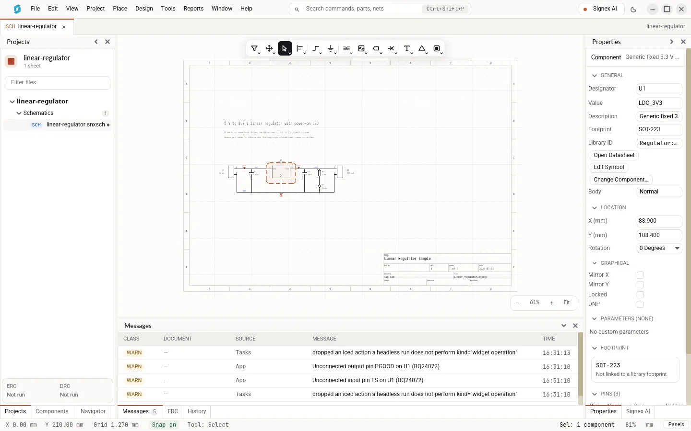
  </picture>
  <br>
  <em>Signex 26.11.0：Graphite Light 主题下的原理图编辑器（系统为深色时使用 Graphite Dark）。<a href="#截图">更多截图</a></em>
</p>

<h1 align="center">Signex</h1>
<p align="center">
  源码可见、AI 优先的电子设计自动化
</p>

<p align="center">
  <a href="README.md">English</a> &middot; 简体中文
</p>

<p align="center">
  <a href="https://github.com/alplabai/signex/blob/main/LICENSE"></a>
  <a href="https://github.com/alplabai/signex/releases"></a>
  <a href="https://www.rust-lang.org/"></a>
  <a href="docs/USER_GUIDE.md"></a>
  <a href="https://github.com/alplabai/signex/discussions"></a>
</p>

<p align="center">
  <a href="#功能">功能</a> &middot;
  <a href="#截图">截图</a> &middot;
  <a href="#下载">下载</a> &middot;
  <a href="#构建">构建</a> &middot;
  <a href="#路线图">路线图</a> &middot;
  <a href="docs/USER_GUIDE.md">用户指南（英文）</a> &middot;
  <a href="#参与贡献">参与贡献</a> &middot;
  <a href="#许可证">许可证</a>
</p>

---

> 本文是 [README.md](README.md) 的简体中文翻译，由 [alainchen6](https://github.com/alainchen6) 翻译，仅供参考；如与英文原文有出入，以英文原文为准。发现翻译问题，欢迎在 issue 中提出。

Signex 是用 Rust 编写的源码可见电子设计自动化软件，通过 wgpu 实现 GPU 加速渲染。26.11.0 版本提供**原理图编辑器**和 **PCB 编辑器**：从原理图出发，完成布线、通过规则检查的电路板，并生成制造文件。符号、封装和元件库编辑器以及电路板 3D 视图也已提供，但处于较早阶段。仿真和插件系统列在[路线图](docs/ROADMAP.md)中。原生文件格式（`.snxsch`、`.snxpcb`）可在 git 中按行 diff，体积约为等价 JSON 的 1/5。

**第一次使用？** 安装发行包（见[下载](#下载)），然后按照**[用户指南](docs/USER_GUIDE.md)**（英文）操作：从 **File ▸ New Project**（文件 ▸ 新建项目）开始，直到保存原理图并导出 PDF。

**从基于 GPL 的 EDA 工具迁移？** 可选的[导入配套仓库](https://github.com/alplabai/signex-kicad-import)（GPL-3.0-or-later，独立分发）可将基于 GPL 的 EDA 工具的项目文件单向转换为 Signex 原生格式。对项目运行一次，然后在 Signex 中打开生成的 `.snxprj`。

**从 Altium 迁移？** 安装可选的 [signex-altium-import](https://github.com/alplabai/signex-altium-import) 配套工具（FSL-1.1-ALv2，净室实现）。然后使用 **File › Import › Altium Project…**（文件 › 导入 › Altium 工程…），将 `.PrjPcb`、`.SchDoc`、`.PcbDoc`、`.SchLib` 或 `.PcbLib` 转换为同级的 `<name>-signex/` 文件夹并打开。导入过程会列出所有只能近似处理或跳过的内容；在制造导入的电路板之前，请先审阅该列表。

**版本：**

- **Signex Community**（FSL-1.1-ALv2，免费、永久离线）——完整编辑器：带布线和 DRC 的原理图与 PCB 布局，以及无界面 CLI；插件系统将在发布后加入（见[路线图](docs/ROADMAP.md)）
- **Signex Pro** —— 独立的专有产品，基于 Community 构建，增加 Signex AI、团队协作和 PLM

Community 中没有任何功能被锁定或限制，也不会显示升级提示。Pro 单独规划；本仓库只包含 Community。

> **状态：** **26.11.0**（2026-11-17）是最新版本，也是 **Community Preview** 版本。**原理图和 PCB 编辑器**已受支持。封装、符号和库编辑器以及电路板 3D 视图可用，但处于较早阶段。Signex AI 随 Pro 发布，本版本不包含。版本号基于日历，格式为 `YY.MM.MICRO`：26.11.0 是 2026 年 11 月的第一个版本，当月第二个版本会是 26.11.1；`26.11.0-rc.1` 之类的候选版本以 GitHub **预发布**形式发布（见 [docs/ROADMAP.md](docs/ROADMAP.md) §3）。`trunk` 包含最新版本之后的工作。
> [参与讨论](https://github.com/alplabai/signex/discussions)或查看[路线图](#路线图)。

## 功能

**原理图**

- 层次化、多页原理图，使用原生 `.snxsch` / `.snxprj` 格式：导线、总线、网络标签、电源端口、连接点、未连接标记、层次页符号与入口、绘图图形、Design Blocks 以及导入的图形
- 编辑：移动和拖动（带橡皮筋）、旋转、镜像、复制粘贴、阵列粘贴、就地文本编辑（F2）、复制属性、查找相似对象、工程级查找替换、五种选择模式和选择过滤器
- 多单元符号；已放置的元件保有其库符号版本，直到你从库中更新它们
- 四种标注模式，支持按位号锁定；从电路板回注（Back Annotate）；原理图页编号
- ERC：33 条内置规则，包括跨页层次、总线和完整性检查、引脚连接矩阵、带原因和作者的逐项豁免，以及可导出为 `.txt`、`.csv`、`.json`、`.html` 或 `.pdf` 的 ERC 报告（[docs/ERC_RULES.md](docs/ERC_RULES.md)、[docs/ERC_REPORT.md](docs/ERC_REPORT.md)）
- 网络颜色（F5）、AutoFocus（F9）、跨页网络导航和网络检查器（Net Inspector）
- 每个编辑器都支持撤销/重做；原理图页、电路板、库行和工程支持崩溃恢复

**PCB**

- 新建 PCB 设置，提供配置卡片；Update PCB from Schematic 以可审阅的变更表呈现；原理图与电路板之间的双向交叉探测
- 封装放置，以及 Track、Via、Fill、Solid Region、Keepout、Pad、Arc、String 和 Dimension 工具；电路板图形和 DXF 导入
- 交互式布线，可绕行或推挤其他网络；差分对、Quick Route、Multi-Route 和长度调谐；过孔缝合、泪滴和平滑优化（gloss）
- 按优先级填充的覆铜，支持去除孤岛和死铜、开槽以及 Slice Pour
- 层叠管理器，最多 32 层铜层，支持按层设置焊盘和过孔尺寸；层集合
- 网络类、带类矩阵和预设的规则管理器、DRC 规则语言，以及支持豁免的 DRC 面板（[docs/DRC_RULES.md](docs/DRC_RULES.md)）
- 引脚和门交换、设计复用块、走线和过孔锁定、拼板（[docs/PANELISATION.md](docs/PANELISATION.md)）
- 可旋转的电路板视图，坐标以电路板原点为基准且 Y 轴向上；电路板 3D 视图，使用封装的 STEP 或 VRML 模型
- 制造输出：带 X2 属性的 Gerber RS-274X、Excellon 钻孔文件和钻孔表、贴片坐标 CSV、IPC-D-356 测试网表以及作业文件（[docs/FABRICATION_OUTPUTS.md](docs/FABRICATION_OUTPUTS.md)）；电路板 PDF、打印和电路板报告

**库**

- 库浏览器（Library Browser）标签页中的 `.snxlib` 元件库，支持生命周期状态、范围过滤，并内置可放置元件库
- 元件编辑器：General、Datasheet、Pin Map、Parameters、Supply、Simulation 和 Alternates
- 符号编辑器和封装编辑器，由净室约束求解器驱动（参数化草图，烘焙为焊盘、丝印和外框）
- DigiKey、Mouser、LCSC 和 JLCPCB 分销商适配器
- 每个库都支持 git 版本控制，并提供 History 面板

**输出**

- PDF 导出（带书签）、打印预览、BOM 预览（支持 CSV / HTML / XLSX 导出）以及网表导出

**自动化与 AI**

- 一套命令目录驱动菜单、Active Bar、上下文菜单、快捷键和命令面板（[docs/COMMANDS.md](docs/COMMANDS.md)）
- `signex-cli` 从 JSON Lines 运行同一套命令，可无界面运行，也可通过仅限本地用户、默认关闭的 socket 连接到正在运行的 Signex（[docs/CLI.md](docs/CLI.md)、[docs/AGENT_SOCKET.md](docs/AGENT_SOCKET.md)）；Agent 的每次编辑都是一个带标签的撤销步骤，并记录在工程日志中
- 面向脚本和 Agent 的按需 ERC 和 DRC（`check_erc`、`check_drc`）
- Signex AI（助手、Agent 和生成器）随 Pro 发布；本版本没有 Signex AI 面板

**界面**

- Graphite Light（默认）和 Graphite Dark，UI 字体为 Inter，可在 Preferences ▸ Theme 或标题栏的明暗切换中切换
- 可停靠面板；可将任意文档标签页脱离为独立窗口，或在主窗口中平铺文档
- Project 标签页：原理图页、变体、库、ERC 和标注设置，以及版本控制
- 命令面板（`Ctrl+Shift+P`）、可配置的快捷键方案（跟随操作系统，macOS 上为 ⌘）、触控板捏合缩放和双指平移
- 启动界面，显示固定和最近使用的工程

**后续计划：**

| 计划 | 里程碑 |
|---|---|
| **PCB Design** | 从原理图进行布局和布线；布线器会规划路径 |
| **Community Release** | 制造输出：ODB++、IPC-2581、STEP 3D 导出、装配图 |
| **3D Viewer → High-Speed Design** | 3D 查看器、高级 PCB、高速设计 |
| **MCAD** | 外壳适配检查、零件建模和电路板驱动外壳 |
| **Simulation** | 统一的仿真视图，支持 SPICE、EM 和热仿真 |

## 截图

以下为 Signex 26.11.0 当前应用在 Graphite Light 和 Graphite Dark 下的截图。

<p align="center">
  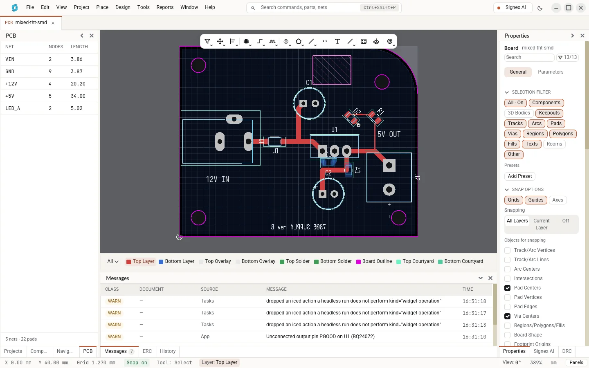
  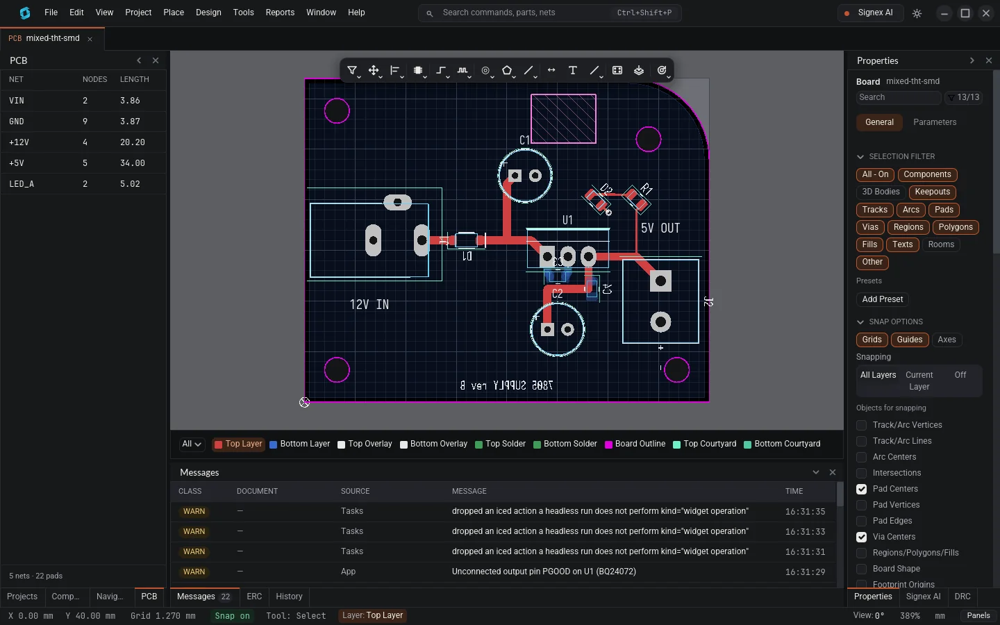
  <br>
  <em>PCB 编辑器：网络面板、含走线和封装的电路板、层标签以及电路板属性</em>
</p>

<details>
<summary><strong>更多界面</strong></summary>

<p align="center">
  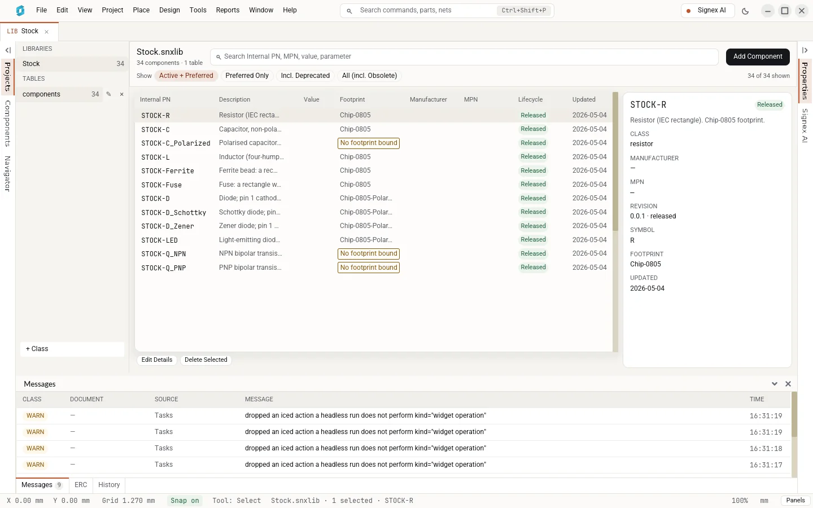
  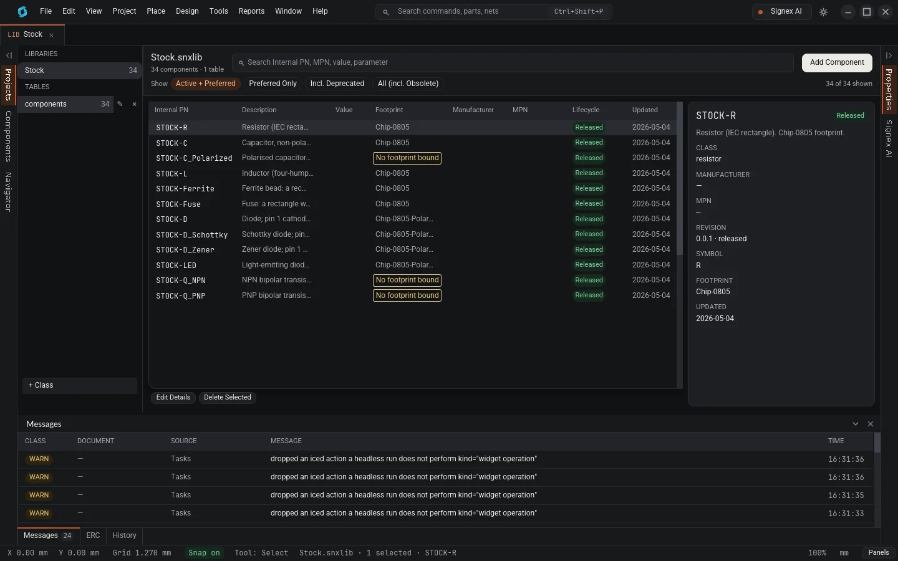
  <br>
  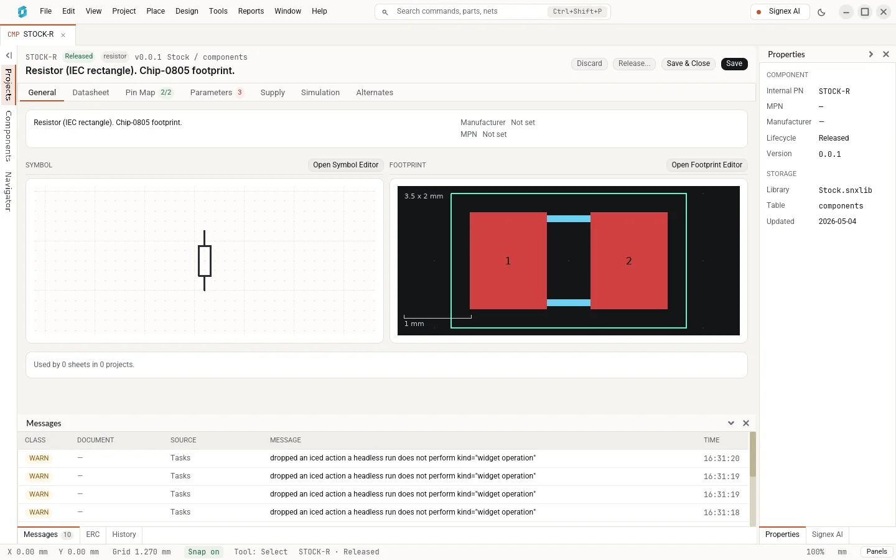
  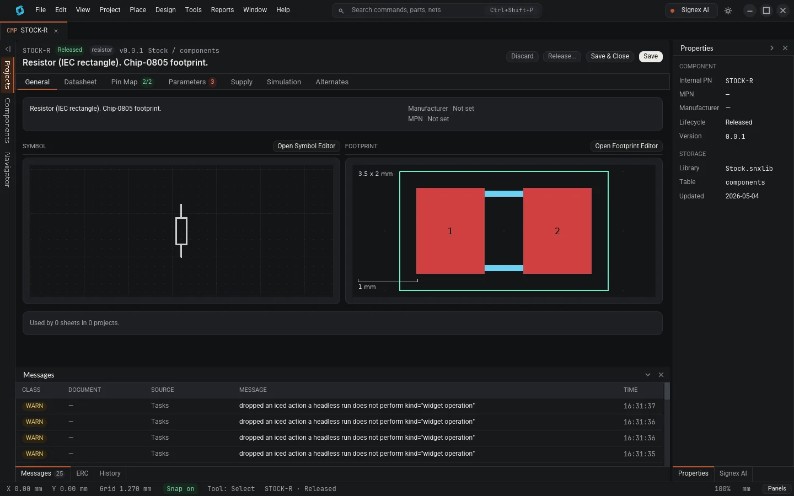
  <br>
  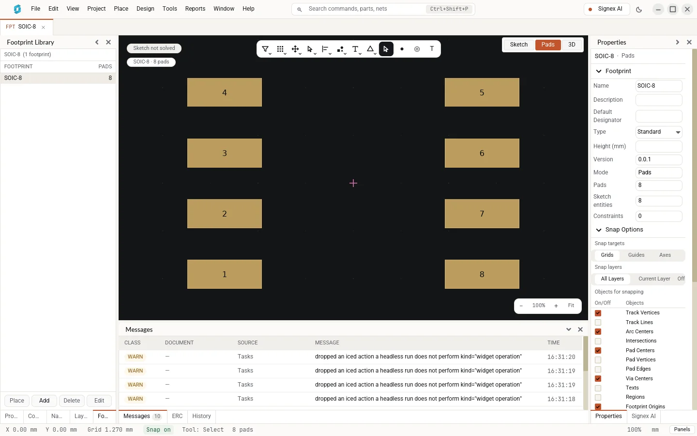
  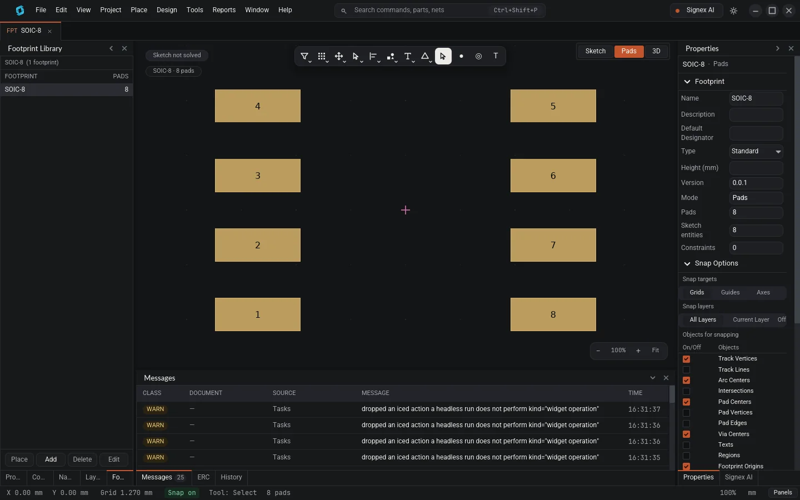
  <br>
  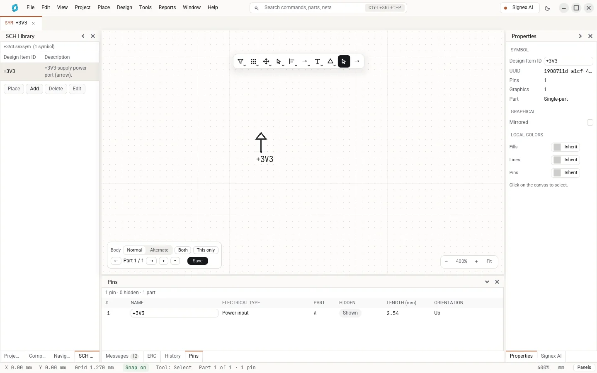
  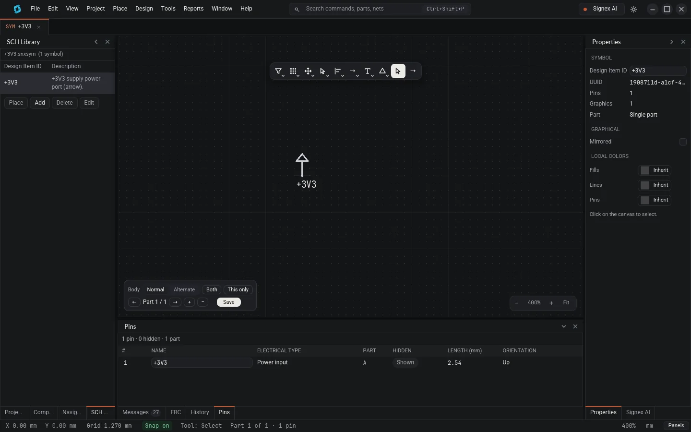
  <br>
  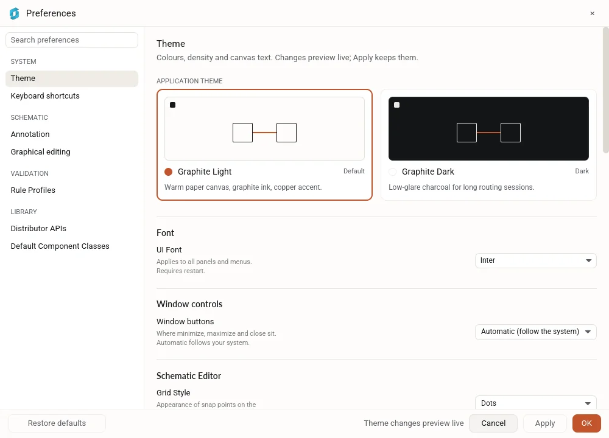
  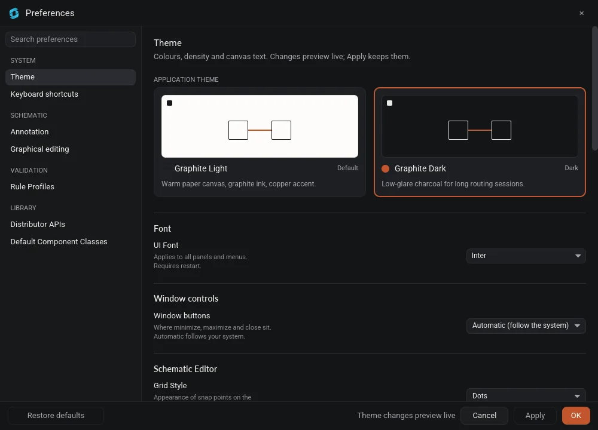
  <br>
  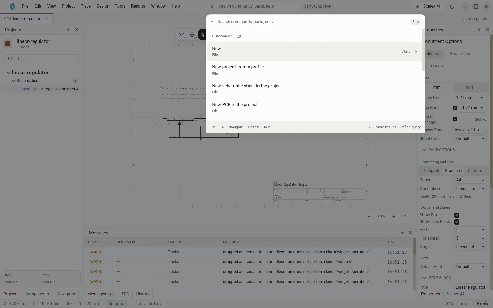
  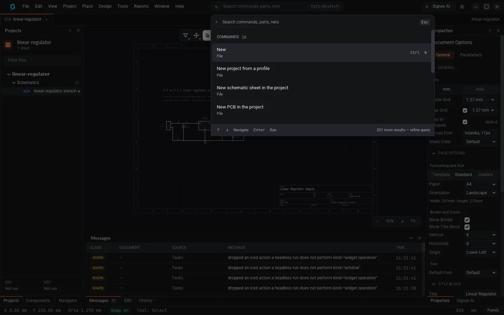
  <br>
  <em>库浏览器、元件/封装/符号编辑器、偏好设置和命令面板</em>
</p>

</details>

## 架构

包含 25 个 crate 的 Rust workspace（`edition = 2024`），无环 DAG，`signex-app` 位于顶点，`signex-types` 是共享基础：

```
signex/
├── crates/
│   ├── signex-app/            # 主程序 —— iced 0.14 应用（面板、停靠、画布、编辑器）
│   ├── signex-cli/            # 无界面命令运行器 —— 输入 JSON Lines，输出结果行（docs/CLI.md）
│   ├── signex-commands/       # 命令目录：id、标签、快捷键、操作数
│   ├── signex-types/          # 领域类型 —— 原理图/PCB/层/主题 —— 不依赖渲染
│   ├── signex-engine/         # 原理图编辑的命令 / 补丁 / 撤销引擎（+ signex-history）
│   ├── signex-net/            # 权威网表与连接性契约
│   ├── signex-erc/            # ERC 规则引擎（+ signex-erc-dsl）
│   ├── signex-drc/            # PCB 设计规则检查（使用 pcb-geom 度量；+ signex-drc-dsl）
│   ├── pcb-geom/              # 整数纳米电路板几何
│   ├── signex-sketch/         # 净室 Newton-LM 约束求解器 + 草图 schema
│   ├── signex-bake/           # 草图 → 封装烘焙（焊盘 / 丝印 / 外框 / 阻焊 / …）
│   ├── signex-output/         # PDF / 网表 / BOM / 制造输出管线（+ signex-bom）
│   ├── signex-renderer/       # 领域类型 → 渲染图元（+ signex-gfx wgpu 管线）
│   ├── signex-library/        # .snxlib 元件库 —— 端口/适配器模型（+ signex-library-server）
│   ├── signex-widgets/        # 可复用 iced 组件（树视图、Active Bar、预览）
│   ├── signex-i18n/           # UI 消息目录（Fluent）和区域感知格式化
│   ├── signex-i18n-ids/       # 消息 id 和 Translatable，不依赖 locale
│   └── signex-3d-model-importer/  # STEP / WRL 导入器，用于挂接 3D 实体
└── Cargo.toml
```

**设计原则：**

- **原生 `.snx*` 格式优先。** `.snxsch` / `.snxpcb` / `.snxprj` 是规范格式（TOML 外壳 + TSV 批量块，可按行 diff，体积约为 JSON 的 1/5；`.snxprj` 工程文件是唯一的 JSON 例外，见 [docs/architecture/snxprj-format.md](docs/architecture/snxprj-format.md)）。从基于 GPL 的 EDA 工具进行单向导入，是可选的、独立分发的配套工具。
- **Elm 架构（MVU）。** iced 的 `state → view → Message → update` 循环；`view` 是纯函数，`update` 是唯一的修改点且从不阻塞——所有 IO 都以 `Task` 返回。没有进程级全局可变状态。
- **领域逻辑放在领域 crate 中。** `signex-app` 之下的类型和引擎不依赖 `iced`/`wgpu`（由 Cargo 强制）；连接性只在 `signex-net` 中派生一次，其他位置只读取，绝不重复派生。
- **默认多窗口。** 基于 `iced::daemon` 构建；每个脱离的标签页都有自己的引擎和画布，以窗口 id 为键，因此两个原理图可以并行编辑而互不干扰。
- **磁盘上的纳米坐标。** 文件存储整数纳米，在公制和英制下都精确；电路板几何（`pcb-geom`）以整数纳米计算，“同一点”是同一个共享桶，绝不使用浮点 `EPS`。
- **GPU 渲染。** 通过 iced 使用 wgpu 27：原理图页和电路板的画布细分，以及 `signex-gfx` 中的实例化管线。

## 下载

下载前请先查看[硬件要求](#硬件要求)。每个版本都会发布以下安装包。`v26.11.0` 是正式版本，因此[最新版本](https://github.com/alplabai/signex/releases/latest)链接指向它。`v26.11.0-rc.1` 之类的候选版本以 GitHub **预发布**形式发布，上述链接会跳过它们：请打开 [Releases 页面](https://github.com/alplabai/signex/releases)获取。

| 平台 | 安装包 | 架构 | 用途 |
|---|---|---|---|
| Windows | `signex-setup-<arch>-<version>.exe` | x86_64、ARM64（`aarch64`） | 运行以进行引导式安装 |
| Windows | `signex-windows-<arch>-<version>.zip` | x86_64、ARM64（`aarch64`） | 解压后直接运行，无需安装 |
| macOS | `signex-macos-universal-<version>.dmg` | Apple silicon 和 Intel | 打开后将 Signex 拖入 Applications |
| Linux | `signex_<version>_<arch>.deb` | x86_64（`amd64`）、ARM64（`arm64`） | Debian 或 Ubuntu（glibc 2.35 或更新版本）：`sudo apt install ./signex_<version>_<arch>.deb` |
| Linux | `Signex-<version>-<arch>.AppImage` | x86_64、ARM64（`aarch64`） | 大多数发行版：`chmod +x` 赋予可执行权限后运行 |
| Linux | `signex-linux-<arch>-<version>.tar.gz` | x86_64、ARM64（`aarch64`） | 解压后直接运行，无需安装 |
| 全部平台 | `signex-<version>.cdx.json` | 不适用 | CycloneDX SBOM：`signex` 二进制在所有平台上的依赖（是任一单平台构建的超集），含版本和许可证 |
| 全部平台 | `SHA256SUMS.txt` | 不适用 | 上述所有文件的 SHA-256 校验和 |

26.11.0 的 `<version>` 为 `26.11.0`，例如 `signex-setup-x86_64-26.11.0.exe` 或 `signex_26.11.0_amd64.deb`。

Linux 安装包（`.deb`、AppImage、tar 包）在 Ubuntu 22.04 上构建，需要 **glibc 2.35 或更新版本**，因此可在 Ubuntu 22.04、Debian 12 及更新的发行版上运行。用 `ldd --version` 查看你的版本。

### 首次启动

在启用发布签名之前（见 [docs/RELEASE_SIGNING.md](docs/RELEASE_SIGNING.md)），安装包不携带受信任的发布者或开发者签名：

- **Windows：** 可能出现 Microsoft Defender SmartScreen 提示。选择 **More info**（更多信息），然后选择 **Run anyway**（仍要运行）。
- **macOS：** 打开 DMG 并将 Signex 移到 Applications 后，首次启动时右键点击 Signex 并选择 **Open**（打开），以绕过 Gatekeeper 的“未识别开发者”警告。

这些变通做法可在 [Windows 签名](https://github.com/alplabai/signex/issues/318)和 [macOS 签名与公证](https://github.com/alplabai/signex/issues/319)落地后移除。

### 校验下载

每个版本都包含 `SHA256SUMS.txt`：从 [Releases 页面](https://github.com/alplabai/signex/releases)下载你所选版本附带的该文件，放在你下载的安装包旁边。校验和文件列出了所有发布产物，因此下面的命令只会选中你下载的那个文件。

Linux（将 `file` 设为实际下载的文件名）：

```bash
file='Signex-<version>-x86_64.AppImage'
grep -F "  $file" SHA256SUMS.txt | sha256sum -c -
```

macOS（将 `file` 设为实际下载的文件名）：

```bash
file='signex-macos-universal-<version>.dmg'
grep -F "  $file" SHA256SUMS.txt | shasum -a 256 -c -
```

Windows PowerShell（将 `$file` 设为实际下载的文件名）：

```powershell
$file = "<downloaded-package-filename>"
$expected = ((Select-String -Path .\SHA256SUMS.txt -SimpleMatch "  $file").Line -split '\s+')[0]
(Get-FileHash -Algorithm SHA256 -Path $file).Hash.ToLowerInvariant() -eq $expected
```

## 硬件要求

Signex 使用 [wgpu](https://wgpu.rs) 进行硬件加速渲染，需要支持有效 Vulkan 1.1（Linux）、DirectX 12（Windows）或 Metal（macOS）的现代 GPU。实际而言，这意味着**2014 年前后或更新的 GPU** —— Intel HD Graphics 4400 及更新型号、NVIDIA GeForce 600 系列及更新型号、AMD Radeon HD 7000 系列及更新型号，或任意 Apple Silicon Mac。

只提供旧版 OpenGL 的较老 GPU 仍可能通过回退路径启动应用，但会出现面板重叠、布局错乱等渲染问题——这些 GPU 不受支持。

## 构建

**前置条件：** Rust 1.97.0 —— 通过 `rust-toolchain.toml` 固定，`rustup` 会自动安装；这也是 MSRV（我们构建和支持的正是这个工具链）—— 以及支持 Vulkan、Metal 或 DX12 的 GPU。

在 Linux 上，安装 CI 使用的开发包（Debian 和 Ubuntu 名称；`mesa-vulkan-drivers` 为没有 GPU 的机器提供软件 Vulkan 驱动）：

```bash
sudo apt-get install -y \
  libxkbcommon-dev libwayland-dev libvulkan-dev \
  libx11-dev libxrandr-dev libxinerama-dev libxcursor-dev libxi-dev \
  mesa-vulkan-drivers
```

你自己构建的二进制会链接到你本机的 glibc。glibc 2.35 的下限适用于发布包，正因为如此发布包在 Ubuntu 22.04 上构建（`scripts/check_glibc_ceiling.sh`，#1688）。

```bash
git clone https://github.com/alplabai/signex.git
cd signex
cargo run -p signex-app          # 运行
cargo test --workspace           # 测试
cargo clippy --workspace --all-targets --all-features -- -D warnings  # Lint
```

## 路线图

| 里程碑 | 版本 / 关卡 | 状态 |
|---|---|---|
| 脚手架 —— Iced 外壳、面板、主题、停靠系统 | v0.1 | 已完成 |
| 解析器 —— 外部格式读写、领域类型 | v0.2 | 已完成 |
| 画布 —— wgpu 平移/缩放/网格和相机 | v0.3 | 已完成 |
| 原理图查看器 —— 渲染所有元素、多页导航 | v0.4 | 已完成 |
| 原理图编辑器 —— 选择、移动、连线、撤销/重做、保存 | v0.5 | 已完成 |
| 完整 SCH 编辑器 —— 复制/粘贴、标签、元件、Active Bar | v0.6 | 已完成 |
| 校验 + 多窗口 —— ERC、标注、引脚矩阵、可脱离标签页 | v0.7 | 已完成 |
| 输出 —— PDF、BOM、网表、多工程工作区、脏标记跟踪 | v0.8 | 已完成 |
| 原生文件格式 —— `.snxsch` / `.snxpcb` TOML+TSV；通过导入配套工具读写外部格式 | v0.9 | 已完成 |
| 库浏览器标签页 —— 只读 `.snxlib` 表 | v0.10 | 已完成 |
| 库与打磨 —— 完整 DBLib 模型、SCH 库编辑器、元件预览、选择器 + 自动挂载、分销商适配器 | v0.11 | 已完成 |
| 符号与库 —— 净室原理图渲染器、符号编辑器中统一的 Active Bar、`.snxsym` TOML 外壳 | v0.13 | 已完成 |
| 封装编辑器 —— `.snxfpt` 焊盘 + 参数化草图编辑器、Newton-LM 求解器（19 种约束）、对齐/分布/移动/填充/文本工具 | v0.14 | 已完成 |
| 编辑器修复 —— 封装/符号编辑器正确性、顺序无关网表、崩溃安全的持久化、固定工具链 | v0.15 | 已完成 |
| 命令注册表与符号单元 | 1.0.0-rc.1 | 已完成 |
| **Community Preview** —— 原理图和 PCB 编辑器 | **关卡** | 已达到：`v26.11.0`（2026-11-17） |
| **PCB Design** —— 从原理图进行布局和布线；布线器会规划路径 | **关卡** | 下一步 |
| **Community Release** —— 制造输出；完整原理图 + PCB 编辑器 | **关卡** | |
| 3D 查看器、高级 PCB、高速设计 | 已计划 | |
| MCAD —— 外壳适配检查、零件建模、电路板驱动外壳 | 已计划（P3） | 原理图和 PCB 编辑器完成后启动 |
| 仿真 —— SPICE、EM、热仿真、仿真向导 | 已计划 | |

详细的发布计划见 [docs/ROADMAP.md](docs/ROADMAP.md)。

## 文档

**[用户指南](docs/USER_GUIDE.md)**（英文）会带你从下载安装包开始，以 **File ▸ New Project** 为起点，完成保存原理图和导出 PDF。它就在仓库中，因此与代码一起版本化，并在 pull request 中接受审阅。

仓库内的参考文档位于 [`docs/`](docs/)：[命令参考](docs/COMMANDS.md)、[无界面命令运行器](docs/CLI.md)、[键盘快捷键文件格式](docs/KEYBOARD_SHORTCUTS.md)、[主菜单栏](docs/MENU_BAR.md)、[ERC 规则](docs/ERC_RULES.md)、[DRC 规则](docs/DRC_RULES.md)、[PCB 工具](docs/PCB_TOOLS.md)、[制造输出](docs/FABRICATION_OUTPUTS.md)、[ROADMAP.md](docs/ROADMAP.md)、[LICENSING.md](docs/LICENSING.md)、[RELEASE_SIGNING.md](docs/RELEASE_SIGNING.md) 和 [REPOSITORY_AND_CODEBASE.md](docs/REPOSITORY_AND_CODEBASE.md)。[wiki](https://github.com/alplabai/signex/wiki) 已不再是主要指南。

## 参与贡献

Signex 是源码可见的，我们欢迎所有人的贡献——无论你是 EDA 从业者、Rust 开发者，还是只想帮助打造更好设计工具的人。

**参与方式：**

- 报告 bug 或渲染差异
- 提供真实项目的测试用例/数据
- 实现[路线图](docs/ROADMAP.md)中的功能
- 修复[未解决的 issue](https://github.com/alplabai/signex/issues)
- 改进文档

**构建与运行**（Linux 需要[构建](#构建)中列出的软件包）：

```bash
git clone https://github.com/alplabai/signex.git
cd signex
cargo build --workspace
cargo run -p signex-app
```

完整指南见 **[CONTRIBUTING.md](CONTRIBUTING.md)**：分支流程、crate 地图、代码风格和适合新手的 issue。

## 许可证

> 以下为许可证摘要的中文说明，不构成法律意见；以 [LICENSE](LICENSE) 的英文原文为准。

Signex Community Edition 以[Functional Source License 1.1, Apache 2.0 Future License（FSL-1.1-ALv2）](LICENSE) 的形式源码可见：

- **允许：** 任何用途，包括公司使用 Signex 设计和销售自己的产品。
- **不允许：** 竞争性用途（Competing Use），即把 Signex 作为商业产品或服务提供给别人，且该产品或服务替代 Signex（或替代 Alp Lab 基于 Signex 提供的产品或服务），或提供与 Signex 相同或实质相似的功能。免费、非商业的再分发是允许的。
- **之后：** 每个版本在发布两年后转为 Apache-2.0。

许可证变更之前发布的版本仍为 Apache-2.0。变更（#2344）之前做出的贡献按 Apache-2.0 授权，这些授权继续有效；整个项目按 FSL-1.1-ALv2 分发。Apache-2.0 文本的副本位于 [LICENSE-APACHE](LICENSE-APACHE)（见 [NOTICE](NOTICE)）。

主仓库不包含源自 GPL 的代码，因此无论 Apache-2.0 转换前后，你的构建依赖闭包中都不存在 GPL 聚合问题。

从基于 GPL 的 EDA 工具迁移由可选的[导入配套仓库](https://github.com/alplabai/signex-kicad-import)提供，该仓库采用 **GPL-3.0-or-later**，因为它实现这些工具的文件格式时，结构源自其 GPL-3.0 源码。两个项目独立分发。完整理由和双仓库拆分背后的审计记录见 [docs/LICENSING.md](docs/LICENSING.md)。

Copyright 2026 [Alp Lab AB](https://github.com/alplabai)

Signex™ 和 Signex AI™ 是 Alp Lab AB 的商标。FSL-1.1-ALv2 许可证不授予使用这些商标的权利；fork 必须使用不同的名称。
