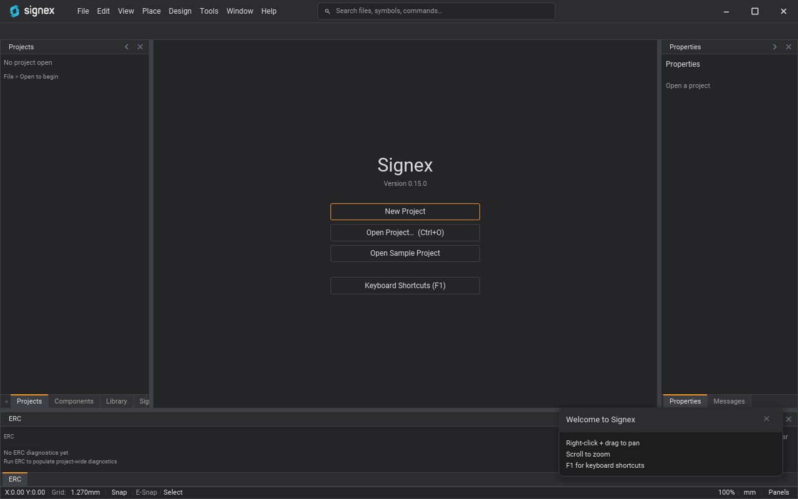
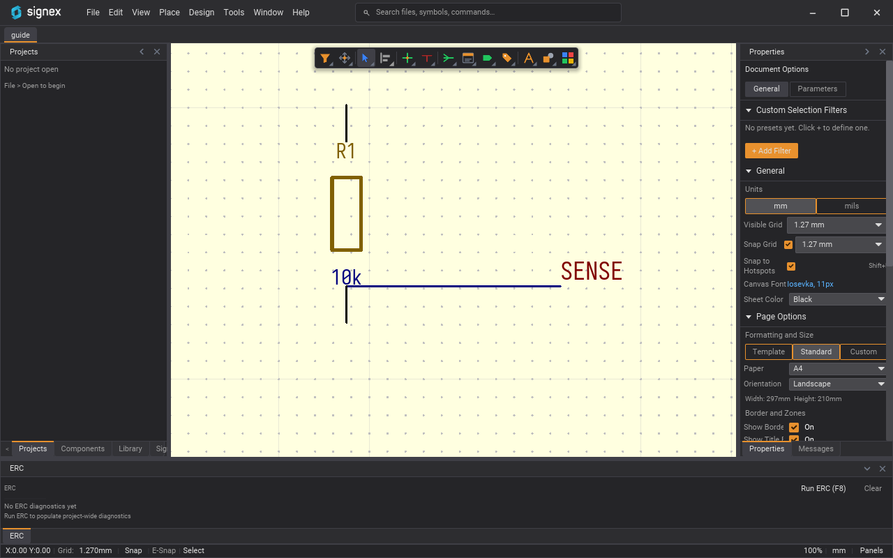
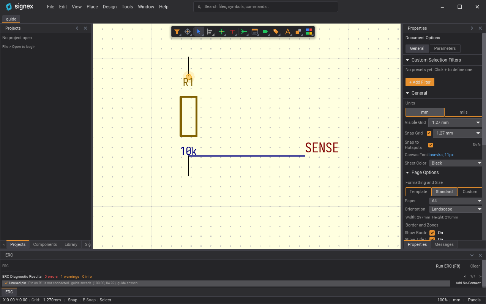

# Signex user guide

This guide takes you from a downloaded Signex package to a saved schematic
and an exported PDF. It assumes you have never used an EDA tool and have never
installed Rust. You do not need either.

<!-- The screenshots in this guide are rendered headlessly, not captured by hand.
Regenerate assets/screenshots/guide-*.png with:
cargo test -p signex-app --test guide_screenshots -- --ignored
(needs a GPU adapter; the test skips itself without one). -->

It describes the application as it is on the `trunk` branch. Where a step
depends on work that has not shipped yet, the guide says so and links the
tracking issue. Menu paths are written `Menu ▸ Item`.

Contents:

1. [Install](#1-install)
2. [First launch](#2-first-launch)
3. [Create a project](#3-create-a-project)
4. [Canvas basics](#4-canvas-basics)
5. [Place a symbol](#5-place-a-symbol)
6. [Wire](#6-wire)
7. [Label a net](#7-label-a-net)
8. [Annotate](#8-annotate)
9. [Run ERC](#9-run-erc)
10. [Save](#10-save)
11. [Export PDF and BOM](#11-export-pdf-and-bom)
12. [File types](#12-file-types)
13. [Keyboard shortcuts](#13-keyboard-shortcuts)
14. [Where to get help](#14-where-to-get-help)

For the whole flow in one pass, see the
[walkthrough](#walkthrough-a-saved-schematic-with-a-wired-symbol).

## 1. Install

Follow the [Download section of the README](../README.md#download). It lists
the package for each platform, the first-launch warnings on Windows and macOS,
and how to verify a download. This guide does not repeat it. A release
candidate such as `v1.0.0-rc.1` is a GitHub pre-release: get it from the
[Releases page](https://github.com/alplabai/signex/releases), because the
"latest release" link skips pre-releases.

## 2. First launch

Start Signex. With no document open you see a start screen with four
buttons:

- **New Project**
- **Open Project…** (with its keyboard shortcut shown next to it)
- **Open Sample Project**
- **Keyboard Shortcuts (F1)**

On your very first launch a small card titled **Welcome to Signex** also
appears in the bottom-right corner of the window. It lists the three gestures
you need immediately:

- Right-click + drag to pan
- Scroll to zoom
- F1 for keyboard shortcuts

Close it with the ✕ in its corner or with `Esc`. It is a reminder only; nothing
else changes when you dismiss it.

`F1` (or **Help ▸ Keyboard Shortcuts**) opens a reference of every binding in
the active shortcut profile.

## 3. Create a project

Choose **File ▸ New Project** (or press **New Project** on the start screen).

A save dialog titled **New Signex Project (a folder named after the project
is created)** opens with the name `Untitled.snxprj`. Pick the place where the
project should live and a name, and keep the `.snxprj` ending.

Signex creates a folder named after the project, `<location>/<name>/`, and
writes these files into it:

| File | What it is |
|---|---|
| `<name>.snxprj` | The project file. It is created empty; Signex builds the project from the files in the folder. |
| `<name>.snxsch` | A blank schematic sheet, A4 paper size. |
| `.gitignore` | A Signex-managed block of patterns for files that should not be versioned. |

If you already made an empty folder with the project's name and pick the file
inside it, Signex uses that folder instead of creating `<name>/<name>/`. A
folder that holds only OS files such as `.DS_Store`, `Thumbs.db` or
`desktop.ini` counts as empty (the name match ignores letter case). If that folder is not empty, Signex creates the project in
`<name>/<name>/` instead and says so in the Messages panel.

Signex refuses, and writes nothing, when:

- the folder `<location>/<name>/` already exists and is not empty;
- that folder already contains a `.snxprj` (open it with **File ▸ Open…**
  instead; the dialog accepts `.snxprj` and `.snxsch`);
- the new folder would sit inside another project's folder (a folder
  `<name>/` that holds `<name>.snxprj`; a loose `.snxprj` in your Desktop
  or home folder does not count).

The reason appears in the error notice and in the Messages panel.

The project loads and the blank schematic opens in a tab, ready to draw on.

**Enable Version Control** refuses to start a git repository in your home
folder, in Desktop, Documents or Downloads, in a filesystem root, in a folder that holds more than this one project, or in a folder
that has other projects in its subfolders (two levels are checked). A folder
that cannot be fully read is refused too. Such a repository would commit
every file in the folder. Move the project into its own folder first. A
project that already lives in a shared folder still opens normally.

To come back later use **File ▸ Open…** or **File ▸ Open Recent**.

> **Sample project.** **Help ▸ Open Sample Project** (or the button on the
> start screen) opens a small bundled design, a linear regulator. Signex copies
> it into your per-user configuration folder the first time, so your edits to it
> are kept.

## 4. Canvas basics

- **Pan:** hold the right mouse button and drag. The middle button also pans.
  A right-click without dragging opens the context menu, unless you are in the
  middle of drawing a wire, where it cancels the wire.
- **Zoom:** scroll the mouse wheel. Zoom is centred on the pointer.
- **Fit the sheet:** **View ▸ Fit All**.
- **Grid:** the status bar at the bottom shows the grid size and whether
  snapping is on (**Snap**) or off (**Free**). Click the grid value to show or
  hide the grid, and click **Snap/Free** to switch snapping. **View ▸ Toggle
  Grid** does the same as the grid click. Placed objects snap to the grid
  while snapping is on.

**View ▸ Cycle Grid Size** steps the grid of the schematic. In the Altium
profile `G` (forward) acts only in the footprint editor, while `Shift+G` steps
the grid backward on a schematic too. In the Classic profile `N` / `Shift+N`
cycle it on a schematic. The menu item always works. **View ▸ Zoom In** and
**Zoom Out** zoom about the centre of the view. `PageUp` / `PageDown` (Altium
profile) or `F1` / `F2` (Classic profile) and the scroll wheel zoom about the
pointer.

## 5. Place a symbol

A symbol is a part on the sheet: a resistor, a connector, a chip. Symbols come
from libraries.

**Libraries.** The Components panel (**View ▸ Components**) lists mounted
libraries in four sections: **Project**, **Installed**, **Global** and
**Stock**. The **Stock** section is the library that ships with Signex. It is
mounted on every launch; you do not add it, and its parts can be placed
(34 component rows: resistors, capacitors, inductors, diodes, LEDs,
transistors, connectors, 74HC logic and more). If the installer's copy cannot
be found, the section says "Stock library not found. Reinstall Signex to
restore the bundled parts." The **Installed** and **Global** sections have a
**+ Add Library…** button, and **File ▸ Library ▸ Open Library…** mounts a
`.snxlib` library. Type in **Filter components…** to narrow the list. Clicking
a part row opens its Component Preview tab.

The stock library is read-only. Opening one of its **symbols** or
**footprints** for editing does not open the original: the first time, a
**Copy to Library** dialog asks which writable library receives a copy (or
**New Library…** creates one), remembers the choice, and opens the copy for
editing under the stock name. The stock original is never changed. If no
writable library is open, the dialog says so and offers **New Library…**.

**Typed values and the range filter.** A measurement such as a resistance or a
capacitance is a number, an SI prefix and a unit, each chosen separately: you
type the number, pick the prefix (`k`, `µ`, ...) from a list, and the unit is
fixed by the part's template or picked from a list. You do not type the unit,
and `4k7` or `4.7uF` in the number field is refused with a message. The
Library Browser opens the **Edit Component Details** modal for a measurement
cell, and the component editor's **Parameters** tab edits the same way. In the
Library Browser and in the **Place Component** picker, **Add range filter…**
filters a measurement column with an operator (`≥`, `≤`, `=` or `between`), a
number and a prefix, compared in base units, so 4.7 kΩ and 4700 Ω match. Rows
whose cell is not a measurement in that unit are left out, and the filter says
how many ("N excluded: not a measurement in Ω."). **✕** removes the filter.

To place a part, open a schematic sheet, then either:

- choose **Place ▸ Component…** (or **File ▸ Library ▸ Place Component…**,
  the `P` shortcut, or the Active Bar's **Part** button, which all open the same
  picker), select a part and press **Place**; or
- press **Place** at the end of a part's row in the Components panel.

The part attaches to the cursor and follows it on the grid. While it is
attached:

- **Rotate and mirror** it with the keys that rotate and mirror a selection
  (section 13: `Space` rotates in the default profile; `X` and `Y` mirror). They
  turn the part on the cursor, not whatever is selected on the sheet.
- Press `Tab` to open the pre-placement properties in the Properties panel:
  the value, the designator and the rotation. Placement pauses until you press
  **Resume**.
- Click to place it. One click is one **Undo** step. The part stays on the
  cursor, and each further click places another copy with the next free
  designator (R1, R2, R3...). A designator typed in the `Tab` form is used for
  the next click and then counts up from it. If that designator is already on
  the sheet, the click uses the next free one and the Messages panel says so.
  A blank value in the `Tab` form is ignored: the part keeps its value.
  Pressing on the sheet while a part is on the cursor always places it; it
  never moves or selects what is already there.
  A part with several units places unit 1 under a new number at each click.
- Press `Esc` or right-click to let go of the part.

The part belongs to the sheet that was showing when you picked it. Switching to
another tab, or closing the sheet, lets go of it, and a click on another sheet
never places into it. A sheet written by a newer Signex is read-only in this
build: Signex says so in the Messages panel and does not attach the part. With
no schematic open, Signex shows a **Place Failed** notice instead.

### Normal and alternate (De Morgan) bodies

Some library symbols, mostly logic gates, have a second body that draws the
same part in its De Morgan form. Select a placed symbol and use the **Body**
row of **Properties**: **Normal** or **Alternate (De Morgan)**. The row is
read-only, with a tooltip, when the library symbol has no alternate body. A
symbol that stores Alternate but whose library symbol has none reads
"Alternate (not in symbol; drawn as Normal)" and can be set back to Normal.

Switching body redraws the symbol, and the netlist, ERC, exports and
hit-testing all follow the body shown. Pins that are not wired may move.
Signex refuses the switch, and says why in the **Messages** panel, when a
wired pin would be lost, moved, or land on a new connection; remove those
wires first. One **Undo** reverts a switch.

In the symbol editor, the toolbar **Body** buttons (**Normal**, **Alternate**)
choose which body is shown and which body new pins and shapes are added to.
**Both bodies** marks the selection as common to both; **This body only**
pins it to the body shown. Updating a library symbol from its library never
silently drops a placed symbol's Alternate choice: the update is refused when
it would disturb a wired pin, and otherwise the choice is kept.

**Datasheets.** A part's Component Preview tab has a **Datasheet** tab that
holds one or more documents: a datasheet per manufacturer, an errata, an
application note. Each document is a URL or a pinned PDF, with an optional
label. **Add document** appends one; **Make primary**, **Up**, **Down** and
**Remove** reorder and remove them. The first document is the primary: it is
the one the schematic treats as the part's datasheet. Selecting a placed part
lists all of its documents in the Properties panel. A document left empty is
not saved.

**Copy and paste.** Select items and use **Edit ▸ Copy** or **Edit ▸ Cut**,
then **Edit ▸ Paste**. The copy attaches to the cursor, centred on it and
snapped to the grid. The rotate and mirror keys turn the whole group about the
cursor (a single pasted part turns about the cursor too, not about itself), a
click places it as one **Undo** step, and the paste then ends: paste again to
place another copy. `Esc` or a right-click drops it. Pasted parts keep
their designators, so run **Annotate** (section 8) to renumber duplicates. The
copy carries the library symbols its parts use, so it can be pasted into another
sheet; if that sheet already holds a different version of one of those symbols,
Signex says so in the Messages panel and the pasted parts use the sheet's
version. A group of more than 60 items follows the cursor as an outline.
**Edit ▸ Paste Special** skips the cursor and places the copy at once, to the
right of the sheet's content. A sheet written by a newer Signex is read-only in
this build, so nothing is pasted into it.

## 6. Wire

Wires connect pins and each other.

1. Choose the wire tool: **Place ▸ Wire**, or the keyboard shortcut. In the
   default profile (see [section 13](#13-keyboard-shortcuts)) press `P` then
   `W`, one after the other, or press `Ctrl+W`. With the Classic profile press
   `W`.
2. Click on the sheet to start a wire.
3. Click again to end the segment. Each click commits a segment and starts the
   next from the same point.
4. Double-click to stop drawing. `Esc` or a right-click cancels the wire you
   are drawing.

Wires snap to the grid while snapping is on. The status bar shows the active
tool.

Once you have placed parts (section 5), connect the wires to their pins.

## 7. Label a net

A net label gives a wire a name. Wires with the same net label on the same
sheet are connected, even if they are not drawn touching.

A net label connects only on its own sheet. Two net labels named `SDA` on two
sheets are two separate nets. To connect across sheets, use a Port (a global
name, joined everywhere in the project) or a sheet entry wired to a pin on the
parent's sheet symbol. This is fixed; there is no setting for it. ERC warns
with "Local label name on other sheets" when the same net label name appears on
more than one sheet.

To follow a net across sheets, select a port, global label, hierarchical label
or sheet entry and run **Go to net partner on another sheet** from the command
palette; run it again to cycle through the other ends. The highlight commands
keep a net bright on every sheet while the rest fades, and step through its pins
and labels. Resting the pointer on a wire, pin or label shows its net, class and
pins (Preferences ▸ Schematic ▸ Editing turns it off). See
[NET_NAVIGATION.md](NET_NAVIGATION.md).

1. Choose **Place ▸ Net Label**, or press `P` then `N` in the default profile
   (`L` in the Classic profile).
2. Click where you want the label. It is placed with the default text `NET`.
3. Press `Esc` to leave the tool, then double-click the label, type the new
   name, and press `Enter`.

### Editing text in place

Double-click a part's designator or value to edit it where it sits: type, then
press `Enter` to apply (one undo step) or `Esc` to cancel. The same editor opens
from the keyboard on the object under the pointer, or on the one selected part:
`F2` (Default profile) edits a label, a text note or a part's designator; the
Classic profile has `U` for the designator, `V` for the value and `F` for the
footprint. A part's footprint has no text on the sheet, so its editor opens at
the part. A command with nothing to act on says so in the Messages panel.

### Editing several objects at once

With more than one object selected, Properties lists the fields they share, a
group each for parts, labels and wires. A value the objects disagree on reads
`<mixed>`. Type a new value and press `Enter` (or flip a checkbox) to set it on
every object of that group in one undo step. Parts offer value, footprint, DNP,
In BOM, On board and their custom parameters; labels size, justification and
rotation (0, 90, 180 or 270); wires width. Label text is not edited in bulk,
because giving labels one name would merge their nets. Value, footprint and
parameter edits skip locked parts and the Messages panel says which; DNP, In BOM
and On board apply to locked parts too. An empty parameter value removes that
parameter from every selected part.

### Bus labels

A bus carries the signals its label names. Put a label on the bus (anywhere
along it) with one of these forms:

| Label | Signals it carries |
|---|---|
| `D[0..7]` | `D0`, `D1`, ... `D7` |
| `D[7..0]` or `D[7:0]` | the same eight signals, written high to low |
| `{SDA SCL}` | `SDA` and `SCL` (a group; items are separated by blanks) |
| `{A[0..1] CLK}` | `A0`, `A1` and `CLK` (a group may hold ranges) |

Numbers are plain unsigned integers without leading zeros (`D03` is not the same
signal as `D3`), and matching is case-sensitive (`d3` is not `D3`). There is no
space around the numbers or around
the label, a range needs a name before the `[`, and nothing may follow the `]`
(`D[0..7]A` is refused). A bare name such as `VCC`
is a net label, not a bus label.

Unlike wires, which need a junction dot to join at a T, bus segments join wherever
one ends on another (at its end or along it), dot or not. A bus never joins its
signals together. A wire that leaves the bus through a
bus entry connects to a signal only through its own net label, so label each
entry wire with one signal of the bus (for example `D3`). ERC checks this, see
section 9.

### Buses across sheets

A sheet pin, a Port (global label) or a hierarchical label can carry a bus: name
it with a bus label such as `D[0..7]` and place it on a bus. The signals join
one by one, never the bus as a whole:

- A bus sheet pin joins the hierarchical label or Port with the same bus name on
  its child sheet. `D[0..7]` and `D[0..3]` are the same bus at two widths; the
  signals both name (`D0` to `D3`) join, and ERC reports the width mismatch,
  naming the pin and the port.
- A Port bus joins every Port bus of the same name in the project, signal by
  signal. ERC reports a Port bus that appears at two widths in the project
  (`D[0..7]` and `D[0..3]`), since only the shared signals join.
- A local net label bus never leaves its sheet.

A signal joins through the net label on its bus-entry wire, so each side needs
its entry wires labelled. A group (`{SDA SCL}`) joins only a group with the same
content. Still to come: a bus joined to another bus by geometry across sheets,
and bus-aware rendering of the pin (see #1049).

## 8. Annotate

Annotation gives every symbol a unique reference designator such as `R1`, `R2`.
It acts on placed symbols, so with none on the sheet there is nothing to
annotate (section 5).

- **Design ▸ Annotation ▸ Annotate Schematics…** opens the annotation dialog.
  Its right side lists the proposed changes (current and proposed designator
  for each symbol). Press **Accept Changes** to apply them, then **Close**.
- **Design ▸ Annotation ▸ Annotate Schematics Quietly** (`Alt+A`) applies the
  changes without opening the dialog.
- **Reset & Renumber** in the dialog, or **Force Annotate All Schematics**
  (`Shift+Alt+A`), renumbers everything from scratch.

By default a placed part takes its reference letters from the library symbol
(`U?`, `R?`). A project can instead follow a designator standard: right-click
the project in the Projects panel, choose **Project Options...** and pick a
**Designator standard** (IEEE 315, DIN 40719-2 or EN IEC 81346-2). New parts
then get the standard's letters for their component class, for example a diode
is `D` under IEEE 315 and `V` under DIN 40719-2. Power ports and flags keep
their `#` references, and a class the standard does not name (such as Generic,
or a crystal under EN IEC 81346-2) uses the symbol's own letters. EN IEC
81346-2 uses its single-letter main classes. The letters and the pages of the
standards they come from are listed in
`docs/architecture/designator-standards.md`. Editing a reference by hand always
wins, and **Library designator** switches the project back to the default.
The choice is saved in the project file when you save the project.

Parts that are already placed keep their prefix when the standard changes.
**Re-prefix to standard** in the Annotate dialog applies it to them (the button
is disabled while the project follows no standard). It first shows a list of
the changes (each part's old and new prefix, how many parts across how many
sheets, and how many parts stay as they are); nothing changes until you press
**Re-prefix**, and Cancel or Esc changes nothing. Confirmed, every part gets the
standard's letters for its class and is renumbered, across the whole project,
as one undo step: **Ctrl+Z** on any sheet the run changed undoes it on all of
them (the Messages panel names those sheets; on a sheet the run did not change,
Ctrl+Z undoes your previous edit instead). Sheets that are not open are loaded
in memory and stay unsaved like any edited sheet: nothing is written to disk
until you save, and undo reverts them too. If one sheet cannot be converted the
whole run is undone and cannot be redone.

The component class comes from the library row the part was placed from, which
the sheet file stores. For a part on a sheet saved before the file kept that
link, the row is found through its library symbol instead: when every mounted row
binding that symbol has the same class and prefix override, that is the
answer (the list marks such parts "matched by symbol"); when they disagree the
part is left alone.

A part is left alone, and listed in the Messages panel, when it has a locked
unit (the lock column, or the symbol's own lock), sits on a read-only sheet,
was not placed from a library row, comes from a library that is not mounted or
whose row is gone, has a per-placement designator, or carries a prefix you
typed yourself. A prefix counts as typed by you when it is one that no
standard, no library row override and no library symbol would issue for that
part. That is all that is detected: a prefix you typed that happens to equal
one of those letters cannot be told apart from an issued one and is rewritten,
which is why the confirm list shows every change first. Power ports and flags
are never touched. The PCB is not updated: its references keep the old
designators, as after Annotate.

A library row can pin its own letters with a text parameter named
`designator_prefix` (ASCII letters only, for example `ZD`; it is upper-cased).
It beats the standard for new placements and for Re-prefix, but never a
reference you edited by hand, and never a `#` power part. A value that is not
letters only (digits, spaces or `#`) is ignored and reported in the Messages
panel. The parameter editor does not offer a way to name a custom
parameter yet, so the key has to be set in the row data directly.

Parts of the dialog are marked in the dialog itself as not active yet (the
multi-sheet columns and the parameter-matching checkboxes).

### Find and Replace

**Edit ▸ Find** (`Ctrl+F`) and **Find and Replace** (`Ctrl+H` in the Altium
profile) search the text of labels, text notes, designators and values. The
**Scope** row chooses how far the search reaches:

- **Sheet** searches the active sheet only.
- **Project** searches every sheet of the project, including sheets you have
  not opened. Results are grouped under the sheet they are on. A sheet that
  cannot be read, or that was written by a newer Signex and is read-only in
  this build, is not searched; the dialog says so and the Messages panel names
  it.

Click a result to open its sheet and zoom to the item. `F3` steps to the next
result and `Shift+F3` to the previous one (in both profiles), wrapping at the
ends. A sheet placed more than once shows one designator result per placement,
labelled "placement 2 of 3".

**Replace Current** and **Replace All** replace only the matched text, not the
whole field, and match without regard to case. In **Project** scope a Replace
All is one undo step: `Ctrl+Z` on any of the changed sheets reverts every one of
them together. If one of those sheets was edited afterwards, the undo is
refused and the Messages panel names the sheet; undo the newer edit first.

A replace never writes a sheet you have not opened. It loads the sheet, changes
it in memory and leaves it unsaved, like any other edit, so save it (or discard
it) when you are ready. The Messages panel logs "Replaced N on M sheets" and
names them. The text replaced is always read from the sheet as it is when you
press Replace, never from the search results, so an edit made after the search
is not overwritten with stale text. If you open, save or close a document, or close the
project, while a project Replace is still reading the sheets, it is cancelled with a
Messages line and changes nothing; run it again.

### Search everywhere

The command palette (`Ctrl+Shift+P`) is also the project's search box. Type a
designator, a net name or a sheet name and the palette lists, besides the
commands and panels:

- **Designators** from every sheet of the project, including sheets you have
  not opened. A sheet placed more than once gives one row per placement,
  labelled "placement 2 of 3".
- **Nets**, from the project's connectivity. A net's row jumps to one of its
  terminals.
- **Sheets**: child sheets that the project's page list does not name, and a
  row for each placement of a sheet that is placed more than once. A page
  placed once is already listed as a file.

Choosing a row opens its sheet at that placement, selects the item and zooms
to where it is now. This only moves the view; nothing in any document changes.

The designator, net and sheet rows come from an index the palette builds in the
background when it opens, so for a moment after opening it may show only the
active sheet's designators. The index is rebuilt when documents change, and
rows from the index of a different project are never shown. If a row points at
a sheet that has since been renamed or deleted, the Messages panel says it
could not be opened and nothing else is opened in its place; if the symbol is
gone but the sheet is still there, the sheet opens and the Messages panel says
the item is no longer on it.

## 9. Run ERC

ERC (electrical rules check) scans the design for wiring mistakes, such as
pins that connect nothing or two outputs wired together.

1. Press `F8`. This runs the check on the project immediately.
   Alternatively choose **Design ▸ Electrical Rules Check**, which opens a
   dialog where you can set the severity of each rule and press **Run ERC**.
2. The **ERC** panel opens with the results. Its header shows the number of
   errors, warnings and info items, and `<` and `>` step through them.
3. Each row shows a severity letter (`E` error, `W` warning, `I` info), the
   rule, the message, and the sheet and position. Click a row to jump to the
   item on the canvas. The button at the end of a row either says **Show on
   Canvas** or, for an unused pin, **Add No-Connect**, which places a
   no-connect marker on that pin.
4. **Clear** empties the list.

Besides wiring mistakes, ERC runs completeness checks (a part with no
footprint or value, an unannotated designator, a single-pin net, a net with no
driver, an off-grid pin), and a finding you accept can be **waived** with a
reason instead of switching its rule off. The rules, their default severities
and the waiver rules are in [ERC_RULES.md](ERC_RULES.md).

ERC also checks buses (section 7): a wire from a bus entry with no net label,
a label that is not one of the signals the bus carries (for example `D33` on
`D[0..7]`), a bus with no valid bus label, a label on a bus that looks like a bus
name but is malformed (such as `D[0 .. 7]`, anywhere along the bus), and two names
on one bus that carry
different signals (`D[0..7]` and `D[8..15]`) are each reported as warnings. A
bus-name label placed on a wire instead of a bus is also a warning: it still
names that wire's net, which is almost always a mistake.

The **Messages** panel (**View ▸ Messages**) is the application's runtime
log, not the ERC results. Read ERC results in the ERC panel.

Before you run the check the panel shows "No ERC diagnostics yet". Run `F8`
again after each round of edits.

In the picture below the check has run on the sheet from section 6. The wire
ends on the lower pin of `R1`, but the upper pin connects to nothing, so the
**ERC** panel lists one warning, "Unused pin", with an **Add No-Connect** button.

## 10. Save

Press `Ctrl+S` or choose **File ▸ Save**. Signex writes the sheet to its
`.snxsch` file. **File ▸ Save As…** saves a copy under a new name. Both are
greyed out when no schematic is open.

Edits are held in memory until you save. Undo is `Ctrl+Z` and redo is
`Ctrl+Y`.

**Library saves are different.** A component library (`.snxlib`) is a git
repository, and each library save writes the file and then commits it. If the
write succeeds but git refuses the commit, the change is still saved. The
Messages panel says "Saved, not committed" once per cause, and the Library
Browser shows a banner, "Uncommitted changes: N saved file(s) not in version
control" with the cause and a **Commit now** button that retries the commit.
The next successful commit records the pending files too.

**Where a new library goes.** **New Library…** suggests
`<project folder>/<project>-lib/<project>-lib.snxlib`: a folder of its own, made
when the library is created, so that a library with version control gets its own
repository and never touches the project's. If you tick **Enable version
control (Git)** and pick the project folder itself while the project is already
under version control, **Create Library** is refused with the reason, the
dialog stays open, and nothing is written. Choose a folder of its own, or turn
version control off for the library. A library with version control off at the
new subfolder default is not committed by the project's own repository: its
edits stay untracked by Signex in the project repo.

A sheet written by a newer Signex opens read-only. Its tab shows a muted
"read-only" label (the tooltip gives the reason) and a badge sits in the corner
of the canvas. Edits to it are refused and the tab never turns dirty, so there
is nothing to lose at save time. Messages says once per opened sheet which file
was not changed. Open the file in the newer Signex to edit it.

## 11. Export PDF and BOM

Both exports are under **File ▸ Export** and need a schematic open.

**PDF**

1. Choose **File ▸ Export ▸ PDF…** (or press `Ctrl+P`).
2. A preview window opens with **Preview** and **Settings** tabs. Choose colour
   or gray, which pages, and the other options.
3. Press **Export PDF**. A save dialog titled **Export PDF** opens with the
   name `schematic.pdf`. Choose where to save.

**BOM (bill of materials)**

1. Choose **File ▸ Export ▸ Bill of Materials…**.
2. A preview of the table opens. Adjust the options and press **Export…**.
3. In the save dialog, name the file. The format can be CSV (`.csv`), Excel
   (`.xlsx`) or HTML (`.html`).

A schematic without placed parts produces an empty BOM.

The same menu also offers **Netlist (Protel .NET)…** and **ERC Report…**.
The ERC report writes the results of the newest ERC run and does not run ERC
itself: run it first (section 9), or the menu says so and writes nothing. The
save dialog is titled **Export ERC Report**, proposes `erc-report.html`, and
the extension you choose sets the format: `.html`, `.pdf`, `.json`, `.csv` or
`.txt`. See [ERC_REPORT.md](ERC_REPORT.md).

### Title block, project parameters and special strings

The title block of every sheet is filled from **project parameters**. Open the
project's **Project** tab (project tree, **Project Options**) and choose
**Parameters**: title, document number, revision, date, company, drawn by,
checked by and approved by apply to every sheet, and **Custom parameters** adds
your own name/value pairs. Edits there are undoable with `Ctrl+Z` and are saved
to the `.snxprj` with `Ctrl+S`.

A sheet can override a value: in the sheet's **Properties** panel, **Title
Block** section, type the value for that sheet. The label shows `(project)`
while the field is empty and takes the project's value, and `(overrides
project)` while the sheet has its own. Clear the field to fall back to the
project's value.

Any text note, and the title block, can use these special strings. They
resolve the same way on the canvas, in the PDF and in the SVG page:

| String | Value |
|---|---|
| `${PROJECT_NAME}` | the project's name |
| `${TITLE}` | title |
| `${DOCUMENTNUMBER}` | document number |
| `${REVISION}` (or `${REV}`) | revision |
| `${DATE}` | date |
| `${COMPANY}` | company |
| `${DRAWNBY}`, `${CHECKEDBY}`, `${APPROVEDBY}` | the sign-off names |
| `${COMMENT1}` to `${COMMENT4}` | the four comment lines |
| `${SHEETNUMBER}`, `${SHEETCOUNT}` | this sheet's number and the sheet count |
| `${SHEETNAME}`, `${FILENAME}` | the sheet's name and file name |
| `${NAME}` | a custom parameter called `NAME` (case matters) |

An unknown string prints as empty text. The standard title block prints the
title, document number, revision, sheet, date, company, file name and the
Drawn / Checked / Approved row.

## Walkthrough: a saved schematic with a wired symbol

This is sections 3 to 11 as one run, from an empty window to a saved sheet and
a PDF. Each step names the section with the detail. The shortcuts are those of
the default Altium profile; the menu path always works.

1. **Create the project.** Choose **File ▸ New Project**, name it in the
   save dialog, and keep the `.snxprj` ending (section 3). Signex creates a
   folder named after the project; a blank `.snxsch` in it opens in a tab.
2. **Find a part.** Open **View ▸ Components** and expand **Stock**
   (section 5). Type in **Filter components…** to find the part.
3. **Place it.** Choose **Place ▸ Component…** (or **File ▸ Library ▸ Place
   Component…**), select the
   part and press **Place** (or press **Place** on the part's row in the
   Components panel). The part follows the cursor; click to drop it and press
   `Esc` to let go (section 5).
4. **Wire it.** Choose **Place ▸ Wire** (or press `P` then `W`, or `Ctrl+W`),
   click to start, click to bend, and double-click to stop (section 6). End
   each wire on a pin end of the part.
5. **Name the net.** Choose **Place ▸ Net Label** (or press `P` then `N`),
   click the wire, press `Esc`, double-click the label, type the name, and press
   `Enter` (section 7).
6. **Annotate.** Press `Alt+A` (**Design ▸ Annotation ▸ Annotate Schematics
   Quietly**) to give every part a unique reference designator (section 8).
   **Design ▸ Annotation ▸ Annotate Schematics…** shows the proposed changes
   first.
7. **Run ERC.** Press `F8`, read the **ERC** panel, and click a row to jump to
   the item (section 9). Fix what it reports, then run it again.
8. **Save.** Press `Ctrl+S` or choose **File ▸ Save** (section 10). Signex
   writes the sheet to its `.snxsch` file. Close the tab and reopen it with
   **File ▸ Open Recent** to check that the wires and labels came back.
9. **Export a PDF.** Press `Ctrl+P` or choose **File ▸ Export ▸ PDF…**, check
   the preview, press **Export PDF** and pick where to save (section 11).

*Not working yet:* the **Place ▸ Sheet Entry** menu row is a placeholder
(greyed out). Place sheet entries with the **Sheet Entry** tool of the Active
Bar's sheet-symbol menu. **Place ▸ Power Port**, **Text** and **No Connect**
select their tools. A pin can also be marked as intentionally unconnected with
**Add No-Connect** in the **ERC** panel (section 9).

This walkthrough has not yet been followed end to end by a person with a fresh
install; tell us in [Discussions](https://github.com/alplabai/signex/discussions)
if a step does not match what you see.

## 12. File types

| Extension | What it is |
|---|---|
| `.snxprj` | A Signex project. Open this to load a project. |
| `.snxsch` | One schematic sheet. This is what you edit and save. |
| `.snxlib` | A component library. It is a folder, not a single file. |
| `.snxsym` | A schematic symbol, edited in the symbol editor. |
| `.snxfpt` | A PCB footprint, edited in the footprint editor. |

## 13. Keyboard shortcuts

Signex ships two shortcut profiles, **Altium** and **Classic**. Altium is
the default. Change the profile, or edit any binding, in **Tools ▸
Preferences…** (`Ctrl+,`) under the keyboard shortcuts page.

A binding written with spaces, such as `P W`, is a sequence: press `P`, release
it, then press `W`. A binding written with `+`, such as `Ctrl+S`, is pressed
together.

Shortcuts used in this guide, in the default Altium profile:

| Action | Shortcut |
|---|---|
| New project | `Ctrl+N` |
| Open | `Ctrl+O` |
| Save | `Ctrl+S` |
| Print / export PDF | `Ctrl+P` |
| Undo / redo | `Ctrl+Z` / `Ctrl+Y` |
| Place wire | `P W` or `Ctrl+W` |
| Place net label | `P N` |
| Cancel the current tool | `Esc` |
| Rotate selection | `Space` |
| Mirror selection | `X` / `Y` |
| Delete selection | `Delete` |
| Run ERC | `F8` |
| Annotate | `T A` |
| Annotate quietly | `Alt+A` |
| Find / Find and Replace | `Ctrl+F` / `Ctrl+H` |
| Next / previous Find result | `F3` / `Shift+F3` |
| Toggle visible grid | `Ctrl+Shift+G` |
| Keyboard shortcut reference | `F1` |
| Preferences | `Ctrl+,` |

The Classic profile uses single keys, for example `W` for wire and `L` for
label. The complete lists are in the
[command reference](COMMANDS.md), generated from the shipped profiles.

**File ▸ New Project** is `Ctrl+N` in both profiles.

## 14. Where to get help

- Ask a question or share an idea in
  [Discussions](https://github.com/alplabai/signex/discussions).
- Report a bug or request a feature in the
  [issue tracker](https://github.com/alplabai/signex/issues). **Help ▸ Report
  an Issue** opens it from inside the application.
