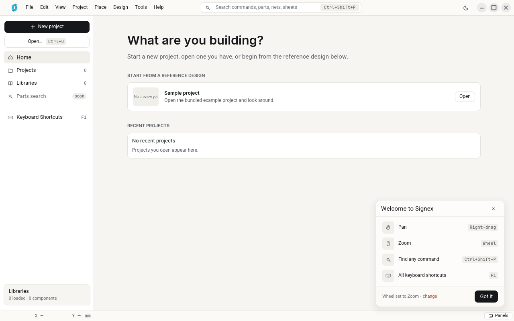
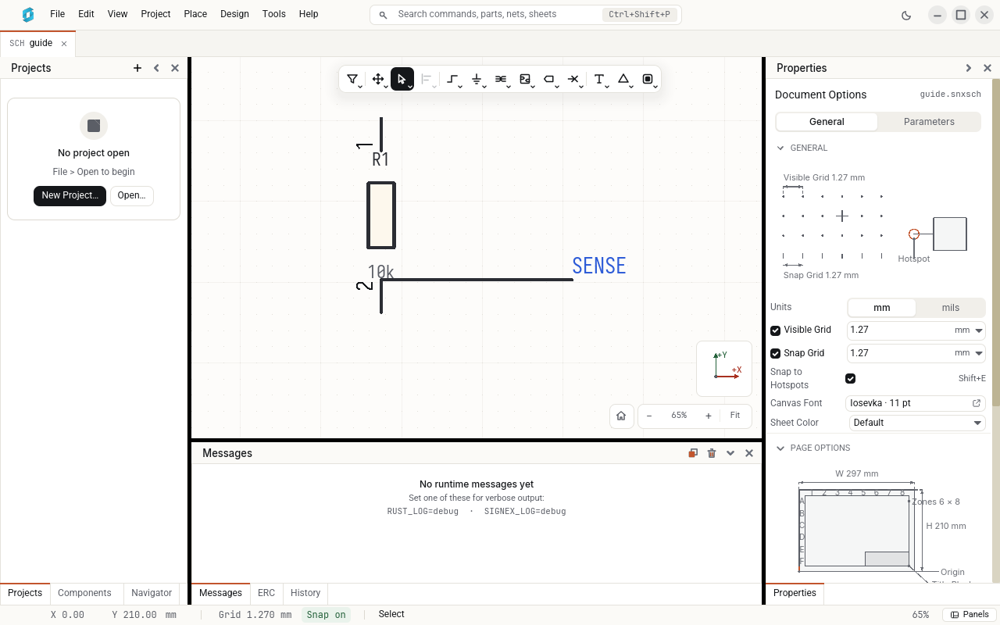
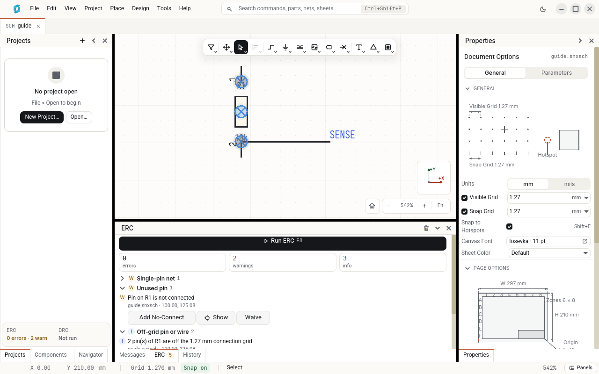

# Signex user guide

This guide takes you from a downloaded Signex package to a saved schematic
and an exported PDF, and then from that schematic to a routed board and the
files a board house needs. It assumes you have never used an EDA tool and have never
installed Rust. You do not need either.

<!-- The screenshots in this guide are rendered headlessly, not captured by hand.
Regenerate assets/screenshots/guide-*.png with:
cargo test -p signex-app --test guide_screenshots -- --ignored
(needs a GPU adapter; the test skips itself without one). -->

It describes the application as it is on the `trunk` branch. Where a step
depends on work that has not shipped yet, the guide says so and links the
tracking issue. Menu paths are written `Menu ▸ Item`.

Contents:

1. [Install](#1-install)
2. [First launch](#2-first-launch)
3. [Create a project](#3-create-a-project)
4. [Canvas basics](#4-canvas-basics)
5. [Place a symbol](#5-place-a-symbol)
6. [Wire](#6-wire)
7. [Label a net](#7-label-a-net)
8. [Annotate](#8-annotate)
9. [Run ERC](#9-run-erc)
10. [Save](#10-save)
11. [Export PDF and BOM](#11-export-pdf-and-bom)
12. [File types](#12-file-types)
13. [Keyboard shortcuts](#13-keyboard-shortcuts)
14. [Where to get help](#14-where-to-get-help)
15. [Preferences](#15-preferences)

For the whole flow in one pass, see the
[walkthrough](#walkthrough-a-saved-schematic-with-a-wired-symbol).

The board chapters follow the walkthrough:

- [Board 1. Create the board from the schematic](#board-1-create-the-board-from-the-schematic)
- [Board 2. Outline, layer stack and the Layers panel](#board-2-outline-layer-stack-and-the-layers-panel)
- [Board 3. Place the parts](#board-3-place-the-parts)
- [Board 4. Route and pour copper](#board-4-route-and-pour-copper)
- [Board 5. Design rules and DRC](#board-5-design-rules-and-drc)
- [Board 6. Fabrication outputs](#board-6-fabrication-outputs)

## 1. Install

Follow the [Download section of the README](../README.md#download). It lists
the package for each platform, the first-launch warnings on Windows and macOS,
and how to verify a download. This guide does not repeat it. A release
candidate such as `v1.0.0-rc.1` (or `v26.11.0-rc.1`) is a GitHub pre-release: get it from the
[Releases page](https://github.com/alplabai/signex/releases), because the
"latest release" link skips pre-releases.

## 2. First launch

Start Signex. With no document open you see a start screen with four
buttons:

- **New Project**
- **Open Project…** (with its keyboard shortcut shown next to it)
- **Open Sample Project**
- **Keyboard Shortcuts (F1)**



On your very first launch a small card titled **Welcome to Signex** also
appears in the bottom-right corner of the window. It lists the three gestures
you need immediately:

- Right-click + drag to pan
- Scroll to zoom
- F1 for keyboard shortcuts

Close it with the ✕ in its corner or with `Esc`. It is a reminder only; nothing
else changes when you dismiss it.

`F1` (or **Help ▸ Keyboard Shortcuts**) opens a reference of every binding in
the active shortcut profile.

## 3. Create a project

Choose **File ▸ New Project** (or press **New Project** on the start screen).

The **New Project** dialog opens. Nothing is written until you press
**Create project**.

- **Project name** starts as `Untitled`, selected so you can type over it.
  A name cannot contain `\ / : * ? " < > |` or end with a dot or a space.
- **Location** is the folder the project goes in: beside the open project's
  folder, else a `Signex` folder in your documents folder. **Browse…** picks
  another one; the folder must already exist.
- **Create "<name>" folder** (on by default) puts the project in a new folder
  `<location>/<name>/`. Turn it off to create the project directly in a
  folder you already made.
- **Start from a profile** sets the board rules: the fab tiers
  **Standard** (the default), **Advanced** and **HDI**, or **Custom**. The
  copper layer count is a separate stepper on each card. Hover a card and
  press the pencil to edit a built-in profile; **Reset to default** in its
  menu brings the shipped values back. **Customize settings** opens the values
  behind the profile: the **Fab tier** (or **Import rules…**), copper layers, board
  thickness, clearance, track width, via size and drill, and the schematic's
  sheet size, orientation, title block and designators. The **Preview** shows
  the stack-up and sheet you will get. You can change all of it later in
  Project Options.

Press **Create project** (or Enter) to create the project; **Cancel** or Esc
closes the dialog and writes nothing.

Signex writes these files into the project folder:

| File | What it is |
|---|---|
| `<name>.snxprj` | The project file, holding the setup you chose and the project's rules. Signex builds the project from the files in the folder. |
| `<name>.snxsch` | A blank schematic sheet with the sheet size and title block you chose (A3 by default). |
| `.gitignore` | A Signex-managed block of patterns for files that should not be versioned. |

A folder that holds only OS files such as `.DS_Store`, `Thumbs.db` or
`desktop.ini` counts as empty. The dialog checks the target while you type,
and **Create project** stays unavailable, with the reason shown, when:

- the location is empty or does not exist;
- the project file is already there;
- the project folder `<location>/<name>/` already exists and is not empty;
- the folder already contains a `.snxprj` (open it with **File ▸ Open…**
  instead; the dialog accepts `.snxprj` and `.snxsch`);
- the project would sit inside another project's folder (a folder `<name>/`
  that holds `<name>.snxprj`; a loose `.snxprj` in your Desktop or home
  folder does not count).

If the write itself fails, the dialog stays open with your setup and says
why. On success it closes, the project loads and the blank schematic opens in
a tab, ready to draw on.

**Enable Version Control** refuses to start a git repository in your home
folder, in Desktop, Documents or Downloads, in a filesystem root, in a folder that holds more than this one project, or in a folder
that has other projects in its subfolders (two levels are checked). A folder
that cannot be fully read is refused too. Such a repository would commit
every file in the folder. Move the project into its own folder first. A
project that already lives in a shared folder still opens normally.

The dialog lists the project's files and library folders, all ticked; untick
one to keep it out of the repository (it goes into `.gitignore`), or click
**Select all** to tick every row again. **First commit message** is the
subject of the repository's first commit, "Initial version of" and the
project's name until you change it; **Enable** waits while it is blank.
**Commit every save** (on by default) commits each later save of a project
file. Turn it off to create the repository without that: saves are then not
committed until you turn it on in the Project tab's Version control section.

**Rename** shows the file's name without its extension, which stays as it is.
Renaming a sheet that sheet symbols of the same project place says so, and
those symbols are pointed at the new name. A name another file of the folder
already has is shown at once, and **Rename** waits for a different one.

To come back later use **File ▸ Open…** or **File ▸ Open Recent**.

> **Sample project.** **Help ▸ Open Sample Project** (or the button on the
> start screen) opens a small bundled design, a linear regulator. Signex copies
> it into your per-user configuration folder the first time, so your edits to it
> are kept. A copy that is already there is never overwritten, so one opened
> before an update keeps its old layout until you delete its folder under the
> app configuration directory.

## 4. Canvas basics

- **Pan:** hold the right mouse button and drag. The middle button also pans.
  A right-click without dragging opens the context menu, unless you are in the
  middle of drawing a wire, where it cancels the wire.
- **Zoom:** scroll the mouse wheel. Zoom is centred on the pointer.
- **Fit the sheet:** **View ▸ Fit All**.
- **Grid:** the status bar at the bottom shows the grid size and whether
  snapping is on (**Snap**) or off (**Free**). Click the grid value to show or
  hide the grid, and click **Snap/Free** to switch snapping. **View ▸ Toggle
  Grid** does the same as the grid click. Placed objects snap to the grid
  while snapping is on.

**View ▸ Cycle Grid Size** steps the grid of the schematic. In the Altium
profile `G` (forward) acts only in the footprint editor, while `Shift+G` steps
the grid backward on a schematic too. In the Classic profile `N` / `Shift+N`
cycle it on a schematic. The menu item runs `next_grid`, so it works on a
schematic and a PCB in either profile. **View ▸ Zoom In** and **Zoom Out**
zoom about the centre of the view. `PageUp` / `PageDown` (Altium profile) or
`F1` / `F2` (Classic profile) and the scroll wheel zoom about the pointer.

**Fast grids.** The Fast grid 1 and Fast grid 2 commands snap to two grids
you choose in **Tools ▸ Preferences… ▸ Editing ▸ Grid** (1.27 mm and 2.54 mm
out of the box). Each field shows the grid in mil as you type, and a value
that cannot be a grid (not a number above zero, or finer than 1 nm) is marked
on its row with the reason; Save refuses it until you fix it. The snap preview
under the fields draws Fast grid 1 as dots and Fast grid 2 as rings. Click a
pitch on the drawing to type it (Enter commits, Tab moves to the other pitch,
Esc cancels), or drag its handle; the field follows, and the other way round.

**How the canvas looks.** **Tools ▸ Preferences… ▸ Appearance** holds the
theme (Graphite Light or Graphite Dark), the UI font, the interface scale,
the grid style of the schematic and of the symbol editor (dots, lines or
small crosses, shown side by side in the grid preview), the symbol editor's
default grid, pin selection, the GPU render and anti-aliasing, the mouse
wheel (Zoom or Scroll), two-finger scroll panning and zoom speed. A setting
marked **Restart** applies the next time Signex starts.

## 5. Place a symbol

A symbol is a part on the sheet: a resistor, a connector, a chip. Symbols come
from libraries.

**Libraries.** The Components panel (**View ▸ Components**) lists every
mounted library in one list. Each row has an expand chevron, the library name,
a badge for where it comes from (**STOCK**, **PROJECT**, **INSTALLED** or
**GLOBAL**) and its component count; expanding it lists its components. The
list runs Stock first, then Project, Installed and Global. Chips under the
search box (**All** and each source that has a library, with its library
count) narrow the list to one source. The **Stock** library ships with
Signex. It is mounted on every launch; you do not add it, and its parts can be
placed (34 component rows: resistors, capacitors, inductors, diodes, LEDs,
transistors, connectors, 74HC logic and more). If the installer's copy cannot
be found, the list says "Stock library not found. Reinstall Signex to restore
the bundled parts." when you pick the Stock chip. The **+ Add** button in the
panel header asks where to add a library (**Project**, **Installed** or
**Global**), and **File ▸ Library ▸ Open Library…** mounts a `.snxlib`
library. Type in **Filter components…** to narrow the components. Clicking a
part row opens its Component Preview tab.

The stock library is read-only. Opening one of its **symbols** or
**footprints** for editing does not open the original: the first time, a
**Copy to Library** dialog lists the writable libraries. A click on a library
copies into it at once (or **New Library…** creates one); Signex remembers the
choice and opens the copy for editing under the stock name. The stock original is never changed. If no
writable library is open, the dialog says so and offers **New Library…**.

**Pick Symbol** (and Pick Footprint, Pick Sim Model) binds a primitive to a
component row. The list is grouped: each open library, then each library that
holds one of the project's symbol files but is not open ("In library …
(not open)"), then "Not in a library". A click on a row picks it. A symbol of
a library that is not open asks **Link without copying** (the library opens
and the row points at its symbol, so the link breaks if that library is not
open) or **Copy into** the row's library. A symbol in no library can only be
copied; the original file stays as it is. **Cancel** goes back to the list.

**Typed values and the range filter.** A measurement such as a resistance or a
capacitance is a number, an SI prefix and a unit, each chosen separately: you
type the number, pick the prefix (`k`, `µ`, ...) from a list, and the unit is
fixed by the part's template or picked from a list. You do not type the unit,
and `4k7` or `4.7uF` in the number field is refused with a message. The
Library Browser opens the **Edit Component Details** modal for a measurement
cell, and the component editor's **Parameters** tab edits the same way. In the
modal the number and its prefix list form one field; a unit this version does
not know is shown as written and kept. Parameters that come from the class
template are marked **template** and cannot be removed there; your own
parameters keep their **✕**. If the **Internal PN** you type is already used by
another component in the library, the field turns red, says which table has
it, and the footer counts the problem; **Save** waits until the PN is unique.
A save the library refuses shows its reason in the same footer spot. In the
Library Browser and in the **Place Component** picker, **Add range filter…**
filters a measurement column with an operator (`≥`, `≤`, `=` or `between`), a
number and a prefix, compared in base units, so 4.7 kΩ and 4700 Ω match. Rows
whose cell is not a measurement in that unit are left out, and the filter says
how many ("N excluded: not a measurement in Ω."). **✕** removes the filter.

To place a part, open a schematic sheet, then either:

- choose **Place ▸ Component…** (or **File ▸ Library ▸ Place Component…**,
  `P` then `P` in the default profile (`A` in Classic), or the Active Bar's
  **Part** button, which all open the same picker), select a part and press
  **Place**, or press `Enter` in the search field; or
- press **Place** at the end of a part's row in the Components panel.

The picker's header counts the open libraries and their parts. Its search
field and **Add range filter…** share the top row, and the list shows each
part's internal PN, lifecycle state, MPN and description.

The part attaches to the cursor and follows it on the grid. While it is
attached:

- **Rotate and mirror** it with the keys that rotate and mirror a selection
  (section 13: `Space` rotates in the default profile; `X` and `Y` mirror). They
  turn the part on the cursor, not whatever is selected on the sheet.
- Press `Tab` to pause placement and open the pre-placement properties in the
  Properties panel: the value, the designator and the rotation. **Resume**,
  `Enter` or the form's **OK** goes on placing with your edits. `Esc` goes on
  placing without them: the part keeps the values it had when you pressed
  `Tab`, and stays on the cursor. A second `Esc` lets go of it.
- The Position X and Y in that form follow the cursor. Type a position (in
  the panel's unit; Y counts from the sheet's page origin) and press **OK** or
  `Enter`: the next object is placed there without a click. A field that is
  not a number is outlined and **OK** places nothing until it is fixed or
  cleared. `Esc` drops a typed position with the other edits and places
  nothing. The wire tool takes a Start and an End and places one straight
  wire between them. A typed position is used once; the object after it
  starts from the cursor again. Every placement tool has this form.
- Click to place it. One click is one **Undo** step. The part stays on the
  cursor, and each further click places another copy with the next free
  designator (R1, R2, R3...). A designator typed in the `Tab` form is used for
  the next click and then counts up from it. If that designator is already on
  the sheet, the click uses the next free one and the Messages panel says so.
  A blank value in the `Tab` form is ignored: the part keeps its value.
  Pressing on the sheet while a part is on the cursor always places it; it
  never moves or selects what is already there.
  A part with several units places unit 1 under a new number at each click.
- Press `Esc` or right-click to let go of the part.

The part belongs to the sheet that was showing when you picked it. Switching to
another tab, or closing the sheet, lets go of it, and a click on another sheet
never places into it. A sheet written by a newer Signex is read-only in this
build: Signex says so in the Messages panel and does not attach the part. With
no schematic open, Signex shows a **Place Failed** notice instead.

### Normal and alternate (De Morgan) bodies

Some library symbols, mostly logic gates, have a second body that draws the
same part in its De Morgan form. Select a placed symbol and use the **Body**
row of **Properties**: **Normal** or **Alternate (De Morgan)**. The row is
read-only, with a tooltip, when the library symbol has no alternate body. A
symbol that stores Alternate but whose library symbol has none reads
"Alternate (not in symbol; drawn as Normal)" and can be set back to Normal.

Switching body redraws the symbol, and the netlist, ERC, exports and
hit-testing all follow the body shown. Pins that are not wired may move.
Signex refuses the switch, and says why in the **Messages** panel, when a
wired pin would be lost, moved, or land on a new connection; remove those
wires first. One **Undo** reverts a switch.

In the symbol editor, the toolbar **Body** buttons (**Normal**, **Alternate**)
choose which body is shown and which body new pins and shapes are added to.
**Both bodies** marks the selection as common to both; **This body only**
pins it to the body shown. Updating a library symbol from its library never
silently drops a placed symbol's Alternate choice: the update is refused when
it would disturb a wired pin, and otherwise the choice is kept.

**Datasheets.** A part's Component Preview tab has a **Datasheet** tab that
holds one or more documents: a datasheet per manufacturer, an errata, an
application note. Each document is a URL or a pinned PDF, with an optional
label. **Add document** appends one; **Make primary**, **Up**, **Down** and
**Remove** reorder and remove them. The first document is the primary: it is
the one the schematic treats as the part's datasheet. Selecting a placed part
lists all of its documents in the Properties panel. A document left empty is
not saved.

**Library updates.** When a schematic opens and some of its placed parts are
older than their library rows, a library in the Personal workflow updates them
silently, except a part with a conflict (below). Otherwise **Library Updates
Available** opens, with a pill per change size (major, minor, patch) beside the
count. Its table lists each part: the designator and Internal PN, the library,
the version change (`1.4.2 → 2.0.0`) and a **Major**, **Minor** or **Patch**
pill. Patch changes start ticked, minor and major changes unticked. Parts that
share one library symbol share one tick. The checkbox in the table heading
ticks every row, or clears them all when every row is ticked. When both your
part and the library row changed a field, a line under the part shows
**yours** and **library now**; choose **Keep mine** (the default) or **Use
library value**, and answering ticks the part. **Update Selected Components**
updates the ticked parts, each answer in the same **Undo** step as its part;
**Skip All** and **Cancel** close without updating.

**Copy and paste.** Select items and use **Edit ▸ Copy** or **Edit ▸ Cut**,
then **Edit ▸ Paste**. The copy attaches to the cursor, centred on it and
snapped to the grid. The rotate and mirror keys turn the whole group about the
cursor (a single pasted part turns about the cursor too, not about itself), a
click places it as one **Undo** step, and the paste then ends: paste again to
place another copy. `Esc` or a right-click drops it. A pasted part keeps
its designator unless the project already uses it; then it takes the next free
number (a pasted `R2` becomes `R3`, the original stays `R2`), and the units of
a multi-unit part stay together. An unannotated `R?` stays `R?`. The
**Designators on paste** preference can instead keep every designator, reset
them to `R?`, or always take the next free number. The
copy carries the library symbols its parts use, so it can be pasted into another
sheet; if that sheet already holds a different version of one of those symbols,
Signex says so in the Messages panel and the pasted parts use the sheet's
version. A group of more than 60 items follows the cursor as an outline.
**Edit ▸ Paste Special** (`Ctrl+Shift+V`) opens the **Smart Paste** dialog:
place one copy at an offset (in mm) or an array of copies with a step, give the
parts the next free designators or keep theirs unless the project already
uses one (a taken designator takes the next free number), and keep the
net labels (the pasted nets join the originals) or rewrite them with a pattern
such as `${Net}_${n}`; power nets are never rewritten. The drawing on the right
shows where the copies land, and you can drag the first copy to set the
offset. **Paste** puts every copy on the cursor; one click places them all as
one **Undo** step, and `Esc` cancels. A sheet written by a newer Signex is
read-only in this build, so nothing is pasted into it.

### Unions

A union is a named group of objects on one sheet. Select the objects and press
`Ctrl+G` (or right-click ▸ **Unions ▸ Create Union…**), type a name and any
tags, and press **Create**. On the sheet a union shows as a dashed outline with
its name on a tab; clicking any member selects the whole union. The **Unions**
panel (**View ▸ Unions**) lists the unions of the sheet or of the whole
project, filtered by name or `#tag`; each row selects, locks or hides its
union. A locked union's members cannot be moved, turned, edited or deleted
until you unlock it. Hiding fades the members on the canvas only: printing and
exporting are unchanged, and hiding is not an undo step. Details:
[SCHEMATIC_UNIONS.md](SCHEMATIC_UNIONS.md).

**Paste array** (from the command palette, `Ctrl+Shift+P`) places many copies
of what you copied in a row or grid. Set **Copies** (up to 1000) and the X and
Y **Spacing**, typed in the display unit; copy *k* sits *k* spacings from the
copied original. Under **Numbering**, **Count up label numbers** moves the
numbers in labels by the **Text increment step** per copy, and **Designators**
chooses what the copies' parts are numbered, as the **Designators on paste**
preference does. The preview draws the first copies on the sheet grid, with the
spacing marked. **OK** places every copy as one **Undo** step. The dialog closes
if you switch to another sheet.

## 6. Wire

Wires connect pins and each other.

1. Choose the wire tool: **Place ▸ Wire**, or the keyboard shortcut. In the
   default profile (see [section 13](#13-keyboard-shortcuts)) press `P` then
   `W`, one after the other, or press `Ctrl+W`. With the Classic profile press
   `W`.
2. Click on the sheet to start a wire.
3. Click again to end the segment. Each click commits a segment and starts the
   next from the same point.
4. Double-click to stop drawing. `Esc` or a right-click cancels the wire you
   are drawing.

Wires snap to the grid while snapping is on. The status bar shows the active
tool.

Once you have placed parts (section 5), connect the wires to their pins.

A pin end placed or moved onto the middle of a wire joins it: Signex adds a
junction dot there. It adds none where the dot would join two of the part's
own pins, or where wires of different nets meet (overlapping, crossing, or
one ending there with no dot); in that case Messages names the pin and both
nets. A sheet saved by an older Signex or
another tool may have pins that touch a wire with no dot, which are not
connected. Signex leaves them as they are when it opens the sheet, and
Messages says how many there are. Choose **Tools ▸ Repair Pin Junctions** for
the sheet in view, or the link on that Messages row for the sheet it names, to
add their dots in one undo step.



## 7. Label a net

A net label gives a wire a name. Wires with the same net label on the same
sheet are connected, even if they are not drawn touching.

A net label connects only on its own sheet. Two net labels named `SDA` on two
sheets are two separate nets. To connect across sheets, use a Port (a global
name, joined everywhere in the project) or a sheet entry wired to a pin on the
parent's sheet symbol. This is fixed; there is no setting for it. ERC warns
with "Local label name on other sheets" when the same net label name appears on
more than one sheet.

To follow a net across sheets, select a port, global label, hierarchical label
or sheet entry and run **Go to net partner on another sheet** from the command
palette; run it again to cycle through the other ends. The highlight commands
keep a net bright on every sheet while the rest fades, and step through its pins
and labels. Resting the pointer on a wire, pin or label shows its net, class and
pins (Preferences ▸ Editing ▸ Show net info on hover turns it off). See
[NET_NAVIGATION.md](NET_NAVIGATION.md).

1. Choose **Place ▸ Net Label**, or press `P` then `N` in the default profile
   (`L` in the Classic profile).
2. Click where you want the label. It is placed with the default text `NET`.
3. Press `Esc` to leave the tool, then double-click the label, type the new
   name, and press `Enter`.

### Editing text in place

Double-click a part's designator or value to edit it where it sits: type, then
press `Enter` to apply (one undo step) or `Esc` to cancel. The same editor opens
from the keyboard on the object under the pointer, or on the one selected part:
`F2` (Default profile) edits a label, a text note or a part's designator; the
Classic profile has `U` for the designator, `V` for the value and `F` for the
footprint. A part's footprint has no text on the sheet, so its editor opens at
the part. A command with nothing to act on says so in the Messages panel.

### Editing a wire or a text note in Properties

Select one wire or bus and its **Location** shows **Start** and **End**, each
an X / Y row in the panel's unit (Y counts from the sheet's page origin), and
the **Length** they make. Type a value and press `Enter`: Start moves only the
start point and End moves only the end point. The other end stays where it is,
wires attached at the moved end do not follow, and a straight wire may turn.
Each value is one undo step, and Length follows. A new end on another wire
gets a junction, as a drawn wire does.

Select one text note and its **Text** box takes several lines (`Enter` starts
a new line). What you type is applied as one undo step when the box loses
focus (`Esc`, or a click outside it), on `Ctrl+Enter`, or when you select
something else. Moving the pointer out of the box applies nothing. Typed text
is never lost: a save, a tab switch or closing the tab applies it to its own
sheet first. **Rotation** (0°, 90°, 180°, 270°) and **Justify H** / **Justify
V** are switches; a click sets the value at once, one undo step each.

### Editing several objects at once

With more than one object selected, Properties lists the fields they share, a
group each for parts, labels and wires. A value the objects disagree on reads
`<mixed>`. Type a new value and press `Enter` (or flip a checkbox) to set it on
every object of that group in one undo step. Parts offer value, footprint, DNP,
In BOM, On board and their custom parameters; labels size, justification and
rotation (0, 90, 180 or 270); wires width, picked from the Smallest, Small,
Medium and Large presets or typed as an Exact Width in the panel's unit. Label
text is not edited in bulk,
because giving labels one name would merge their nets. Value, footprint and
parameter edits skip locked parts and the Messages panel says which; DNP, In BOM
and On board apply to locked parts too. An empty parameter value removes that
parameter from every selected part.

### Bus labels

A bus carries the signals its label names. Put a label on the bus (anywhere
along it) with one of these forms:

| Label | Signals it carries |
|---|---|
| `D[0..7]` | `D0`, `D1`, ... `D7` |
| `D[7..0]` or `D[7:0]` | the same eight signals, written high to low |
| `{SDA SCL}` | `SDA` and `SCL` (a group; items are separated by blanks) |
| `{A[0..1] CLK}` | `A0`, `A1` and `CLK` (a group may hold ranges) |

Numbers are plain unsigned integers without leading zeros (`D03` is not the same
signal as `D3`), and matching is case-sensitive (`d3` is not `D3`). There is no
space around the numbers or around
the label, a range needs a name before the `[`, and nothing may follow the `]`
(`D[0..7]A` is refused). A bare name such as `VCC`
is a net label, not a bus label.

Unlike wires, which need a junction dot to join at a T, bus segments join wherever
one ends on another (at its end or along it), dot or not. A bus never joins its
signals together. A wire that leaves the bus through a
bus entry connects to a signal only through its own net label, so label each
entry wire with one signal of the bus (for example `D3`). ERC checks this, see
section 9.

### Buses across sheets

A sheet pin, a Port (global label) or a hierarchical label can carry a bus: name
it with a bus label such as `D[0..7]` and place it on a bus. The signals join
one by one, never the bus as a whole:

- A bus sheet pin joins the hierarchical label or Port with the same bus name on
  its child sheet. `D[0..7]` and `D[0..3]` are the same bus at two widths; the
  signals both name (`D0` to `D3`) join, and ERC reports the width mismatch,
  naming the pin and the port.
- A Port bus joins every Port bus of the same name in the project, signal by
  signal. ERC reports a Port bus that appears at two widths in the project
  (`D[0..7]` and `D[0..3]`), since only the shared signals join.
- A local net label bus never leaves its sheet.

A signal joins through the net label on its bus-entry wire, so each side needs
its entry wires labelled. A group (`{SDA SCL}`) joins only a group with the same
content. Still to come: a bus joined to another bus by geometry across sheets,
and bus-aware rendering of the pin (see #1049).

### Net colours

The net colour palette (`F5` in the default profile, or **Net Color...** in the
sheet's right-click menu) lists every net label name on the active sheet,
coloured nets first, then by name. Type in **Filter nets** to narrow the list.
Click a row to open its chooser: a swatch colours the wires and junctions of
that net, **Clear** takes the colour off, and **Custom…** opens the colour
picker (swatches, R / G / B, **Hex**, and the old and new colour side by side).
**Use Color** colours the net on the sheet the picker was opened from; if
another sheet is active by then, nothing changes and the Messages panel says
so. **Clear all colours** at the foot of the palette clears the active sheet
only. Each colour change is one **Undo** step and is saved with the sheet. A
sheet written by a newer Signex is read-only in this build and keeps its
colours.

## 8. Annotate

Annotation gives every symbol a unique reference designator such as `R1`, `R2`.
It acts on placed symbols, so with none on the sheet there is nothing to
annotate (section 5).

- **Tools ▸ Annotation ▸ Annotate Schematics…** opens the annotation dialog.
  Its right side lists the proposed changes (current and proposed designator
  for each symbol). Press **Accept Changes** to apply them, then **Close**.
- **Tools ▸ Annotation ▸ Annotate Schematics Quietly** (`Alt+A`) applies the
  changes without opening the dialog.
- **Reset & Renumber** in the dialog, or **Force Annotate All Schematics**
  (`Shift+Alt+A`), renumbers everything from scratch.

By default a placed part takes its reference letters from the library symbol
(`U?`, `R?`). A project can instead follow a designator standard: right-click
the project in the Projects panel and choose **Project Options...** (or press
the gear on the project's card at the top of the panel), then pick a
**Designator standard** (IEEE 315, DIN 40719-2, EN IEC 81346-2 or EN IEC
81346-2 (full codes)). New parts then get the standard's letters for their
component class, for example a diode is `D` under IEEE 315 and `V` under DIN
40719-2. Power ports and flags keep their `#` references, and a class the
standard does not name (such as Generic, or a crystal under EN IEC 81346-2)
uses the symbol's own letters. EN IEC 81346-2 uses its single-letter main
classes. EN IEC 81346-2 (full codes) uses the three-letter class codes, for
example `QAC` for a transistor, and each code is numbered on its own
(`QAC1`, `QAC2`). The project stores `QAC1`; the schematic and PCB canvases,
the BOM, the netlist, the PDF and the board and fabrication outputs
(IPC-2581, ODB++ and the board STEP model included) show it with the
product-aspect sign, `-QAC1`. The IPC-D-356 test netlist is the exception: it
writes `QAC1`, because its 6-character field would cut `-QAC100` into
`-QAC10`. Typing `-QAC9` as a reference stores `QAC9`. A spreadsheet program
may read a pick-and-place or BOM CSV cell that starts with `-` as a formula;
import the file as text, or set the designator column to text, to keep
`-QAC1`. The codes for display (`PH`), sensor (`B`) and battery (`GBA`) are
provisional and may change. The letters and the pages of the standards they
come from are listed in
`docs/architecture/designator-standards.md`. Editing a reference by hand always
wins, and **Library designator** switches the project back to the default.
The choice is saved in the project file when you save the project.

Parts that are already placed keep their prefix when the standard changes.
**Re-prefix to standard** in the Annotate dialog applies it to them (the button
is disabled while the project follows no standard). It first shows a list of
the changes (each part's old and new prefix, how many parts across how many
sheets, and how many parts stay as they are); nothing changes until you press
**Re-prefix**, and Cancel or Esc changes nothing. Confirmed, every part gets the
standard's letters for its class and is renumbered, across the whole project,
as one undo step: **Ctrl+Z** on any sheet the run changed undoes it on all of
them (the Messages panel names those sheets; on a sheet the run did not change,
Ctrl+Z undoes your previous edit instead). Sheets that are not open are loaded
in memory and stay unsaved like any edited sheet: nothing is written to disk
until you save, and undo reverts them too. If a sheet cannot be read, the run stops
before anything changes and the Messages panel names that sheet; fix it and
press the button again. If one sheet cannot be converted while numbering, the
whole run is undone and cannot be redone.

The component class comes from the library row the part was placed from, which
the sheet file stores. For a part on a sheet saved before the file kept that
link, the row is found through its library symbol instead: when every mounted row
binding that symbol has the same class and prefix override, that is the
answer (the list marks such parts "matched by symbol"); when they disagree the
part is left alone.

A part is left alone, and listed in the Messages panel, when it has a locked
unit (the lock column, or the symbol's own lock), sits on a read-only sheet,
was not placed from a library row, comes from a library that is not mounted or
whose row is gone, has a per-placement designator, or carries a prefix you
typed yourself. A prefix counts as typed by you when it is one that no
standard, no library row override and no library symbol would issue for that
part. That is all that is detected: a prefix you typed that happens to equal
one of those letters cannot be told apart from an issued one and is rewritten,
which is why the confirm list shows every change first. Power ports and flags
are never touched. The PCB is not updated: its references keep the old
designators, as after Annotate.

A library row can pin its own letters with a text parameter named
`designator_prefix` (ASCII letters only, for example `ZD`; it is upper-cased).
It beats the standard for new placements and for Re-prefix, but never a
reference you edited by hand, and never a `#` power part. A value that is not
letters only (digits, spaces or `#`) is ignored and reported in the Messages
panel. The parameter editor does not offer a way to name a custom
parameter yet, so the key has to be set in the row data directly.

Parts of the dialog are marked in the dialog itself as not active yet (the
multi-sheet columns and the parameter-matching checkboxes).

### Find and Replace

**Edit ▸ Find** (`Ctrl+F`) and **Find and Replace** (`Ctrl+H` in the Altium
profile) search the text of labels, text notes, designators and values. The
**Find / Replace** switch in the dialog's header changes between the two in
place. The pill inside the Find field counts the matches. The three toggles
beside it choose how the text matches:

- **Match case** (`Aa`): upper and lower case differ. Off, case is ignored.
- **Whole word** (`ab`), on by default: a match may not touch a letter, digit
  or `_` on either side, so `VOUT` does not find `VOUT_3V3` or `VOUT_SENSE`.
  Turn it off to find text inside longer names.
- **Regular expression** (`.*`): the Find text is a regular expression, and
  the replacement may use its groups (`$1`, `${name}`). An invalid expression
  marks the field and finds nothing. An expression is used as typed, spaces
  included; plain Find text drops the spaces at its ends.

The **Scope** switch chooses how far the search reaches:

- **Sheet** searches the active sheet only.
- **Project** searches every sheet of the project, including sheets you have
  not opened. A sheet that cannot be read, or that was written by a newer
  Signex and is read-only in this build, is not searched; a warning line under
  the results says so and the Messages panel names it.

Results are grouped by kind (Net Label, Text Note, Designator, Value), each
with its matches highlighted and its sheet in the right-hand column. Click a
result to open its sheet and zoom to the item; the footer reads "Match 2 of 5".
`F3` steps to the next result and `Shift+F3` to the previous one (in both
profiles), wrapping at the ends. A sheet placed more than once shows one
designator result per placement, labelled "placement 2 of 3".

In Replace mode every result has an include box, all set at first, and shows
what it becomes (`VOUT → VOUT_3V3`). The primary button counts the included
results ("Replace 1 of 5") and replaces only those; a cleared row stays as it
is. Changing the Find text, a toggle or the scope sets every box again.
**Replace Current** replaces the selected result.

**Replace Current** and **Replace All** replace only the matched text, not the
whole field. A Replace All is one undo step; in **Project** scope `Ctrl+Z` on
any of the changed sheets reverts every one of
them together. If one of those sheets was edited afterwards, the undo is
refused and the Messages panel names the sheet; undo the newer edit first.

A replace never writes a sheet you have not opened. It loads the sheet, changes
it in memory and leaves it unsaved, like any other edit, so save it (or discard
it) when you are ready. The Messages panel logs "Replaced N on M sheets" and
names them. The text replaced is always read from the sheet as it is when you
press Replace, never from the search results, so an edit made after the search
is not overwritten with stale text. If you open, save or close a document, or close the
project, while a project Replace is still reading the sheets, it is cancelled with a
Messages line and changes nothing; run it again.

### Find Similar Objects

**Edit ▸ Find Similar Objects...** (`Shift+F`, or the right-click menu) starts
from the object under the cursor, or the one selected object. The dialog lists
its properties with the object's value for each, and a **Same** / **Any**
choice: **Kind** starts at Same and the rest at Any, so at first every object
of the same kind matches. A placed part reads as **Part**. **Current sheet**
counts the matches on the sheet; **Whole project** also counts them on the
project's other sheets, including closed ones. **Select N** selects the matches
on the dialog's own sheet; matches elsewhere are only counted. Opened on a
board, it searches that board.

### Search everywhere

The command palette (`Ctrl+Shift+P`) is also the project's search box. Type a
designator, a net name or a sheet name and the palette lists, besides the
commands and panels:

- **Designators** from every sheet of the project, including sheets you have
  not opened. A sheet placed more than once gives one row per placement,
  labelled "placement 2 of 3".
- **Nets**, from the project's connectivity. A net's row jumps to one of its
  terminals.
- **Sheets**: child sheets that the project's page list does not name, and a
  row for each placement of a sheet that is placed more than once. A page
  placed once is already listed as a file.

Choosing a row opens its sheet at that placement, selects the item and zooms
to where it is now. This only moves the view; nothing in any document changes.

The designator, net and sheet rows come from an index the palette builds in the
background when it opens, so for a moment after opening it may show only the
active sheet's designators. The index is rebuilt when documents change, and
rows from the index of a different project are never shown. If a row points at
a sheet that has since been renamed or deleted, the Messages panel says it
could not be opened and nothing else is opened in its place; if the symbol is
gone but the sheet is still there, the sheet opens and the Messages panel says
the item is no longer on it.

## 9. Run ERC

ERC (electrical rules check) scans the design for wiring mistakes, such as
pins that connect nothing or two outputs wired together.

1. Press `F8`. This runs the check on the project immediately.
   Alternatively choose **Project ▸ Electrical Rules Check**, which opens a
   dialog where you can set the severity of each rule and press **Run ERC**.
2. The **ERC** panel opens with the results. Its header shows the number of
   errors, warnings and info items, and `<` and `>` step through them.
3. Each row shows a severity letter (`E` error, `W` warning, `I` info), the
   rule, the message, and the sheet and position. Click a row to jump to the
   item on the canvas. The button at the end of a row either says **Show on
   Canvas** or, for an unused pin, **Add No-Connect**, which places a
   no-connect marker on that pin.
4. **Clear** empties the list.

Besides wiring mistakes, ERC runs completeness checks (a part with no
footprint or value, an unannotated designator, a single-pin net, a net with no
driver, an off-grid pin), and a finding you accept can be **waived** with a
reason instead of switching its rule off. The rules, their default severities
and the waiver rules are in [ERC_RULES.md](ERC_RULES.md).

ERC also checks buses (section 7): a wire from a bus entry with no net label,
a label that is not one of the signals the bus carries (for example `D33` on
`D[0..7]`), a bus with no valid bus label, a label on a bus that looks like a bus
name but is malformed (such as `D[0 .. 7]`, anywhere along the bus), and two names
on one bus that carry
different signals (`D[0..7]` and `D[8..15]`) are each reported as warnings. A
bus-name label placed on a wire instead of a bus is also a warning: it still
names that wire's net, which is almost always a mistake.

The **Messages** panel (**View ▸ Messages**) is the application's runtime
log, not the ERC results. Read ERC results in the ERC panel.

Before you run the check the panel shows "No ERC diagnostics yet". Run `F8`
again after each round of edits. Until you do, the panel keeps the last run's
results and warns "Results may be out of date": a finding whose part, wire or
label you have deleted disappears from the panel and the sheet, and **Undo**
brings it back. A wire that was split or merged can still show or hide a
finding until the next run, so trust only a fresh run.

In the picture below the check has run on the sheet from section 6. The wire
ends on the lower pin of `R1`, but the upper pin connects to nothing, so the
**ERC** panel lists one warning, "Unused pin", with an **Add No-Connect** button.



## 10. Save

Press `Ctrl+S` or choose **File ▸ Save**. Signex writes the sheet to its
`.snxsch` file. **File ▸ Save As…** saves a copy under a new name. Both are
greyed out when no schematic is open.

Edits are held in memory until you save. Undo is `Ctrl+Z` and redo is
`Ctrl+Y` or `Ctrl+Shift+Z`.

**Closing a project with unsaved edits.** **Close Project** lists every
unsaved document of the project with what it is (Schematic, PCB, Project
settings, Library, Component). **Save All** (or `Enter`) saves them and closes
the project; **Discard All**, alone at the left, drops the edits; **Cancel**
(or `Esc`) keeps everything open. A document another open project may use
stays open, and the dialog says so. While a sheet cannot be read, Discard All
is not offered and the dialog says why.

**Removing a file from the project.** Right-click a file in the Projects panel
and choose **Remove from Project**. Pick a card, then press the button:
**Exclude** keeps the file on disk (and in Git, when the project folder is a
repository) and only takes it off the project's list; **Delete file** also
deletes it from disk for good. Exclude is selected when the dialog opens;
`Enter` does nothing here, only the button acts. A choice that does not apply (the file
is placed by another sheet, it is a shared library, or it is not a page of the
project) is not shown, and a note says why.

**Library saves are different.** A component library (`.snxlib`) is a git
repository, and each library save writes the file and then commits it. If the
write succeeds but git refuses the commit, the change is still saved. The
Messages panel says "Saved, not committed" once per cause, and the Library
Browser shows a banner, "Uncommitted changes: N saved file(s) not in version
control" with the cause and a **Commit now** button that retries the commit.
The next successful commit records the pending files too.

**Where a new library goes.** **New Library…** suggests
`<project folder>/<project>-lib/<project>-lib.snxlib`: a folder of its own, made
when the library is created, so that a library with version control gets its own
repository and never touches the project's. After you pick the path, the
**New Library** dialog shows it and asks whether the library gets version
control (**Enable version control (Git)**, off by default) and, with Git on,
**Use Git LFS for binary 3D models** (greyed while Git is off). If you turn on
version control and pick the project folder itself while the project is already
under version control, **Create Library** is refused: the dialog stays open with
the reason in a red banner, **Create Library** is greyed, and nothing is
written. **Choose another location…** in the banner closes the dialog and opens
the save-as picker again (the version-control switches start off again there),
or turn version control off to create the library where it is. A library with
version control off at the
new subfolder default is not committed by the project's own repository: its
edits stay untracked by Signex in the project repo.

A sheet written by a newer Signex opens read-only. Its tab shows a muted
"read-only" label (the tooltip gives the reason) and a badge sits in the corner
of the canvas. Edits to it are refused and the tab never turns dirty, so there
is nothing to lose at save time. Messages says once per opened sheet which file
was not changed. Open the file in the newer Signex to edit it.

## 11. Export PDF and BOM
The PDF is under **File ▸ Export**; the BOM, netlist and ERC report are under **Reports**. Both need a schematic open.
Both exports are under **File ▸ Export** and need a schematic open.

**PDF**

1. Choose **File ▸ Export ▸ PDF…** (or press `Ctrl+P`).
2. The **Export PDF** window opens on one screen: the sheets as thumbnails on
   the left, the page in the middle, the settings on the right. Tick the sheets
   to print under **Sheets** (an unticked sheet's thumbnail is dimmed), choose
   the pages, the page setup and the colour under **Output**, and the variant.
   **Watermark** prints DRAFT, CONFIDENTIAL or your own text over the pages
   (off by default; the preview shows it), **PDF Layers** lets a PDF reader
   switch groups such as wires or parts on and off, and **Bookmarks** adds one
   bookmark per sheet, per part or per net. The rarely changed sections start
   folded and show a summary.
3. Press **Export PDF…**. A save dialog titled **Export PDF** opens in the
   project's folder with the name `<project or document>.pdf` (`schematic.pdf`
   only when neither is known). Choose where to save. When the file is written,
   the footer of the export window names the written file (a long path is
   shortened in the middle; the Messages panel has the full path) and
   **Cancel** becomes **Close**. Changing a setting brings the page count back.

**BOM (bill of materials)**

1. Choose **Reports ▸ Bill of Materials…** or **File ▸ Export ▸ Export
   BOM…**.
2. The Bill of Materials dialog opens on the table. The toolbar holds the
   **Filter lines** field, the **Variant** picker, the **Grouped** /
   **Ungrouped** / **Flat** switch and, when validation finds something, a
   chip such as **2 warnings** that opens the **Rules** tab. The filter only
   hides lines on screen; the file always lists every line. Click a column
   head to sort, drag it to move the column, or drag the line between two
   heads to resize. Lines a validation rule flags are tinted, with a mark in
   the line-number column.
3. The Properties side bar has three tabs. **General**: **Include not-fitted
   (DNP), excluded-from-BOM and off-board parts** lists the parts a BOM
   leaves out (DNP parts and parts the variant marks not fitted, parts
   excluded from the BOM and parts not on the board) instead of leaving them
   out, and **Format** picks CSV, XLSX or
   HTML. **Columns**: the ticked columns are exported, in the order shown;
   drag a ticked column by its grip to move it. **Rules**: the validation
   rules and the issues they found; click an issue to select its line.
4. The footer shows how many lines are shown, how many parts the BOM lists
   and, with a price column, the total. Press **Export CSV…** (or **Export
   XLSX…** / **Export HTML…**) and name the file in the save dialog, or
   **Cancel**. Issues never stop the export.

A schematic without placed parts produces an empty BOM.

Export save dialogs open in the project's folder, **File ▸ New Project** beside
it, and **Save As** in the document's own folder. With no project open, or for
the bundled Sample Project (which lives in the app's config folder), the export
and New Project dialogs leave the folder to the operating system.

The Reports menu also offers **Netlist (Protel .NET)…** and **ERC Report…**.
When some pages cannot go into the netlist (a missing or unreadable sheet file,
a sheet cycle), the netlist export stops and lists them with the reason.
**Cancel**, the default, writes nothing; **Export anyway (incomplete)** writes
the partial netlist and reports the omitted pages in the Messages panel.
The ERC report writes the results of the newest ERC run and does not run ERC
itself: run it first (section 9), or the menu says so and writes nothing. It
lists the rows the ERC panel shows, and when you have edited the sheet since the
run it says so in the file and in the Messages panel. The
save dialog is titled **Export ERC Report**, proposes
`<project or document>-erc-report.html` (`erc-report.html` when neither is
known), and the extension you choose sets the format: `.html`, `.pdf`, `.json`, `.csv` or
`.txt`. See [ERC_REPORT.md](ERC_REPORT.md).

### Title block, project parameters and special strings

The title block of every sheet is filled from **project parameters**. Open the
project's **Project** tab (project tree, **Project Options**) and choose
**Parameters**: the **Title block** group (title, document number, revision,
date, company, drawn by, checked by, approved by, author, engineer,
organization and address 1 to 4) applies to every sheet, and
the **Variables** group holds your own name/value pairs (the project
variables). A name is letters, digits and `_`, not starting with a digit. Add
one with the Name field and **Add** at the end of the list, remove one with ×
on its row, and rename one by typing over its name and pressing Enter. A value
that is an `=` expression shows what it evaluates to, or why it does not, under
its row. A rename changes only
the project's name for the value: sheet text that uses the old name as a special
string, and a sheet value with the old name, keep it and stop showing the
project value until you change them, which the row warns about before you press
Enter. The filter above the
list finds a row by its name or value, and a group's header folds it shut.
Edits there are undoable with `Ctrl+Z` and are saved to the `.snxprj` with
`Ctrl+S`.

A sheet's own parameters are in one list: click an empty spot of the sheet so
the **Properties** panel shows **Document Options**, and open its
**Parameters** tab. Each row shows its current value. Type in **Filter
parameters** to show only the rows whose name holds that text; the **All**,
**Parameters** and **Rules** chips carry their counts (a sheet has no rules
yet, so **Rules** shows an empty card). Click a group's header to fold it.

- The **Title block** group: **Title**, **Document No.**, **Revision**,
  **Date**, **Company**, **Drawn By**, **Checked By**, **Approved By**,
  **Author**, **Engineer**, **Organization** and **Address 1** to
  **Address 4**. Type a value and press `Enter` to apply it; each applied
  field is one undo step, and the title block on the sheet shows it. A field
  you leave empty is not saved and reads *Not set*. While the sheet leaves a
  field empty and the project has a value, the row shows the project's value
  greyed with a **project** pill; typing a value overrides it for this sheet.
  Clear the field to fall back to the project's value.
- An empty **Date** with no project value shows today's date, greyed, and
  its name says `(today)`; nothing is saved for it, so it always shows the
  current day. Type a date to store it.
- The **Built-in** group is read-only: **Document Name**, **Sheet Name**,
  **Sheet Number**, **Sheet Count**, **Project Name**, **Current Time**,
  **Current Date**, **Time**, **Document Full Path** and **Modified Date**.
  The clock rows show the time the panel was last refreshed, to the minute;
  **Modified Date** is the date the sheet's file was last read from disk or
  saved. A row with no value is empty.

Every row name is also a special string you can type in any text, note or
title block: `${Title}`, `${CompanyName}`, `${DrawnBy}`, `${Author}`,
`${Address1}`, `${CurrentDate}`, `${CurrentTime}` (or `${Time}`),
`${ModifiedDate}`, `${DocumentFullPathAndName}`, `${DocumentName}` and
so on. The names are matched exactly, before any variable of the same name.

A sheet has its own variables too, in the **Sheet variables** group of the
same tab. Type a name, press **Add variable**, type the value and press
`Enter`; the ✕ button deletes a variable. A sheet variable replaces the
project variable of the same name on that sheet only; it is saved in the
`.snxsch`.

A value that starts with `=` is an expression: `= VCC / 2` with `VCC` set to
`3.3V` shows `1.65V`. An expression may use other variables, units and the
functions of the footprint parameters. The value you typed is what is saved;
the result is what is drawn; in the Parameters list it shows in a pill beside
the field. A value that does not evaluate (an unknown name, or two variables
that refer to each other) is drawn as typed, shows `?` in the pill and its
error under the field, and is reported in the **Messages** panel when you
press `Enter`. To start a plain value with `=`, type `==`.

A part's value and its fields take expressions too. A bare name is the
part's own field first (`= Rbase * 2`), then a variable; `R1.Value` is the
value of part R1 on the same sheet. The sheet, PDF and SVG show the result
with its unit (`20kΩ`), and so do the BOM, the netlist export, ERC and the
Net Inspector: the BOM lists and groups parts by that result. The
**Properties** panel shows the expression in the **Value** row and the
result, or the error, under it.

A reference follows its part. When annotation renumbers R1, when you reset
the designators and annotate again, or when you change or swap a designator
by hand, `= R1.Value` is rewritten to the part's new designator in the same
undo step. While a part has no number (`R?`), or shares its designator with
another part, the reference shows it by an internal id (`_u…`) until it is
numbered again.

Under the EN IEC 81346-2 full-codes standard the leading `-` of a designator
is only how it is shown: write `= QAC1.Value`, not `= -QAC1.Value`, which is
an error. An expression that cannot be calculated is drawn and exported as
typed and listed in **Messages** when you save the sheet (also by Save All
or a save before closing) and when you export a BOM or a netlist.

Any text note, the title block and a part's value can use these special
strings. They resolve the same way on the canvas, in the PDF and in the SVG
page; the field itself keeps the string. A text note that starts with `=` is
an expression too. A power port's value is a net name and is never resolved,
and neither are net labels, ports and sheet entries:

| String | Value |
|---|---|
| `${PROJECT_NAME}` | the project's name |
| `${TITLE}` | title |
| `${DOCUMENTNUMBER}` | document number |
| `${REVISION}` (or `${REV}`) | revision |
| `${DATE}` | date |
| `${COMPANY}` | company |
| `${DRAWNBY}`, `${CHECKEDBY}`, `${APPROVEDBY}` | the sign-off names |
| `${COMMENT1}` to `${COMMENT4}` | the four comment lines |
| `${SHEETNUMBER}`, `${SHEETCOUNT}` | this sheet's number and the sheet count |
| `${SHEETNAME}`, `${FILENAME}` | the sheet's name and file name |
| `${NAME}` | the variable `NAME`: the sheet's, else the project's (an exact match first, then one in any letter case) |

An unknown string prints as empty text. The standard title block prints the
title, document number, revision, sheet, date, company, file name and the
Drawn / Checked / Approved row.

## Walkthrough: a saved schematic with a wired symbol

This is sections 3 to 11 as one run, from an empty window to a saved sheet and
a PDF. Each step names the section with the detail. The shortcuts are those of
the default Altium profile; the menu path always works.

1. **Create the project.** Choose **File ▸ New Project**, name it in the
   save dialog, and keep the `.snxprj` ending (section 3). Signex creates a
   folder named after the project; a blank `.snxsch` in it opens in a tab.
2. **Find a part.** Open **View ▸ Components** and expand **Stock**
   (section 5). Type in **Filter components…** to find the part.
3. **Place it.** Choose **Place ▸ Component…** (or **File ▸ Library ▸ Place
   Component…**), select the
   part and press **Place** (or press **Place** on the part's row in the
   Components panel). The part follows the cursor; click to drop it and press
   `Esc` to let go (section 5).
4. **Wire it.** Choose **Place ▸ Wire** (or press `P` then `W`, or `Ctrl+W`),
   click to start, click to bend, and double-click to stop (section 6). End
   each wire on a pin end of the part.
5. **Name the net.** Choose **Place ▸ Net Label** (or press `P` then `N`),
   click the wire, press `Esc`, double-click the label, type the name, and press
   `Enter` (section 7).
6. **Annotate.** Press `Alt+A` (**Tools ▸ Annotation ▸ Annotate Schematics
   Quietly**) to give every part a unique reference designator (section 8).
   **Tools ▸ Annotation ▸ Annotate Schematics…** shows the proposed changes
   first.
7. **Run ERC.** Press `F8`, read the **ERC** panel, and click a row to jump to
   the item (section 9). Fix what it reports, then run it again.
8. **Save.** Press `Ctrl+S` or choose **File ▸ Save** (section 10). Signex
   writes the sheet to its `.snxsch` file. Close the tab and reopen it with
   **File ▸ Open Recent** to check that the wires and labels came back.
9. **Export a PDF.** Press `Ctrl+P` or choose **File ▸ Export ▸ PDF…**, check
   the preview, press **Export PDF…** and pick where to save (section 11).

**Place ▸ Sheet Entry** selects the same **Sheet Entry** tool as the Active
Bar's sheet-symbol menu. **Place ▸ Power Port**, **Text** and **No Connect**
select their tools. A pin can also be marked as intentionally unconnected with
**Add No-Connect** in the **ERC** panel (section 9).

This walkthrough has not yet been followed end to end by a person with a fresh
install; tell us in [Discussions](https://github.com/alplabai/signex/discussions)
if a step does not match what you see.

## Board 1. Create the board from the schematic

A project holds one board, a `.snxpcb` file. You make it from the schematic
and keep it in step with the schematic through **Update PCB**. The board
chapters give the keys of the default shortcut profile; the menu path always
works.

Before you start, every part needs a footprint and a unique designator:

- **Tools ▸ Assign Footprints** lists the project's parts with their
  footprints. A part can take the footprints its library row offers.
- Annotate the schematic (section 8), so no part is still `R?`.

**Create the board and bring the parts over**

1. With a schematic of the project open, choose **Design ▸ Update PCB
   Document**. The dialog **Update PCB from Schematic** opens.
2. A project with no board yet shows **This project has no board yet.** and a
   **Create PCB** button. Press it.
3. The **New PCB** dialog opens with the project's setup: a **From project
   setup** row (**Use another profile…** shows the profile cards), then
   **Copper layers**, **Clearance**, **Track width**, **Via size**, **Via
   drill**, **Board thickness** and a preview of the stack-up. Change what you need and press **Create PCB**.
4. The board is created as `<project name>.snxpcb` next to the `.snxprj`, and
   the Update PCB list is read for it. A new board lists only adds: one row
   per part (**Components**), per net (**Nets**) and per pad that gets a net
   (**Pad nets**).
5. Press **Execute** (it reads **Execute 12 changes**, for example). The
   footprints land on the board with their nets, as one undo step.

<!-- screenshot: the Update PCB from Schematic dialog on a new board, with the Add chip and the three groups -->

The new board opens as an unsaved tab. Nothing is written to disk until you
save it with `Ctrl+S` or **File ▸ Save**. **File ▸ New ▸ PCB** opens the same
**New PCB** dialog directly.

**Reading the list**

- The chips **Add**, **Change**, **Remove** and **Problems** count the rows. A
  click on a chip lists only those rows; a second click lists all of them.
  **Show problems only** does what it says.
- A row that cannot run is greyed and unticked, and its **Status** says why.
  The fix sits next to it: **Choose footprint...** for a part with no
  footprint, **Annotate...** for a part that is not annotated or shares its
  designator, and the Cross Probe icon to show the part on its sheet.
- **Validate** tries the ticked rows on a copy of the board and marks each
  row that applies with ✓. **Report...** saves the list as text.
- Keys: `Space` ticks the row you clicked last, `Enter` executes, `Esc`
  closes.

**After you change the schematic**

Run **Design ▸ Update PCB Document** again. The list now holds only what
changed: new parts, removed parts, a new footprint or value, renamed nets and
pad nets. Untick a row to leave that change out. On the board itself the
same command reads **Design ▸ Import Changes From `<project>`**.

The schematic wins: a designator you changed on the board is renamed back by
the next update. To carry board changes to the schematic instead, use
**Design ▸ Update Schematics** (or **Tools ▸ Annotation ▸ Back Annotate
Schematics…**).

More detail: [UPDATE_PCB.md](UPDATE_PCB.md).

## Board 2. Outline, layer stack and the Layers panel

**Draw the board outline**

A new board has no outline. The fabrication outputs refuse a board without
one, so draw it first.

1. Choose **Design ▸ Board Sketch** (or press `1` on the board). The board
   enters sketch mode and the Active Bar shows the sketch tools.
2. Draw the shape with **Line**, **Rectangle**, **Circle** or **Arc**. Add
   dimensions and constraints as you would in the footprint editor.
3. Select one edge of the shape. In the **Properties** panel, under
   **Board**, tick **Board outline**. One tagged edge is enough for a closed
   shape.
4. Press **Leave** (or `Esc` with no tool armed) to apply the sketch to the
   board and end the mode. **Apply** applies and stays in the mode;
   **Discard** drops the changes.

<!-- screenshot: sketch mode on a board, a rectangle with one edge selected and Board outline ticked in Properties -->

The same sketch draws keepouts and cutouts (with **Role** in Properties) and
mounting holes (tick **Mounting hole** on a circle, then set **Drill**,
**Plated** and **Net**). The whole commit is one undo step. If the sketch
cannot be turned into a board shape, for example an open loop, the reason is
shown and the board stays as it was.

Two other ways to get an outline:

- **File ▸ Import ▸ DXF as Board Outline…** reads the outline from a DXF
  file.
- Select closed lines on the board and choose **Tools ▸ Board Shape from
  Selection**.

**The board origin**

Coordinates on a board count from its origin, with X to the right and Y up.
A new board starts at the bottom-left corner of its area. **Edit ▸ Origin**
moves it: **Set** (`E O S`, or `Shift+O` with the Classic keys) puts it
where you click next, **Reset** puts it at the bottom-left of the board
outline, and **Snap to Outline Corner** puts it at the outline corner
nearest the pointer. Each is one undo step and is saved with the board.

**The layer stack**

The number of copper layers comes from the **New PCB** dialog. To change the
stack later, choose **Design ▸ Layer Stack Manager…**. The **Layer Stack**
panel lists the layers top to bottom with **Name**, **Type**, **Material**,
**Thickness (mm)**, **Er** and **Weight (oz)**, and the total thickness
above them.

- **Add Signal**, **Add Plane** and **Add Dielectric** insert a layer below
  the selected row. A new copper layer brings a dielectric with it.
- **Remove** takes the selected row. A copper layer with items on it stays.
- **Move Up** and **Move Down** swap a row with its neighbour.
- Type a value and press `Enter`. Each edit is one undo step, and the board
  thickness follows the stack's total.

<!-- screenshot: the Layer Stack panel of a four-layer board -->

**Layer tabs and the Layers panel**

The tabs under the board list every layer the Layers panel shows, and
scroll sideways when they do not fit; a hidden layer has no tab. Click a tab
to make that layer active; new tracks, pours and text go on the active
layer. `+` and `-` step
to the next and previous layer, `*` to the next signal layer. A right-click
on a tab hides, highlights or shows layers, sets the layer's colour
(**Layer colour...**, saved with the board) and its **Layer stack...** row
opens the Layer Stack panel.

**View ▸ Layers** opens the **Layers** panel. Its **Layers & Colors** tab
has an eye per layer to show or hide it and a colour chip to change its
colour (saved with the board, one undo step). **Used On** lists only the
layers the board uses, and **Layer Sets** switches between sets of layers.
The **View Options** tab
shows or hides each kind of object and switches 3D and **Single Layer Mode**.
Apart from the colours, these are view settings; they never change the board
file.

<!-- screenshot: the Layers panel, Layers & Colors tab, on a four-layer board -->

Other view rows: **View ▸ Toggle Ratsnest** (`N`), **View ▸ Single Layer
Mode** (`Shift+S`), **View ▸ Flip Board View** to look from below, and
**View ▸ 3D View** (`3`) to see the board in 3D.

In 3D, drag to turn the board, right-drag to slide it, use the wheel to
zoom and click a part to select it. The toolbar at the top of the view
switches back with **2D**, looks from **Top**, **Iso**, **Front**,
**Left**, **Right** or **Back**, resets the camera
and fits the board. **Flip** turns the board over to show its bottom side;
**Explode** opens a slider that moves the copper, mask and parts apart. The
lighting button steps through four lighting presets (Studio, Workshop,
Outdoor, Dark), which also set the backdrop. The camera button copies a
screenshot of the view to the clipboard; its arrow opens **Save PNG…**.
None of this changes the board file.

More detail: [PCB_SKETCH.md](PCB_SKETCH.md) and
[PCB_LAYER_STACK.md](PCB_LAYER_STACK.md).

## Board 3. Place the parts

Update PCB puts new footprints beside the board, or inside the board area
when the board is still empty. Thin lines, the ratsnest, join the pads that
still need a connection.

<!-- screenshot: a board after Update PCB, footprints beside the outline with the ratsnest -->

Parts come from the schematic through Update PCB. **Place ▸ Component** on a
board is greyed with the reason "not available on boards yet".

- **Move:** drag a footprint, or select it and choose **Edit ▸ Move ▸
  Move**. Tracks joined to its pads come along. The move is one undo step.
- **Turn:** `Space` turns the selection 90° counter-clockwise, `Shift+Space`
  clockwise.
- **Other side:** `L` (**Edit ▸ Move ▸ Flip Selection**) puts the part on the
  bottom side, and a part on the cursor too.
- **Exact position:** with one footprint selected, the **Properties** panel
  shows its designator, value and position. Press `Enter` to apply a typed
  value.
- **Line up:** the Active Bar's Align button lines up two or more selected
  footprints (Align Left, Distribute Horizontally, Align To Grid, ...).
  **Tools ▸ Arrange in Box** packs the selected parts into a box you draw.
- **Find a part:** select it on the schematic. With **Tools ▸ Cross Select
  Mode** on (the default) it is selected on the board too. **Tools ▸ Cross
  Probe** brings the other side forward and frames it.
- **Move a designator:** drag the text; the part stays where it is.

**Tools ▸ Re-Annotate Board…** renumbers designators by position on the
board. Run **Design ▸ Update Schematics** afterwards to carry the new names
to the schematic; otherwise the next Update PCB renames them back.

## Board 4. Route and pour copper

**Route a connection**

1. Make the layer you want active (a layer tab, `+` or `-`).
2. Choose **Place ▸ Interactive Routing**.
3. Click on a pad. The route takes the pad's net.
4. Click to add each leg. The route keeps the clearance the design rules ask
   from other nets and finds its way around copper in the way. `Space` flips
   the bend; `Shift+Space` steps the corner mode (90°, 45°, any angle).
5. To change layer mid-route, make another copper layer active. A via goes
   in at the end of the route.
6. Click on the route's end, press `Esc` or right-click to finish. The whole
   route lands as one undo step. Press `Esc` again to end the tool.

The width comes from the net's class (**Design ▸ Net Classes**), else the
board's setup.

<!-- screenshot: Interactive Routing between two pads, the route preview on the cursor -->

**Push and shove**

By default the route walks around other nets' tracks. To push them aside
instead, run the palette command (`Ctrl+Shift+P`) **Switch Interactive
Routing between walking around and pushing other nets' tracks**. Run it again
to go back. Pushed tracks move just far enough to keep the clearance. A
locked track, a pad or a via is never pushed; the route walks around it.

**Other routing tools**, all under **Place**:

- **Track** (`P T`) draws exactly where you click and does not keep the
  clearance.
- **Differential Pair Routing** routes a `_P`/`_N` pair side by side.
- **Multi-Route** routes the selected nets side by side as a bus.
- **Quick Route** routes straight from the first click to the second.
- **Via** (`P V`) places a through via per click.

**Copper pours**

1. Make the copper layer active.
2. Choose **Place ▸ Polygon Pour** (`P G`).
3. Click the corners. Start on a pad or track of the net you want, for
   example `GND`; the pour takes the net under its first corner. Click the
   first corner again to close the shape.
4. The pour fills its area and keeps clear of other nets' copper.

Select a pour to change its net, clearance, priority and island removal in
**Properties**. **Place ▸ Pour Cutout** cuts a hole in a pour and **Place ▸
Slice Pour** cuts a pour in two. The fill follows every board edit by
itself; **Tools ▸ Repour All** and **Tools ▸ Repour Selected** fill again and
report the result in the Messages panel.

<!-- screenshot: a ground pour on the bottom layer with clearance around other nets -->

More detail: [PCB_TOOLS.md](PCB_TOOLS.md).

## Board 5. Design rules and DRC

**Pick a fab tier**

The rules start from a manufacturing tier, chosen in **Fab tier** in the
New Project or **New PCB** dialog: **Standard**,
**Advanced** or **HDI**; the field mirrors the picked profile card. The tier writes seven `fab_*` rules (the
floor of what the board house can build) into the project's rules:

| Tier | Clearance | Track | Via / drill | Hole | Edge |
|---|---|---|---|---|---|
| Standard | 0.15 mm | 0.15 mm | 0.5 / 0.25 mm | 0.25 mm | 0.3 mm |
| Advanced | 0.1 mm | 0.1 mm | 0.4 / 0.2 mm | 0.2 mm | 0.25 mm |
| HDI | 0.075 mm | 0.075 mm | 0.25 / 0.1 mm | 0.1 mm | 0.2 mm |

These are generic process classes, not one maker's numbers. Check them
against your board house's published limits.

**Edit the rules**

**Design ▸ Rules…** opens the project's rules as a **Rules** tab. The
sub-tabs **Clearance**, **Routing**, **Holes**, **Mask & paste** and
**Silkscreen & courtyard** list the rules as a table. Edit a cell, or switch
to **Text** to write rules, for example:

```text
rule hv_spacing on clearance when class == "HV" require clearance >= 0.8mm
  then error "HV nets need 0.8 mm"
```

**Presets** applies a different tier (**Standard tier**, **Advanced tier**,
**HDI tier**) and shows what changes first. A rule that asks less than the
fab floor is still applied, but flagged. Save the project with `Ctrl+S` to
keep the rules.

Net classes give a group of nets its own width, clearance and via size:
**Design ▸ Net Classes** opens the **Net Classes** panel, where **Add Class**
adds one and **Add net** puts nets in it.

<!-- screenshot: the Rules tab, Clearance sub-tab, with the fab_* rules -->

**Run DRC**

1. With the board in view, choose **Tools ▸ Design Rule Check** (`T D`), or
   press **Run DRC** in the Messages panel.
2. Choose **Tools ▸ DRC Results** to open the results, grouped by rule.
3. Click a row: its objects are selected and the view centres on them.
4. Fix the board and run DRC again. Results go stale when the board changes.

DRC reports clearance violations, shorts, unconnected links (the ratsnest
lines still open), keepout violations and every written rule. To accept a
violation on purpose, press **Waive**, type why, and press **Waive** again.
**Show waived** lists waived ones; **Unwaive** takes a waiver back.

<!-- screenshot: the DRC Results panel with a clearance violation selected on the board -->

More detail: [DRC_RULES.md](DRC_RULES.md).

## Board 6. Fabrication outputs

Run DRC until it is clean, save the board, then make the files.

**Gerber, drill, pick-and-place and the whole-job files**

1. Choose **File ▸ Fabrication Outputs…** (or the Active Bar's
   **Fabrication Outputs** button).
2. Tick what to write. The kinds come in four groups, each counting its
   ticks:
   - **Fabrication**: **Gerber RS-274X**, **Excellon drill** and the
     **IPC-D-356 test netlist**
   - **Single-file job**: **IPC-2581 revision C** and the **ODB++ job**
     (tick **As a folder instead of one archive** under it for the folder
     form; it is greyed until ODB++ is ticked)
   - **Assembly**: **Pick and place (CSV)**, **Assembly drawing (PDF)** and
     **Assembly drawings (SVG)**
   - **3D**: the **STEP model of the board and its parts**

   The footer counts the kinds ticked. Your ticks are saved with the
   project.
3. Under **Destination**, check **File name** (the board's name) and
   **Output folder** (a `fabrication` folder beside the board; **Browse…**
   picks another). The line under them shows how the files are named.
4. Press **Generate**. A green banner says how many files were written and
   where; **Open folder** shows them. Notes follow: what the files leave
   out, and in red any older files in the folder that are not part of this
   set. **Generate again** runs it once more; **Close** closes the dialog.

<!-- screenshot: the Fabrication Outputs dialog after Generate -->

With a fabrication file ticked, Generate also writes the Gerber job file
`<name>-job.gbrjob`. Send the board house either the Gerber and drill files
or one of the IPC-2581 and ODB++ files, whichever it asks for. The
pick-and-place file is `<name>-centroid.csv`; it goes to the assembler.

Generate writes the board as it is in memory, unsaved edits included, and
replaces files of the same name. It never deletes: older files of the same
name that this run did not write are listed, so you can remove them before
you send the folder. Without a board outline nothing is written (Board 2).
With a panel (**Tools ▸ Panelize Board**) a blue banner at the top holds the
**Whole panel** box, which writes the whole panel.

**Assembly drawings**

- **Reports ▸ Assembly Drawings as SVG…** asks for a folder and writes
  `<board>-assembly-top.svg` and `<board>-assembly-bottom.svg`.
- For a PDF, choose **File ▸ Export ▸ PDF…** on the board. In **Board Print
  / PDF**, tick **Assembly Drawing, Top** and **Assembly Drawing, Bottom**
  under **Layer Sets** and press **Export PDF…**. The same dialog prints the
  copper and mechanical layers. The **Page plan** on the right shows a card
  for each page as you change the options; with no set ticked, Export PDF…
  is greyed. **Mirror the Bottom Side** is greyed until a bottom set is
  ticked.

**STEP model**

**File ▸ Export ▸ STEP 3D Model…** asks where to save and writes the board
and its parts as a STEP file for a mechanical CAD tool. The board body has
its holes and cutouts; each part is the body the 3D view shows.

**Board reports**

**Reports ▸ Board Bill of Materials…**, **Board Netlist…**, **Net Lengths…**
and **Component Report…** show the board's tables; **Export Report as CSV…**
saves the one in view. In **Board Reports**, switch tables at the top, type
in **Filter rows** to narrow the rows, and click a column heading to sort by
it (click again to turn the order round). The filter and the sort only
change what you see: **Export CSV…** always saves every row.

More detail: [FABRICATION_OUTPUTS.md](FABRICATION_OUTPUTS.md) and
[BOARD_OUTPUT.md](BOARD_OUTPUT.md).

## 12. File types

| Extension | What it is |
|---|---|
| `.snxprj` | A Signex project. Open this to load a project. |
| `.snxsch` | One schematic sheet. This is what you edit and save. |
| `.snxpcb` | The project's board. |
| `.snxlib` | A component library. It is a folder, not a single file. |
| `.snxsym` | A schematic symbol, edited in the symbol editor. |
| `.snxfpt` | A PCB footprint, edited in the footprint editor. |

## 13. Keyboard shortcuts

Signex ships two shortcut profiles, **Altium** and **Classic**. Altium is
the default. Change the profile, or edit any binding, in **Tools ▸
Preferences…** (`Ctrl+,`) under the keyboard shortcuts page.

A binding written with spaces, such as `P W`, is a sequence: press `P`, release
it, then press `W`. A binding written with `+`, such as `Ctrl+S`, is pressed
together.

Shortcuts used in this guide, in the default Altium profile:

| Action | Shortcut |
|---|---|
| New project | `Ctrl+N` |
| Open | `Ctrl+O` |
| Save | `Ctrl+S` |
| Print / export PDF | `Ctrl+P` |
| Undo / redo | `Ctrl+Z` / `Ctrl+Y` or `Ctrl+Shift+Z` |
| Place wire | `P W` or `Ctrl+W` |
| Place net label | `P N` |
| Cancel the current tool | `Esc` |
| Rotate selection | `Space` |
| Mirror selection | `X` / `Y` |
| Delete selection | `Delete` |
| Run ERC | `F8` |
| Annotate | `T A` |
| Annotate quietly | `Alt+A` |
| Find / Find and Replace | `Ctrl+F` / `Ctrl+H` |
| Next / previous Find result | `F3` / `Shift+F3` |
| Toggle visible grid | `Ctrl+Shift+G` |
| Board sketch (on a board) | `1` |
| Next / previous layer (on a board) | `+` / `-` |
| Toggle ratsnest (on a board) | `N` |
| Flip to the other side (on a board) | `L` |
| Place track / via / polygon pour | `P T` / `P V` / `P G` |
| Run DRC (on a board) | `T D` |
| 3D view (on a board) | `3` |
| Keyboard shortcut reference | `F1` |
| Preferences | `Ctrl+,` |

The Classic profile uses single keys, for example `W` for wire and `L` for
label. The complete lists are in the
[command reference](COMMANDS.md), generated from the shipped profiles.

**File ▸ New Project** is `Ctrl+N` in both profiles.

## 14. Where to get help

- Ask a question or share an idea in
  [Discussions](https://github.com/alplabai/signex/discussions).
- Report a bug or request a feature in the
  [issue tracker](https://github.com/alplabai/signex/issues). **Help ▸ Report
  an Issue** opens it from inside the application.

## 15. Preferences

<!-- Preferences: the dialog (shell), Language and Annotation pages. -->

**Tools ▸ Preferences…** (`Ctrl+,`) opens the Preferences dialog in its own
window. The pages are listed on the left in four groups: **System**
(Appearance, Language, Keyboard shortcuts), **Schematic** (Annotation,
Editing), **Validation** (Rule Profiles) and **Library** (Distributor APIs,
Component Classes). The search field above the list filters it by page or group
name; the former names Theme and Graphical editing still find their pages.

A change is not kept until you press **Apply** (the dialog stays open) or
**OK** (it closes). **Cancel** drops every change. While a change is not
applied, the footer shows **Unsaved changes** and the page it is on gets a dot
in the list. Rule Profiles is the exception: its edits are saved to the profile
file at once.

If your preferences file cannot be read, a red banner under the title names the
file and the reason. Until it is fixed, appearance, ERC severities, component
classes and panel layout show their defaults and are not saved; the file itself
is not changed. **Start a fresh preferences file** moves the unreadable file
aside and starts a new one; **Open folder** shows the folder that holds it, so
you can repair it by hand.

**Language** sets the language of menus, panels, dialogs and messages. **Follow
the system** uses your operating system's language and names the one it
picks. The preview under the list shows the menu titles, three buttons and a
message in the language you chose. The language changes in every window when
you press Apply or OK; there is no restart. Text on the canvas (designators,
values, net names) is your own and is never translated, and numbers always use a
point. Developer builds also list the pseudo-locale (en-XA), which brackets and
lengthens every string to show text that cannot be translated yet or that is cut
off.

**Annotation** sets how many undo steps one annotate run is: **One step for the
whole project** (one Undo reverts every sheet the run changed) or **Per sheet**
(each sheet is undone on its own). It applies to the next annotate run. What a
pasted part is called is set on Editing (Designators on paste); the Annotation
page links to it.

<!-- Preferences: Keyboard shortcuts page (mockup row 145); belongs with section 13. -->
### Editing keyboard shortcuts

**Tools ▸ Preferences… ▸ Keyboard shortcuts** shows the active profile's
bindings in one table sorted by command. Pick a profile in the Profile list
(each entry says how many bindings it has); **Create** makes an editable copy
of it, **Delete** removes a custom profile, and **Import…** / **Export…** read
and write a profile file.

When two commands share the same keys, a warning banner names them; **Show**
lists only the clashing rows. The chips next to the search field narrow the
table to one context (Global, Schematic, PCB, Footprint, Library) or to the
conflicts.

In a custom profile, point at a row and press **Edit**. Press the keys you want
(Esc counts as a key), then **OK**; **Clear** starts over, **Stop** ends the
recording and **Cancel** closes without a change. The new keys are saved when
you press **Apply** or **OK** in Preferences.

<!-- Preferences: Distributor APIs and Component Classes pages -->
## Preferences: Distributor APIs

**Preferences ▸ Library ▸ Distributor APIs** holds the accounts Signex uses to
fetch prices, stock and part data. Keys and tokens are kept in the OS keyring,
never in a project file. Each distributor has a card with its state:

- **DigiKey** shows *Connected as …* once connected. **Connect via OAuth**
  opens your browser to sign in and stores the refresh token in the keyring;
  **Cancel** stops a sign-in that is still waiting. **Disconnect** removes the
  stored token and forgets the account; if the keyring refuses, the card says
  why and the message is also in the Messages panel. When Signex was started
  without `SIGNEX_DIGIKEY_CLIENT_ID` the card shows *Not configured* and
  Connect stays off until Signex is started with that variable (and
  `SIGNEX_DIGIKEY_CLIENT_SECRET`) set.
- **Mouser** takes an API key. **Test** checks it with one lookup and, if it
  works, saves it in the keyring; the card then shows *Key verified*. Editing
  the key makes it *Not tested* again.
- **LCSC, JLCPCB** need no key.

**Order of Preference**, beside the cards, decides which distributor's adapter
is tried first when you paste a distributor URL into the Supply tab. Drag a
row by its handle to move it; the order is saved at once to the
`distributors.toml` file named under the list.

## Preferences: Component Classes

**Preferences ▸ Library ▸ Component Classes** lists the classes a new library
starts with. They appear in the class picker of New Component and Edit
Component; a library's own list is edited in that library.

- The **Key** is what a part stores; the **Label** is what pickers show. Click
  a cell to edit it.
- **+ Add Class** adds a row at the bottom, marked *new*, with its key ready
  to type.
- Drag a row by its handle to change the order the picker shows. The filter
  field only hides rows; it does not change the order.
- Point at a row and press **×** to remove it.
- A key that is empty or used by another row is marked in red with the
  reason. Save keeps one class per key: when two rows share a key, the lower
  row's label is kept.
- **Reset to Defaults…** asks before it replaces the list with the default
  classes.

Nothing on this page is kept until you save Preferences; discarding drops the
changes.
