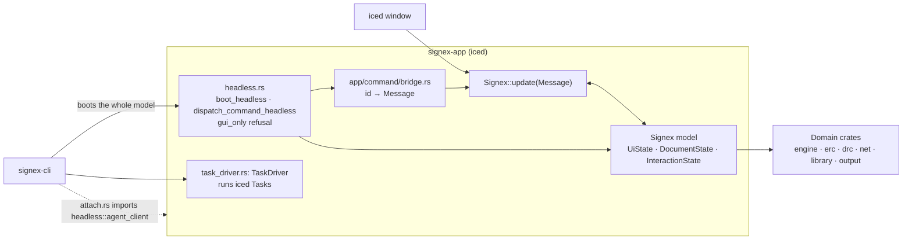
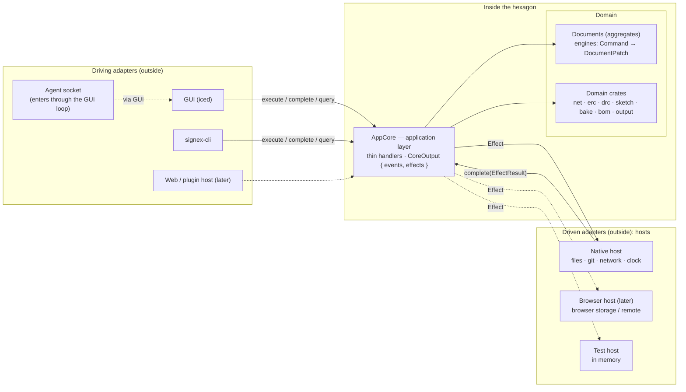
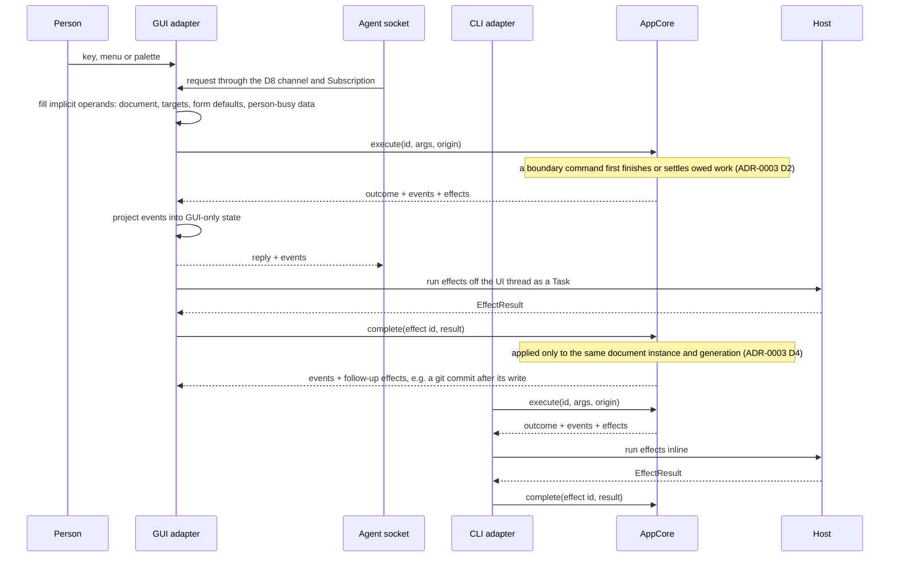
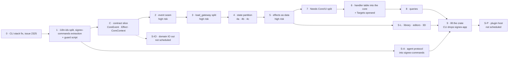

# ADR-0006 — One application core, many front ends (ports and adapters)

- **Status:** Proposed. Accepted on the date #2327 merges with the approval of both maintainers (Hakan and Caner); the merger sets that date here.
- **Decides on merge:** epic #2326 decisions D0 (this record and the ADR-0001 notes), D1, D2, D3, D5, D7 and D11. Already decided: D10 (web, [maintainer decision 2026-11-15](https://github.com/alplabai/signex/issues/2326#issuecomment-6884693348)) and D12 (no event bus, 2026-11-13). The i18n placement below is Caner's decision of 2026-11-15 (`docs/DECISIONS.md`).
- **Scope:** an iced-free application core shared by the GUI, `signex-cli` and later front ends; the crates `signex-commands`, `signex-i18n-ids` and `signex-workspace` (all planned)
- **Amends:** [ADR-0001](adr-0001-app-structure-and-boundaries.md) A1, A2, A3.2, D1, D5, D8 and three Part C bullets, each of which carries a short note pointing here
- **Builds on:** [ADR-0003](adr-0003-deferred-work-and-consistent-history.md) (owed work, the boundary flush, late results)
- **Tracking:** epic #2326, milestone Application Core (`docs/ROADMAP.md`); the slices ship across releases. Sources and the full measurement commands: [the research note](research/hexagonal-ddd.md)

## Context

The GUI is not the only way into signex: `signex-cli` runs catalog commands for scripts and agents, and it must have the same effect as the GUI for the same command. Today that parity is bought by booting the whole GUI model without a window (`boot_headless`). Attach mode is not part of the motivation: its requests already enter the GUI's `update` loop, and this record keeps that.



### The problem, measured

macOS arm64. Each row names the trunk commit it was measured at. The full commands are in the research note, §12.

| Claim | Numbers | Command |
|---|---|---|
| The CLI builds the GUI | 518 distinct crates for `signex-cli`, 115 for the domain crates it needs (`1bf5750dd`) | `cargo tree -p signex-cli -e normal --prefix none \| awk 'NF{print $1" "$2}' \| sort -u \| wc -l` |
| | GUI/GPU crates are about 26% of the summed compile-unit time of a cold release build, about 32% with `signex-app`; the binary is 47 MB (`1bf5750dd`) | `cargo build --release -p signex-cli --timings` |
| The CLI boots the GUI | 1.29 s for a run with no commands (median of 5 warm runs), 0.026 s for `--help`; the split inside the boot is not measured (`1bf5750dd`) | `time signex-cli run <project>.snxprj` |
| | The run log shows `dropped an iced action a headless run does not perform kind="window"` three times | the same run |
| Parity costs every new command | 34 ids have an operand handler; 20 of them also have a GUI arm in `bridge.rs` (`f3d4efc75`) | research note §12 |
| | 250 commands in `tests/golden/commands.json`; `gui_only` on 184 lines in 6 files of `signex-app`, 166 of them catalog golden rows (`f3d4efc75`) | research note §12 |
| IO runs on the update path | 156 production `std::fs::` call sites under `crates/signex-app/src/app` (`1bf5750dd`) | research note §12 |
| | In a hand-read sample of 15, about half run synchronously in a `&mut self` handler: `canonicalize` in `handlers/document_identity.rs`, `load_sheet` in the Sync Sheet Pins menu action, the agent registry and journal. A sample estimate. | — |

**What a new command costs today.** A command with a headless form is handled twice: a GUI arm in `app/command/bridge.rs` (id → `Message`) and an operand handler in `app/command/operand_handlers.rs`. It carries a `gui_only` flag. Headless runs are fenced by it through `headless_refusal`, which the agent allowlist `allow::refusal` also reads. A required-operand check (`missing_headless_operand`) and, in the CLI, a status correction for dropped windows and refused dialogs (`honest_status`) follow. The command also gets golden rows in `catalog.golden.tsv`, `tests/golden/commands.json` and, when bound, the three `builtin_profiles*.golden.tsv`.

Under this record a command is one catalog row (the golden rows stay) and one core handler, or one GUI-only table entry. `gui_only` goes in slice 6 and `honest_status` in slice 9; the agent allowlist stays as policy. Headless-parity work so far, some of which this record reuses (#1934, #2172): #1926, #1927, #1929, #1931, #1932, #1934, #2170, #2172, #2243, and #2155 in part.

### The cost of waiting

The surface this record has to move grows with every feature. Counted in `crates/signex-app/src` on the first-parent history of trunk:

| Trunk on | `ui_state.` uses | `document_state.` uses | `spawn_blocking` / `run_blocking` sites | `.rs` files |
|---|---|---|---|---|
| 2026-10-23 (`f901a48ab`) | 766 | 1022 | 34 | 496 |
| 2026-11-04 (`8985a1c02`) | 2085 | 4029 | 148 | 1102 |
| 2026-11-15 (`fee721ea3`) | 2893 | 5507 | 179 | 1566 |
| 2026-11-15 (`f3d4efc75`) | 3067 | 5627 | 183 | 1671 |

Commands, for a commit `<c>`:

```sh
git grep -h -o 'ui_state\.' <c> -- crates/signex-app/src | wc -l
git grep -h -o 'document_state\.' <c> -- crates/signex-app/src | wc -l
git grep -h -o -E 'spawn_blocking|run_blocking' <c> -- crates/signex-app/src | wc -l
git ls-tree -r --name-only <c> -- crates/signex-app/src | rg -c '\.rs$'
git rev-list --count --first-parent f901a48ab..fee721ea3                              # 749
git rev-list --count --first-parent f901a48ab..fee721ea3 -- crates/signex-app/src     # 596
```

From `f901a48ab` to `fee721ea3` (23 days, 749 first-parent commits, 596 of them touching `crates/signex-app/src`):
- `ui_state.` uses grew 3.8×, `document_state.` uses 5.4×, 4.7× combined.
- Background-job sites grew 5.3×; each becomes an `Effect` plus a `complete`.
- `.rs` files grew from 496 to 1566.

Not every access changes when its state moves, but each one is a site a slice has to read and review. Slices 0 and 1 cost the same now or later; slices 2, 3 and 5 get dearer every week.

**#2325 is a symptom, not the reason.** The Windows stack overflow sits on the CLI path, but boxing `Signex` or running the session on a thread with a bigger stack fixes it. It does not by itself justify this record.

## Decision

One iced-free application core, `AppCore`, is the application layer over the engines. Every front end calls it through the same ports.


Names marked *planned* do not exist on trunk yet.



Arrows into the core are calls. The core returns events and effects to its caller; it publishes nothing. A host is chosen per platform. The core depends on no host and names only the `Effect` / `EffectResult` types it defines.

### Inside the hexagon

- The domain crates of ADR-0001 A2.
- `AppCore`, the application core. It is iced-free; it grows in `signex-app/src/app/core/` and is lifted into its own crate, `signex-workspace`, in slice 9 (epic D2). Until then the guard under "Enforcement" keeps it apart.

`AppCore` names no `iced` type, window id, dialog, canvas, selection or clipboard. It holds no file handle, thread or runtime.

### Driving ports

- `execute(command id, args, origin) -> (outcome, CoreOutput)`;
- `complete(effect id, result) -> CoreOutput`, for finished effects;
- `query` for read-only answers, with a typed error.

Every core command names its document and its targets in its arguments (epic D1). A front end fills in what a person leaves implicit before it calls `execute`: the active document, the selection, the pre-placement form. A front end that must protect a person's in-progress drag or text edit passes that as plain data in the arguments, never as a callback into the GUI.

`execute` routes by command id through a thin table, like the footprint editor's `crates/signex-app/src/library/editor/footprint/updates/mod.rs`. The handling lives in area modules (documents, placement, hierarchy, files, agent edits), never in the router.

A core command never opens a dialog (epic D3): "Open…" gathers the path in the GUI, then calls `open_document path=`.

### Driven ports

IO is a set of pluggable driven adapters, the mirror of the driving side (epic D5).
- **Who defines what.** The core defines the port types: `Effect`, `EffectResult`, and the storage, version-control, network and clock capabilities they name. A *host* implements them, owns the adapters and runs `perform(Effect) -> EffectResult`.
- **Where the host lives.** The host is outside the core and depends on it, never the reverse. `perform` takes no `&AppCore`.
- **Swappable per platform.** Native (files, git) and test (in memory) now; a browser host (later) only if a web front end is ever scheduled. Swapping a host changes where documents are stored without touching the core or the front end.
- **How hosts are run.** The GUI runs the host off the UI thread as a `Task`; the CLI runs it inline.
- **ADR-0001 A3.2 tool ports** (`LibraryAdapter`, `DistributorAdapter`, a future `Simulator`) are called by the host, never by the core.
- **What is not an effect.** Pure CPU work (netlist building, ERC, DRC) does no IO, so it is not an effect.
  - A short pure call runs inside `execute`.
  - A long pure job (a full ERC or DRC run) must not block the UI thread. Phase 1 keeps such a job on its existing `Task`.
  - How the core hands such a job out later is still open. One candidate is a compute job (an input snapshot and a pure function) that the front end runs off the UI thread and feeds back through `complete`. The research note, §7.3, argues this is compute, not an effect.
- **What stays with the front end.** Preferences, file dialogs and fonts. The core never reads `prefs.json`; it receives `CoreSettings` as values (epic D7).

### Effect ordering and completion (ADR-0003)

- Effects returned together may run concurrently, except that two writes to one path never run out of order. An effect that must follow another (a git commit after its write) is returned only by the `complete` of the one it follows.
- Owed and in-flight work is core state (ADR-0003 D1). That includes the writes in flight and their per-path order: the #997 ledger, under which an older write never lands after a newer one.
- `complete` applies a result only to the same document instance and generation it was issued for (ADR-0003 D4).
- Every effect gets exactly one `complete`, a failure included, so a lost result frees its slot and reaches the person (ADR-0003 D5).
- A boundary command (save, undo, switch, file move) first finishes or settles its owed work (`finish_pending`, ADR-0003 D2).
  - Writes wait, as `SaveBarrier` does today before a synchronous write or a file move.
  - Compute is settled inline, as `settle_pending_inline` does for an owed footprint solve.
  - For a schematic, undo, redo, switch and async Save need no other flush: the revision stamp covers them (ADR-0003 D2, D4).

### Events are a return value, not a bus

- `CoreOutput { events, effects }` goes back to the one caller, in order. These are application events (what changed: a document, its dirty state, its results), not domain events published to subscribers.
- The GUI projects the events of its own calls into GUI-only state (ADR-0001 A1).
- In a running window the agent socket does not own or call the core. Its requests enter the GUI loop through the ADR-0001 D8 channel → `Subscription` bridge. The GUI calls `execute` with an agent origin, projects the events like its own, and hands the reply and the events back to the socket.
- Only a process without a GUI (the CLI, a server) lets another driving adapter own the core. An adapter serving out-of-process clients forwards the events it received over its own transport.

### Driving adapters

- The iced GUI (`signex-app`): a translator from `Message` to core commands, a projector from core events to GUI-only state, and the GUI-only commands (windows, dialogs, tools, view, the undo-target router).
- `signex-cli`.
- The agent socket.
- Later, a web front end or a plugin host.

### Command flow

Effects come back as data; the caller's host runs them and reports each one through `complete`.



Two writes to one path never run out of order, whichever caller runs them (the #997 ledger is core state).

### Messages the core reports: `signex-i18n-ids`

Caner's decision of 2026-11-15 (`docs/DECISIONS.md`):
- **What it holds.** A small UI-free crate, `signex-i18n-ids`, holds `MessageId`, the id constants (`ids::*`, `command_ids::*`) and `Translatable` (an id plus its arguments). It has no Fluent, ICU or locale dependency.
- **The guard.** It joins `DOMAIN` in `scripts/check_arch_guard.sh`.
- **`signex-i18n` does not move.** It keeps the Fluent bundles, ICU formatting and locale negotiation, and stays in `UI_STACK`. It re-exports the ids at their old paths, so existing call sites keep working. The one change for callers: `render_en_us()` and `localized()` become methods of the `signex_i18n::RenderTranslatable` trait, so a file calling them imports the trait. The 2026-11-07 row that no domain crate may depend on `signex-i18n` stays true.
- **Who renders.** The core and `signex-commands` carry `Translatable` values (notices, refusal reasons, typed errors such as `QueryError`) and never render them. Front ends render them in `view()`, which keeps the `(MessageId, args)` label rule.

Splitting this crate is the first step of slice 1, because the catalog that slice 1 moves imports `signex_i18n::{I18n, MessageId, command_ids, t}` today.

### How DDD (ADR-0001 A2) maps onto it

ADR-0001 A2 stays. This record names the layer above the engines and makes the engine's role precise.

| DDD element | In signex |
|---|---|
| Aggregate (root and its commands) and consistency boundary | A document and its `signex-engine` engine: `Command` → `DocumentPatch`, history, revision. `AppCore` never pokes document fields. This holds for schematics today; symbol, footprint and Component rows join as #661's `History<S>` lands. Until then, their app-local history moves with them. |
| Domain services | `signex-net`, `signex-erc`/`-dsl`, `signex-drc`/`-dsl`, `signex-sketch`, `signex-bake`, `signex-bom`, `signex-output`, `pcb-geom`, and the domain part of `signex-library`. Every UI-free domain crate is listed in `DOMAIN` in `scripts/check_arch_guard.sh`. |
| Value objects | `coord`, `rotation2d`, `anchor2d`, … (unchanged) |
| Common domain types | `signex-types`, the whole model's data shared inside one team. "Shared kernel" is kept for the one real context seam, the schematic-to-PCB `Netlist` contract of ADR-0001 A3.1. The crate keeps its name. |
| Application layer (use cases) | the `AppCore` command handlers: load, run a command, save, run ERC/DRC, journal an agent edit. A command that touches several documents (ECO, back-annotation) records one undo group. |
| Ports | driving: `execute` / `complete` / `query`; driven: `Effect` / `EffectResult` and the capabilities they name, defined by the core |
| Adapters | driving: GUI, CLI, agent socket; driven: the host (native and test now, browser later) and the A3.2 tool adapters it calls |

**`signex-types` keeps its name** (Hakan, 2026-11-15). A rename would churn hundreds of imports for no gain. Its contexts grow as modules inside it: the ADR-0001 A3.1 schematic-to-PCB contract is already one (`signex_types::net`, `Netlist`), and a new contract follows the same pattern, a module rather than a new crate, unless a later ADR says otherwise.

**Handlers stay thin.** An `AppCore` handler does three things:
1. resolves the target document;
2. builds one engine `Command` or calls a domain service;
3. turns the result into events and effects.

A rule about document content belongs in the engine or a domain crate, never in a handler. Examples: the next free designator, where a wire splits, what a paste renames. A handler that grows such a rule is the ADR-0001 D4 leak one level down, and review treats it the same way. This keeps the core from becoming a transaction script.

**The shared command crate (epic D11).** The command catalog, its arguments and outcomes live in `signex-commands`, a small crate that the core and every front end depend on. It is the driving port's vocabulary, so it gets the core's checks. Agent wire framing kept there is only a serialization of those types; the core never names it. Its types are versioned.

## Enforcement

The application core and the crates it uses get the treatment ADR-0001 D5 gives the domain crates, using allowlists rather than denylists.

- **Arch guard.** Each crate's edges go in `scripts/arch-edges.txt`, and the crate joins `DOMAIN` in `scripts/check_arch_guard.sh` when it is created. `DOMAIN`, not the edges file, is what fails on a UI/GPU dependency.
  - `signex-i18n-ids` and `signex-commands` join at slice 1.
  - `signex-workspace` joins at slice 9.
- **While the core grows inside `signex-app`.** A guard fails when `app/core/` imports any `crate::` path outside `app/core/`, or names `iced`, `tokio`, `spawn_blocking` / `run_blocking`, `std::fs`, `std::thread` or `std::process`. It lands with slice 1.
- **After the lift.** Clippy `disallowed-methods` / `disallowed-types` keep the same calls out of the core. They are modelled on the `io_ports` precedent in `clippy.toml`.
  - The lint reaches the domain crates only after slice S-IO, because `signex-types` and `signex-engine` still call `std::fs` today.
  - Clippy reads the nearest `clippy.toml` and does not merge it with the workspace file, so a per-crate file must repeat the workspace bans.
- **No `wasm32-unknown-unknown` gate now** (epic D10: native first).
  - If a web front end is ever scheduled, a wasm32 build of the core and the crates below it would keep OS-bound dependencies (git2, tokio's IO and multi-thread runtime) out.
  - That build alone would not catch `std::fs` or `std::thread`: they compile there and fail only at run time. The lint above is what keeps them out either way.
- **Stack frames (recommendation, open).** Run Clippy `large_stack_frames` on the core, against the stack overflow of #2325. This comes from the research note (§7.6), not from an epic decision.

## Alternatives considered

| Alternative | What it fixes | Why it stops short |
|---|---|---|
| (a) Status quo, plus a lazy `UiState` and boxing the large fields | #2325; part of the headless boot cost | The CLI keeps all 518 crates, the parity heuristics (`gui_only`, `headless_refusal`, `honest_status`) and the IO in `update`. Rejected; slice 0 still lands its first part, so a pause after slice 0 is never worse than today. |
| (b) Extract only a command-catalog crate | The CLI and agents get the catalog, operands and outcomes without `signex-app` types | Running a command still needs `Signex`, so the CLI still builds and boots the GUI. |
| (c) Turn only persistence and git IO into effects | The data-loss-prone IO leaves `update`; ADR-0003's invariants get one home | The handlers still live in the GUI model, so the CLI still boots it and parity stays heuristic. |

This record is (b) and (c) together, plus moving the handlers into the core; each slice below is a stopping point.

## Slices

Numbering follows epic #2326; one PR at a time, in the order 0, 1, C, 2, 3, 4, 5, 7, 6, 8, 9 (S-A after 1, S-L after 5, both before 9). Each is reverted by reverting its PR, so the revert column names only what a revert must also undo.

Every slice has the same stop rule: stop and come back to the maintainers if its exit check fails, or if it needs a facade on `Signex` that outlives the slice. The stop-if column adds what is specific to the slice.

| # | What ships | Exit check | Stop if | Revert path |
|---|---|---|---|---|
| 0 | #2325: box `Signex` / run the CLI session on a thread with an explicit stack (the first part of alternative (a)) | The debug `signex-cli run` passes on Windows CI. | — | revert the PR |
| 1 | First, split `signex-i18n-ids` out of `signex-i18n`. Then extract `signex-commands`: `Modifiers` / `ShortcutContext` out of `binding.rs` (`from_iced` stays in the app), `DocumentTarget` and `PcbTargets`. The `app/core/` guard script lands. Low risk. | Both crates are in `DOMAIN` and `check_arch_guard.sh` passes. `cargo tree -p signex-commands` shows no `iced*`, `wgpu*`, `fluent*` or `icu*`. Catalog JSON and `catalog.golden.tsv` are byte-equal. | a golden file changes | revert; the golden files are byte-equal, so nothing else moves |
| C | `CoreEvent` / `Effect` / `EffectResult`, `CoreContext`, the (id, form) parity skeleton and the test adapter | The parity skeleton lists every (id, form) pair on trunk, and the test adapter runs one command. | the contract cannot express an existing (id, form) | revert; no behaviour moved |
| 2 | Event seam: edit tails split into a core half that returns events, plus a projector | Every removed inline call has a projector arm and a test. The safety-net tests below pass through the test adapter. | the event-granularity bench shows a drag-time regression beyond its noise band, or a safety-net test cannot be expressed through the test adapter | revert restores the inline tails; the removed-call list in the PR says what comes back |
| 3 | `load_gateway` split | Load and restore tests pass through the test adapter, and a test proves that a panicking install leaves no engine missing from the map. | any restore is dropped in a test | revert both PRs together |
| 4 | State partition (4a documents, 4b ERC/DRC/profiles, 4c settings) | The moved field groups are private to the core; `rg 'ui_state\.(io\|erc_\|profile_)'` has 0 hits for the moved groups. | a group cannot move without a facade | the ast-grep renames are reversible by the inverse rule |
| 5 | Effects as data and the native host: 5a save/journal, 5b load, 5c git, 5d export, 5e the rest | For each group, `app/core/` has 0 `spawn_blocking` / `run_blocking` / `std::fs` hits, and the save-order and quit-barrier tests pass. | the save-order or quit-barrier test fails | revert brings back the `Task` path for that group |
| 7 | `Needs` split into Core and Ui | Enablement of every core command is computed without `UiState`. | — | revert |
| 6 | Handler table into the core per area, the `Targets` operand, `gui_only` deleted. Updates the CONTRIBUTING "Commands" bullet and `docs/COMMANDS.md`, and records the supersession under "Superseded decisions". | Per area, the area's ids are no longer flagged `gui_only` and have no bridge arm. At the end, `git grep -c gui_only -- crates` gives 0. | an area needs a dual path past its slice | revert per area |
| 8 | Queries on `core.query` | Every query answers through `core.query` in a test-adapter test. | — | revert |
| S-A | Agent wire protocol and `OperandKind` in `signex-commands` | `signex-cli` has no `signex_app::headless::agent_client` import. | — | revert |
| S-L | Library, pricing, editors and 3D import onto the core | The moved areas have no IO in `app/core/` (the guard passes). | — | revert per sub-area |
| 9 | Lift `app/core/` into `signex-workspace`; the CLI drops `signex-app` | Three checks: `cargo tree -p signex-cli -e normal` shows no `iced*`, `wgpu*` or `winit`; a headless run with no commands boots in about `--help` time; `git grep -E 'gui_only\|honest_status\|boot_headless' -- crates` gives 0. | — | revert the move; the module stays in place |
| S-IO, S-P | Domain IO out for wasm32; the plugin host | — | not scheduled: S-IO waits on a future web front end being scheduled, S-P on #1707 | — |



### Safety net before the high-risk slices

The epic rates slices 2, 3 and 5 (and S-L) high or medium-high. The research note (§10, item 1) names the reason: the persistence invariants become state machines across `complete`. Before slice 2 starts, these tests run against the test adapter, not only against the ledger:
- **Per-path write order (#997):** an older write never lands after a newer one to the same path. Today it is pinned at the ledger level (`persist/document_save.rs`, `an_older_snapshot_scheduled_last_never_overwrites_a_newer_one`).
- **The `SaveBarrier` wait:** a synchronous write or file move waits for every write in flight (`the_barrier_waits_for_an_unfinished_job`, same file).
- **The `complete` generation check (ADR-0003 D4):** a result for a closed, reopened or re-keyed document is dropped. This one does not exist yet, because `complete` does not; it lands with slice C.

The event-granularity benchmark of the research note (§10, item 4) also lands before slice 2: a drag must not over-invalidate the projector.

## A web front end (epic D10)

[Maintainer decision 2026-11-15](https://github.com/alplabai/signex/issues/2326#issuecomment-6884693348): not now; native first; a browser host only if a web front end is scheduled. Keeping the core free of iced and of native IO keeps a web front end possible later. That is an option, not a commitment: there is no `wasm32` build gate now, and S-IO is not scheduled.

## Superseded decisions

- **The 2026-11-02 `docs/DECISIONS.md` row ("an `AppCommandId` behaves the same on every surface").** Its operand clause says operands are filled only by a CLI and no GUI caller sets one. Under this record a front end fills in the document, the targets and the form defaults as operands before `execute`. The rest of the row stays. The supersession takes effect at slice 6, which updates the CONTRIBUTING "Commands" bullet and `docs/COMMANDS.md`. It is recorded in `docs/DECISIONS.md` (2026-11-15).
- **The 2026-11-07 row "one crate owns internationalisation"** stays true for the rendering crate. `signex-i18n-ids` holds ids and arguments only and imports no Fluent or ICU4X.

## Consequences

- The CLI stops building and booting the GUI once slice 9 lands. Until then each slice is a valid stopping point.
- Every command gets one handler; the parity heuristics go in slices 6 and 9.
- The persistence invariants move into the core as state machines across `complete`. This is the main risk, and the safety net above is the guard against it.
- Long-lived dual paths are not allowed. A facade on `Signex` that delegates to the core is removed in the slice that adds it; the only exception is the declared test adapter.
